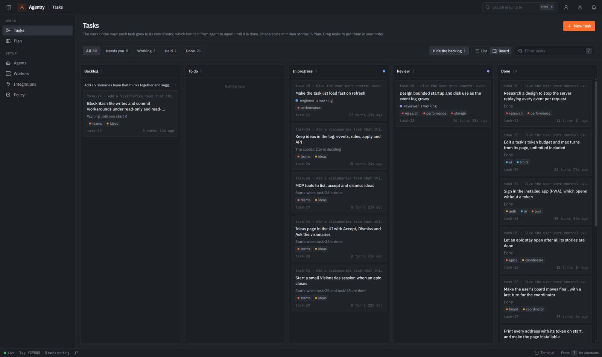
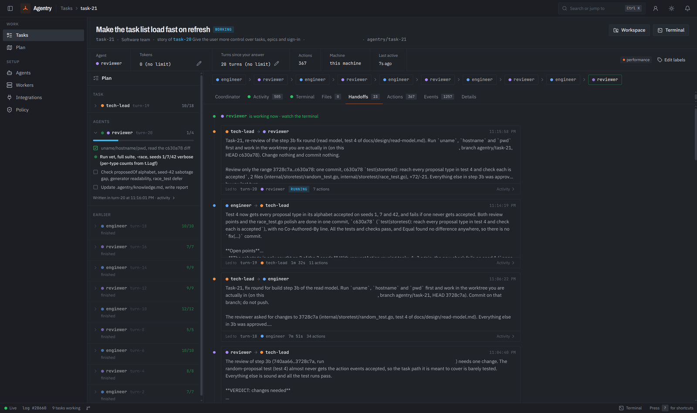
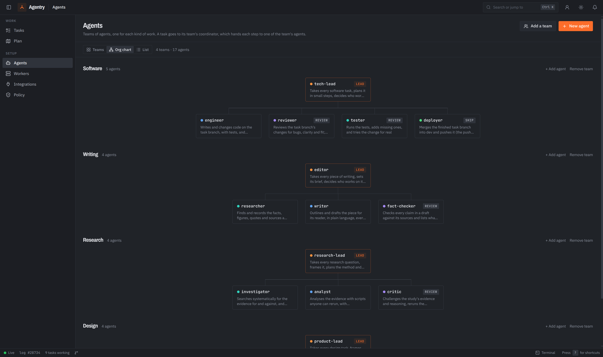
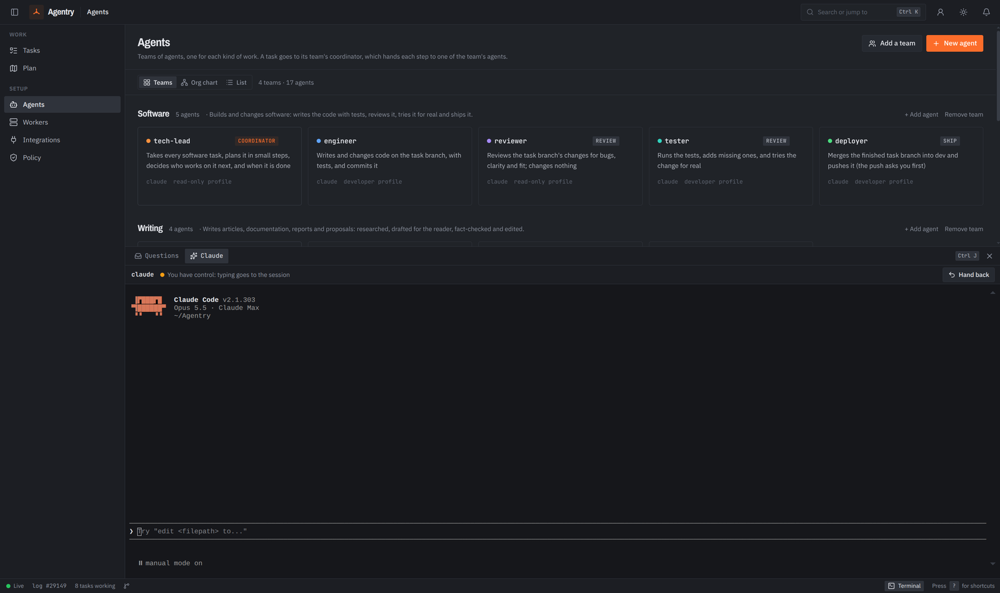

# Agentry

A task board where the workers are AI agents. You describe a task; a coordinator agent hands it from agent to agent (an engineer, a reviewer, a tester, a deployer, or another team's) and reads every report back, until the work is checked and done. You watch it all live, step in when you want, and approve what matters.

<p align="center">
  
</p>

Every action an agent takes passes Agentry's gate first, and your policy decides what runs, what is refused and what waits for you. Agents can work on any of your machines, Linux, macOS or Windows, and you can drive it all from the browser or from Claude Code in any repo. Every step is an event in one append-only log.

`PLAN.md` has what's built, what's next, and the decisions behind it.

## What it looks like

<p align="center">
  
  <br><sub>A task's path from agent to agent, with every handoff between them.</sub>
</p>

<p align="center">
  
  <br><sub>Your teams as an org chart: each lead and the agents it hands work to.</sub>
</p>

<p align="center">
  
  <br><sub>Claude in the page: a Claude Code session in a panel, beside the questions agents ask you.</sub>
</p>

## Install

<p align="center">
  
  <br><sub>Download, unzip, double-click Start Agentry: the same three steps on every system.</sub>
</p>

### What you need

- **git:** [git-scm.com/downloads](https://git-scm.com/downloads)
- **Claude Code**, signed in: [claude.com/claude-code](https://claude.com/claude-code). The agents run in it. Codex works too, if you have it.

Agentry itself needs nothing else: no Docker, no Node, no tmux. Start Agentry says if git or Claude Code is missing.

The zips are on the [releases page](https://github.com/francischempa/agentry/releases/latest). Each is named for its version, such as `agentry-v0.1.0-mac-intel.zip`.

### Mac

1. [Download](https://github.com/francischempa/agentry/releases/latest) `agentry-<version>-mac-apple-silicon.zip` (M1 and later) or `agentry-<version>-mac-intel.zip`.
2. Unzip it, and double-click **Start Agentry.command** in the Agentry folder.
3. The first time, macOS says it can't check the developer, since Agentry isn't signed yet: right-click Start Agentry.command, choose **Open**, then **Open** again. After that it opens with a double-click.

### Windows

1. [Download](https://github.com/francischempa/agentry/releases/latest) `agentry-<version>-windows-x64.zip` (or `-windows-arm64.zip` on an ARM PC).
2. Unzip it (right-click, Extract All), and double-click **Start Agentry.cmd** in the Agentry folder.
3. The first time, Windows may say it protected your PC, since Agentry isn't signed yet: click **More info**, then **Run anyway**.

### Linux

1. [Download](https://github.com/francischempa/agentry/releases/latest) `agentry-<version>-linux-x64.zip` (or `-linux-arm64.zip`).
2. Unzip it with a tool that keeps permissions (`unzip` does), and run `./start-agentry.sh` in the Agentry folder.
3. If it won't run: `chmod +x agentry start-agentry.sh stop-agentry.sh`.

### What Start Agentry does

It starts Agentry in the background, if it isn't already running, prints a link for this computer and one for each of its network addresses, and opens the first in your browser. The links carry the page's token, which signs you in, so share them only with people you trust. On Windows the window waits for a key, so you can copy them. Close the browser or the window whenever you like: Agentry keeps running. Run Start Agentry again to open the page again, and **Stop Agentry** (`Stop Agentry.command`, `Stop Agentry.cmd` or `./stop-agentry.sh`) to stop it. Agents' sessions carry on across a stop and start.

- **Where things are:** the log, settings and the tasks' worktrees are in `.agentry` in your home folder; delete it to start afresh.
- **Your work:** new tasks work in the git repo `Agentry` in your home folder (made the first time), unless you give a task another repo, or a new one.
- **The address:** port 7800, or the next free one, on every network interface, so your other machines and your phone can open it too. The page's token keeps everyone else out; `agentry serve -addr 127.0.0.1:7800` keeps it to this computer.
- **As an app:** Install app, in the page's top bar, installs Agentry as an app with its own window. Browsers install only from a secure page: open it at `http://localhost:7800` on the computer it runs on, or over https, not at a plain `http://` network address. To install it on your phone or another computer, start Agentry with `-https`: see [HTTPS and installing the app on other devices](#https-and-installing-the-app-on-other-devices).
- **The other programs in the folder** (`agentry-linux-amd64` and so on) are what Agentry hands other computers that join as workers. Keep them next to `agentry`.

### Signing in the installed app, or another device

The printed link signs a browser in; the installed app opens without it, and so does a phone you haven't sent the link to. Either one shows a sign-in page:

- **Paste the link or the token** that `agentry serve` printed, and Sign in.
- **Or use a one-time code.** On a device that is signed in, open the person button in the top bar and pick **Sign in another device**. It shows a code such as `ABCD-EFGH` and a QR code: type the code on the other device, or scan the QR code with its camera, which opens Agentry there and signs it in. Pick the address the other device reaches if the server has several. A code works once, for 5 minutes; **New code** makes another. Wrong codes are limited (five a minute from one address), so codes can't be guessed.
- **Sign out**, in the same menu, signs that device out: it forgets its token and the server clears its cookie.

The device keeps the token, and a cookie that lasts a year, so it stays signed in; an app that kept only the cookie, as on iOS, stays signed in too. Installing needs a secure page: `http://localhost` on the computer Agentry runs on, or https. With `-https`, Sign in another device also shows a QR code to the page that trusts Agentry's certificate, for a device's first time: see [HTTPS and installing the app on other devices](#https-and-installing-the-app-on-other-devices).

### From the source

You need Go 1.27 and git.

```sh
go build -o bin/agentry ./cmd/agentry
./bin/agentry open                          # start in the background and open the browser
./bin/agentry serve -repo /path/to/repo     # or run it in the foreground
```

`serve` prints a link with the page's token in it (`open` prints one per address, as above), which signs the browser in and stays the same across restarts. The UI is built into the binary, so this needs no Node; to change the UI, see [Work on it](#work-on-it). `make package` makes the zips above, for every system, from any one machine, into `release/`. [Make a release](#make-a-release) says how they get published.

- **Repo:** `-repo` sets the default repo for new tasks; the page can name another, or make a new one.
- **Data:** `-data` moves `~/.agentry`.
- **Budget:** `-budget` is the tokens a new task may use before it asks you; 0 for no limit.
- **Turn limit:** `-max-turns` (default 24) is the turns a new task may have without your answer before it asks you; 0 for no limit.
- **Archiving:** `-archive-after` (default `720h`, 30 days) moves a task done for that long out of the live log; it still opens, and reopening it brings it back. 0 never archives. On a log made before archiving, the first start with the `720h` default runs one full VACUUM after its first round, which holds the write lock while it runs. A log that archived tasks before erasing came in takes one full VACUUM the first time it is opened, so the rows archiving deleted can't stay on its pages after their task is erased; it holds the write lock too, and the server starts once it is done. On a large log that can take a while, and `agentry open` may say the server didn't start while it is still at it: wait, then open it again.
- **Address:** `-addr` (default `0.0.0.0:7800`, every interface; `127.0.0.1:7800` for this computer only); on every interface it prints a link for each of this machine's network addresses as well. `-public-url` is the address people and machines reach, for links and install commands; with it, it prints only that one, and the install commands start on it.
- **Push:** Notifications on this device, in the account menu, subscribes a browser to Agentry's pushes. It needs an https `-public-url`, such as a proxy that does TLS in front of Agentry; without one, the menu says why it is off. The keys and subscriptions are kept in `push.json` beside the log, never in it.
- **HTTPS:** `-https` serves over https with Agentry's own CA; see [HTTPS and installing the app on other devices](#https-and-installing-the-app-on-other-devices). `agentry open` takes `-https`, `-budget`, `-max-turns` and `-archive-after` too, and passes them on to the server it starts; while one is running already, it says they take effect at the next start.

## First steps

1. **Add a task:** New task (or press `n`). Describe what you want in your own words; the coordinator reads it, names it, and decides who works on it. A big one becomes an epic, split into stories.
2. **Watch it:** the task's page shows its plan, the path its work took, a chat with its coordinator, the live terminal of the agent at work, and everything that happened.
3. **Answer it:** when a coordinator asks you something, or an agent needs your approval, it shows in Questions (`Ctrl+J`), and in Claude Code if you connected it.
4. **Add a team:** Agentry starts with a Software team. Add Writing, Research, Design, Visionaries (suggests features to build next, changes no code) or Networking (diagnoses and changes networks, touches nothing live without your go-ahead) on the Agents page.

## Add machines

Agents can run on your other computers, so work can go where the tools, the data or the power are. On the **Workers** page, Add worker shows one command for the machine's system. Run it there:

| System | Run |
| --- | --- |
| macOS, Linux | `curl -fsSL '<server>/worker/install.sh?code=…' \| sh` in a terminal |
| Windows | `irm '<server>/worker/install.ps1?code=…' \| iex` in PowerShell |

It installs `agentry` (in `~/.local/bin`, or `%LOCALAPPDATA%\Agentry\bin` on Windows, added to your PATH), joins with a code that works once, and starts the worker in the background, started again at login: a systemd user service on Linux, a launchd agent on macOS, a Task Scheduler task on Windows. Run on a machine that has joined, it updates it instead. The machine needs git and Claude Code signed in; it dials out to the server, so it needs no open port.

`<server>` is an address that machine reaches. The command comes for every address the server has: `-public-url`, each network address, the one the page is open at, and localhost (this computer only). A picker above the command switches between them; it starts on the public URL, or on the first network address when the page is open at localhost.

On the worker, `agentry worker` does the rest:

| Command | Does |
| --- | --- |
| `agentry worker status` | the server, the service, the link, the engines and tools found, the tasks running here |
| `agentry worker logs [-f]` | its log, `~/.agentry-worker/worker.log` |
| `agentry worker stop` / `start` / `restart` | stop or start the background service |
| `agentry worker update` | get the server's agentry now and restart; the worker also does this whenever it connects |
| `agentry worker leave [-purge]` | take the machine off the server and stop; `-purge` deletes its repos and worktrees too |
| `agentry worker run` | run in the foreground (what the service runs) |

Give an agent its machines under Runs on in its settings. A coordinator can also send an agent to a particular machine, among those it may run on. A task's branch and its shared files follow the work to whichever machine runs the next turn.

## Use it from Claude Code

With Agentry in Claude Code, plain `claude` in any repo can hand work to Agentry and hear back from it. On the **Integrations** page, make an install command and run it on the machine you use Claude Code on:

| System | Run |
| --- | --- |
| macOS, Linux | `curl -fsSL '<server>/integrations/claude-code.sh?code=…' \| sh` in a terminal |
| Windows | `irm '<server>/integrations/claude-code.ps1?code=…' \| iex` in PowerShell |
| The machine Agentry runs on | `agentry mcp install` |

As on the Workers page, the command comes for every address the server has, with a picker to choose the one that machine reaches.

Then, in any repo:

- **Hand it work:** "make a task to add retries to the webhook sender", or an epic, in the repo you're in; file stories under epics, set their order, start them.
- **See your board:** ask, or type `/mcp__agentry__board`. Claude Code's status line shows `agentry · 1 needs you · 3 running`.
- **Hear from it:** Claude tells you, without being asked, when something needs you, a task finishes, a coordinator replies, or a machine goes offline. A notification shows on your computer too.
- **Answer and approve:** send a coordinator your answer. Approving an agent's action, closing an epic or copying a file from outside a machine's worktrees is asked of you by Claude Code itself, so the model can't approve for you.
- **Decide on ideas:** `list_ideas` shows the features the Visionaries suggest, and open ones show among what waits for you. You decide on each: `accept_idea` makes one a task in your Backlog, or with `start` starts it at once, `dismiss_idea` drops it. Claude Code asks you to confirm either when it can; otherwise it acts on what you told Claude, which only relays your decision.
- **Share files:** `attach_file` shares a file from your machine with a task; `get_file` downloads one.

Each machine connected gets its own credential (the log keeps only its hash); the Integrations page lists them, and Revoke stops one at once. Everything it does is on the page at once.

## HTTPS and installing the app on other devices

Browsers install the app, and run the service worker it needs, only on a secure page: https with a certificate the device trusts, or `http://localhost`. So without https the app installs only on the computer Agentry runs on. A plain self-signed certificate doesn't help: the browser warns that the page isn't secure and still won't install it. Instead, Agentry has its own certificate authority (CA), as mkcert does: you trust it once on each device, and every certificate it signs for this server is trusted from then on.

- **Turn it on:** `agentry serve -https`, or `agentry open -https` (from the zip: Stop Agentry, then run `./agentry open -https` in the Agentry folder, or `.\agentry.exe open -https` on Windows). `-https` isn't remembered: Start Agentry starts it without https, so start it with `./agentry open -https` (`.\agentry.exe open -https` on Windows) every time. The first start makes the CA. The printed links become https, followed by the CA's fingerprint and the trust page's address.
- **One port:** https and plain http share the port. Plain http from another device is sent on to https (a 308 redirect), except the trust page, which a device must reach before it trusts the CA. An address the certificate doesn't cover, such as a name you set up yourself, gets the trust page with the addresses that work. On the computer Agentry runs on, `http://localhost:<port>` keeps working as it is.
- **The certificate:** it names localhost, `127.0.0.1`, `::1`, this machine's hostname and `hostname.local`, and each of its private network addresses (LAN, Hawser, Tailscale). It lasts about 13 months and is kept only in memory: Agentry issues a new one by itself, with no restart, when the machine's addresses change or it is within 30 days of its end.

### Trust a device once

1. Open `http://<address>:<port>/trust/` on the device, the address the server printed after "Trust it once on each device". On a phone, scan the QR code under **Sign in another device** in the person menu instead.
2. Check the fingerprint on the page against the one `agentry ca` prints on the server. The device shows it too, in the certificate's details.
3. Download the CA and trust it. The trust page has every step; in short:
   - **Android:** download `agentry-ca.crt`, then Settings > Security > Encryption & credentials > Install a certificate > CA certificate.
   - **iPhone and iPad:** in Safari, download `agentry.mobileconfig` and install the profile in Settings, then turn on full trust for it in Settings > General > About > Certificate Trust Settings. Without that last step, Safari still doesn't trust it.
   - **macOS:** open `agentry-ca.crt` into the System keychain and set it to Always Trust.
   - **Windows:** `certutil -addstore -f Root agentry-ca.crt` as administrator, or install it into Trusted Root Certification Authorities.
   - **Linux:** add `agentry-ca.pem` to the system's CAs (`update-ca-certificates` or `trust anchor`); Chrome on Linux keeps its own list, so import it there too.
   - **Firefox** keeps its own list on every system: import it under Settings > Privacy & Security > Certificates.
4. Open the https address and sign in with the printed link or a code. Install app now works. If the page still isn't secure, restart the browser.

### Workers and Claude Code over https

The commands on the Workers and Integrations pages carry the CA's fingerprint. They fetch the CA first, check it, and send the code only to a server that has it, so they look longer than the plain `curl … | sh`. `agentry worker join` and `agentry mcp connect` take `-ca-fingerprint` for the same check. From then on each machine trusts only Agentry's CA for this server, not the system's list. Hooks, the status line and `agentry mcp` on the computer Agentry runs on find it by themselves.

Machines that joined over plain http before you turned it on can't reach the server that way any more. Run a new command from the Workers page on each worker: it moves the worker to https and keeps its credential, leaving the code unused. For Claude Code, run a new command from the Integrations page on each machine, then restart its Claude Code sessions.

### What the CA can sign

The CA's name constraints let it sign only for localhost, this machine's hostname and `hostname.local`, loopback, and the private address ranges (`10.0.0.0/8`, `172.16.0.0/12`, `192.168.0.0/16`, `100.64.0.0/10` for Hawser and Tailscale, and IPv6 `fd00::/8`). The constraints are critical, so a device refuses anything else it signs: even a leaked key can't pass as a site on the public web. Its key, `tls/ca.key` in Agentry's data folder (`0600` on macOS and Linux), never leaves the server: it is never served, shown or attached, and no agent may touch it, whatever the policy says. The CA lasts 10 years. It is made for the hostname the machine has then: after you rename the machine, the new name isn't in the certificate (its addresses still work) until you regenerate the CA.

### Regenerate the CA

`agentry ca -regenerate` replaces the CA. Do it if the key may have leaked, or after renaming the machine. Stop Agentry first; the command refuses while it runs. Then:

- **Devices:** each one that trusted the old CA no longer trusts this server. Remove the old "Agentry local CA" from it (on iOS, delete the profile), and trust the new one from `/trust/`.
- **Workers:** each loses its link, and `agentry worker logs` says the server's certificate isn't from the CA it kept. Join again with the new fingerprint: run a new command from the Workers page, or `agentry worker join -ca-fingerprint <F> <server> <code>`, with `F` from `agentry ca`, then `agentry worker restart`, since a running worker reads its settings only when it starts.
- **Claude Code:** run a new command from the Integrations page on each machine connected, then restart its Claude Code sessions.

### Alternatives

`-https` is the simple way on a home network. Others, not built in:

- **Behind a reverse proxy that does TLS:** run Agentry without `-https` and give it `-public-url https://…`. The proxy's certificate is the one devices see.
- **With Tailscale,** `tailscale cert` gives a real certificate for the machine's `*.ts.net` name. Put a proxy in front of Agentry with it, as above.
- **With a public domain,** a proxy that gets its certificate by ACME, such as Let's Encrypt, does the same.

## How it works

### How it fits together

Everything is one program. Its pieces never call each other to say what happened: they write events to the log, and the others read the log. Each agent runs in its own terminal session, which Agentry keeps itself, so it runs on when Agentry restarts, in its own git worktree, and every action it takes comes back through the gate.

<p align="center">
  
  <br><sub>One server keeps the log; you drive it from the browser or Claude Code, and agents work on any machine.</sub>
</p>

### How a task moves

The coordinator is an ordinary agent. It never starts anyone itself: it ends each turn with a decision, and the loop carries it out. Every agent's report, and every issue the watchdog finds, goes back to the coordinator. It can't finish until the checks approve the last change, so a fix made after a review always gets reviewed again.

<p align="center">
  
  <br><sub>The coordinator hands out each step and reads every report; nothing is done until the checks approve it.</sub>
</p>

### What happens to one action

Before an agent runs a command, edits a file or fetches a page, its engine calls `agentry hook`. Anything short of a clear yes blocks the action, including the server being down or slow: the gate fails closed. An action that asks you waits up to 30 minutes; with no answer by then, the agent is told no, and the action stays in Needs you. Approve it later and its coordinator hands it back, and that exact command goes through once without asking again, if the agent that asked runs it in its next turn and the policy still asks rather than denies. A denial stays a denial.

<p align="center">
  
  <br><sub>Four checks before anything runs, and every way out that isn't a clear yes blocks it.</sub>
</p>

### Work across machines

A task's work is its branch, which goes through the repo on the server, and its shared files, kept on the server: both follow the agent to whichever machine works on it next. A coordinator can also bring a file from any machine: from inside its worktrees at once, from anywhere else only once you allow it.

<p align="center">
  
  <br><sub>The branch and the shared files follow the agent.</sub>
</p>

## Use it

The page is an admin console: Tasks, Plan and Ideas, then Agents, Workers, Integrations and the policy, in the sidebar. Everything updates live.

- **Add a task:** New task is a modal over any page (`n`, or the buttons on Tasks and Plan); its address (`?new=task`, `?new=epic`, `?new=story&newIn=task-E`) can be linked. Describe it in your own words; a title, team, kind, labels, files, a token budget and a turn limit are optional (each defaults to the server's, or can be unlimited). Its work goes in the default repo, another repo, or a new repo Agentry makes at the path you give. Another repo can be a folder on this machine or an address to copy it from: any git address (`git@github.com:team/app.git`, `https://…`, `ssh://…`), which Agentry clones into `~/.agentry/repos` and brings up to date for each new task, or a link to a `.zip` or `.tar.gz`, which it downloads and makes a repo. Name one in a task's description and its coordinator moves the task there itself. Every task works in a worktree of its repo, so a new project should be a new repo. A task made in the wrong repo moves with Change repo in its Details.
- **Tasks:** a list, or a board (keys `1` and `2`) with To do, In progress, Review, Shipping and Done (the Backlog when you ask). A task shows in Review or Shipping while an agent whose work counts as review or shipping has it, such as the deployer. Drag a card onto another column and the move is final, at once: the coordinator can't undo it. Done finishes the task as it is: a turn in progress stops, and the coordinator gets one last turn to write its summary and tidy up, then nothing more runs. To do and the Backlog park it: a turn in progress stops, with the same short wrap-up, and nothing runs until you move it on. In progress and Review move the card at once, and the coordinator must hand the task to an agent that builds it or checks it to match; in a team with no checker, a task you put in Review stays there through later handoffs until it is done, parked or moved again. Shipping means ship it now: the coordinator must hand it to an agent of its team that ships work. It is allowed before the work is reviewed or tested, because your move is final: that agent needs no earlier review, but still runs the tests and build after bringing the work up to date, and a failure stops the push. The task counts as shipped only once the push has gone through, and the deployer then reports the pushed commit's pipeline link and status once, without waiting for it to finish; a team with no agent that ships work can't have its cards dropped there. Out of Shipping, In progress means more work, Review means check it again and Done finishes it as it is. Dragging a finished task back to In progress reopens it for more work. Drag within a column, or a row in the list, to set your priority order. Done keeps the last 7 days; the list keeps everything. A done card says Shipped instead of Done when an agent on the task pushed its work (a reopened task only after a new push), and the task page adds Moved to Done by you when you put it there. A push counts only when the agent ran it as a plain `git push ...` that was approved and went through; one wrapped in `timeout` or chained after `cd` isn't seen. Labels filter with a click.
- **A task:** its plan down the left, and the path its work took (`engineer › reviewer › tester`) above the tabs. Each agent writes its plan before it starts and ticks it off as it works; the page follows it live. The tabs: Coordinator, a chat with the task's coordinator (what you send stops the turn in progress so it reads it at once, and it replies with what it changed); Activity, everything that happened, newest first; the agent's live Terminal (Take control lets you type into it); Files; Handoffs, Actions, Events and Details. Activity groups what happened under bands that stay on screen as you scroll and say who wrote it (the agent, its team and role, with the turn's status, time and tokens). Its text is Markdown with safe links: task ids, the task's own commits and its repo's files link in, code is coloured, and long text folds until you choose Show all. Handoffs shows each handoff as a card whose header, who passed it to whom, stays on screen while you read it, with a footer that opens that turn in Activity.
- **Plan:** a page for shaping work before it runs: each epic is a column of its stories, and one more holds the tasks of no epic. Drag a card up or down to set its priority, or to another column to file it there. A story that hasn't started has Start, and each epic has Start the ready ones.
- **Epics and stories:** a task is a story: one goal, on one branch, checked before it is done. A goal too big for that is an epic, which its coordinator splits into stories, each a task of its own, run by its team's coordinator (another team's, for a story given to them). New stories wait in your Backlog until you start them; one that builds on others starts once they are done, from dev with their work in it. Each finished story's summary goes back to the epic. Only you close an epic: once its stories are all done, it asks you, once, and asks nothing more while you leave the question be. Say what else it needs and its coordinator plans it; say to leave it open and it stays open with every story done, quietly, no longer waiting for you. Close it later with Close the epic on its page, `close_epic` in Claude Code, or by telling its coordinator, which asks you to approve. A story you add wakes it, and once that is done too it asks again. A story can't be split, so there are only two levels. File tasks you have already under an epic from Plan, a task's Details, or the epic's Stories tab.
- **Shared files:** what agents and you hand each other that isn't in git (data, builds, documents, images). In a worktree they are the folder `.agentry/files`, which git ignores: before each turn Agentry fills it with the task's files on whichever machine runs it, and after the turn it reads it back. A story also has its epic's files, in `.agentry/files/epic`. Each file is kept once on the server, by the hash of what is in it, up to 2 GB. A coordinator can `fetch` a file or folder from any machine. The Files tab drops files in, downloads them and takes them away.
- **Checks:** each agent's work counts as building, review or shipping. The reviewer, tester, fact-checker, critics and the network checkers end their reports with `Verdict: approved` or `Verdict: changes needed`; after the last change, every one that has checked the work must approve it again before the coordinator may finish. To finish a task unchecked, drag it to Done.
- **Teams:** each team has a coordinator, which hands a task's steps only to its own agents. Agentry starts with Software; Add a team adds Writing, Research, Design, Visionaries (which talks over what to build next and suggests features as ideas, changing no code) or Networking (connectivity, DNS, TLS, proxies, VPNs and firewalls: it changes config in repos, proves each change from where it matters, and asks your go-ahead before anything live changes), each agent with a prompt written for that work. The Networking team's two checkers use the `network-diagnosis` profile, which Add a team offers to install when your policy.toml lacks it. By default the coordinators decide whose work a task is. A coordinator that needs something from another team asks it: that team gets a task, and the asking task carries on with its summary.
- **Machines:** a coordinator can choose where an agent works, with `"machine"` on an assign, among the machines that agent may run on. Unchosen, a turn runs where the work is, if the agent may run there.
- **Agents:** add, edit, rename and remove them: prompt, engine, model, policy profile, colour, what their work counts as, and the machines they may run on. Remove team takes a team and all its agents; Agentry refuses while an unfinished task needs them.
- **What an agent learned:** each agent keeps notes across tasks, which you can read and edit in its Knowledge panel, with the latest versions below. From the release after v0.16.0, Agentry stores a new version as a patch on the one before. **Going back to an older release empties every agent's knowledge without a warning**, since it reads a patch as an empty text, so copy the notes out first if you must downgrade.
- **A task's Workspace** (its button on the task page): the worktree as an editor's git view shows it, with what isn't committed, the branch's commits, every file with its git status, and previews of Markdown and SVG. Its dock has the Coordinator chat, Claude, the agent's Terminal and the agents who worked there.
- **Claude in the Workspace:** a Claude Code session of your own in the task's worktree, for your questions. When you ask it to send the coordinator a change, it runs `agentry send "..."`, which Claude Code asks you before it runs.
- **Showing work:** agents write what they want you to see as files (a design in Markdown, its SVG diagrams) and link them in the chat; a link opens the file in the Workspace, in its preview.
- **The dock:** `Ctrl+J`, or Terminal in the status bar. Questions has everything waiting for you, from every task; Claude is a Claude Code session in the default repo that drafts tasks for you (`agentry task`), but can't approve anything.
- **Budgets and turn limits:** every task has a token budget (`-budget`, 5M by default) and a limit of turns without your answer (`-max-turns`, 24 by default), its own to change at any time, or to make unlimited: on the new-task form, in its Details, or with the pencil beside its tokens and turns under the header, each a list of presets, Unlimited, or a number of your own. At its budget a task stops and asks you to raise it or wrap up; at its turn limit it stops and asks for guidance. Raising either, or making it unlimited, while the task is stopped at that limit is your answer, and the coordinator carries on; it never answers any other question, such as the other limit's stop, a request to copy a file or a stop for issues in a row, even after you lower the limit below what the task has used. Stops asked before Agentry recorded their limit are known by their words. In the Questions list such a stop has kind `budget` or `turns`, with the numbers it stopped at, and a task's `stoppedAt` names it. Through the API: `PUT /api/tasks/{task}/budget` `{"budget": N}` and `PUT /api/tasks/{task}/turns` `{"maxTurns": N}`, 0 or -1 for no limit, each replying with the new limit and `answered`, whether it answered the stop, and `refused`, why not if the rules refused that answer; the limit is kept either way, and a 409 means nothing was saved, as on a done task; a new task (`POST /api/tasks`) takes `budget` and `maxTurns`, left out or 0 for the server's default, -1 for no limit. Tasks Agentry makes follow one rule: a story from a split, a request to another team and a task from an idea that follows up an epic take that task's limits; a task from any other idea, accepted by you or by Agentry, and a follow-up session take the server's. A budget you choose when you accept an idea replaces only the budget; the turns stay the rule's. Tasks made before turn limits were each task's own keep 24.
- **Keys:** `Ctrl+K` searches everything, and `?` lists every shortcut.

## Ideas

An idea is a feature suggested for a repo: the problem, the proposal, why now, a size (S, M or L), the risks, and which agents backed or doubted it. Ideas come from a Visionaries team: its coordinator ends the session with the ideas it agreed on, on its done decision, and Agentry keeps each one in the log beside the task it came from. You accept an idea, as a task or an epic in your Backlog or started at once, in the idea's repo, whose description links back to it; or you dismiss it with a note. An idea that follows up an epic carries the epic's limits into the task's description: the epic's paragraph that names its limits, constraints or rules, with its bullets, or the whole epic description, cut short, when it has none. The next Visionaries session in that repo is told, by id, which ideas were accepted there (with the task each became) and which you dismissed and why, so it doesn't suggest them again; to raise one again on purpose, its lead names the old id in the idea's `repeats`.

- `GET /api/ideas` (`?repo=` for one repo's): newest session first; `autoAccepted` is true for an idea Agentry accepted for you; `repeats` is the idea the Visionaries said it raises again; `notAutoAccepted`, on an open idea, says why Agentry wouldn't accept it for you under your rule, such as "doubted by skeptic", "only one backer" or "duplicate of idea-11 (task-64)", and is "" when it would, even while auto-accept is off; `becameColumn` is the board column an accepted idea's task is in now (as a task's `column`; "" when it can't be read).
- `POST /api/ideas/{idea}/accept` with `{"kind": "task" or "epic", "note": "...", "start": true, "budget": N}`: `start` starts the task instead of leaving it in your Backlog; `budget` is its token budget, left out or 0 for the one its limits give it (the server's, or the epic's it follows up), -1 for no limit. It answers `{"task", "column", "accepted", "refused"}`, `column` being the task's board column now (as a task's `column`; "" when it can't be read). A task made but the idea not marked accepted still answers 200, with the reason in `refused`.
- `POST /api/ideas/{idea}/dismiss` with `{"note": "..."}`.
- `GET /api/features`: `{"features": [{"name": "ideas", "enabled", "visible", "why", "badge"}], "unknown": [...]}`. Ideas is enabled while a team made from the Visionaries template has a coordinator, and visible while it is enabled or any idea is left; `why` says which in a line, and `badge` counts the open ideas. `unknown` lists what the log holds that this build skips: per stream prefix of a feature it doesn't have, `{"prefix": "idea-", "streams", "events", "last"}`, and per type it doesn't know in its other streams, `{"type", "events", "last"}`, where `last` is the last one's position; it is `[]` when nothing was skipped. The server also says once per such prefix at start that it skipped those events, which the log keeps.

On the page, **Ideas** is in the sidebar under Work. Open ideas are grouped by the session that suggested them, newest first, each with its links to that session and to the epic it follows up; a session that closing an epic started names that epic. Accept asks task or epic (the idea's suggestion is picked), takes an optional note and a token budget (preset to the epic's for an idea that follows one up, else the server's default), and links to the task it made. Accept as a task (or an epic) leaves it in your Backlog; Accept and start starts it at once, In progress, spending tokens straight away. Dismiss takes an optional reason. A refusal, such as an idea someone decided a moment before, shows in the dialog. Ideas you decided stay in the History below, with your note and, for an accepted one, the task it became and the column it is in now.

**Follow-ups after an epic:** when you close an epic, by answering its close question with Close the epic or with `close_epic` in Claude Code, Agentry starts one Visionaries session about it: what the epic delivered, the follow-ups it left and the next steps it makes possible. Its brief names the epic, its closing summary and each story with its summary; it takes the server's budget and turn limit, as a task you make does, and its ideas show on the Ideas page linked to the epic. One close starts one session, even across a restart; a reopened epic closed again gets another. A move to Done on the board isn't a close and starts none. Nor do epics closed before the server started, or a close written while the server is stopping. With no team made from the Visionaries template, Agentry starts nothing and leaves a note on the epic saying how to add one (Agents, Add a team, Visionaries). To turn these sessions off, untick **Ask the visionaries for follow-ups when you close an epic** at the top of the Ideas page; it is on until you do.

**Auto-accept ideas the Visionaries agree on:** off until you turn it on. When it is on and a Visionaries session ends, Agentry accepts for you each idea your rule counts as agreed (below), as your Accept does: the same task, in the idea's repo, for the same coordinator, with the epic's limits. The log shows Agentry, not you, with a note that names the rule: "auto-accepted: all Visionaries agreed" or "auto-accepted: nobody doubted it, 3 backed it". An accepted idea isn't among what waits for you. With **and start them** on as well, Agentry also starts the task, as Start does; without it the task waits in your Backlog. An idea the rule leaves out stays open for you, as does a duplicate, or one that follows up an epic Agentry can't find. To turn it on, tick **Auto-accept ideas the Visionaries agree on** at the top of the Ideas page. Under it, **Which ideas qualify** picks the rule, Everyone backed it or Nobody doubted it, and **and start them** starts the tasks too; both are greyed out while auto-accept is off. The history marks each idea Agentry accepted "Auto-accepted", with its note on hover.

Which ideas count as agreed is your rule, `autoAcceptRule`. **Everyone backed it** (`everyoneBacked`, the default) is the strict one: every viewpoint of the Visionaries team backed the idea (each of its agents that doesn't coordinate is in backed-by) and none doubted it. **Nobody doubted it** (`nobodyDoubted`) accepts an idea no viewpoint doubted and at least two backed, so an idea one agent floated alone still waits for you. Under either rule Agentry never accepts a duplicate. An idea is one when the Visionaries marked it with `repeats`, or when another idea about the same repo has the same title once case, punctuation and filler words are dropped, or shares more than 35% of the words in their problems and proposals (shared words over all the words of both, each needing at least 10 words, past the short and filler ones). That other idea is the original when it was suggested earlier, whether it is open, accepted or dismissed; one suggested later is the original only when it was accepted. Each open idea that wouldn't be auto-accepted shows "Not auto-accepted: <reason>" on the Ideas page, such as "doubted by skeptic", "only one backer" or "duplicate of idea-11 (task-64)", even while auto-accept is off.

**The most tasks running at once:** no limit until you set one. With `maxRunningTasks` set, say to 3, Agentry gives at most 3 tasks a turn at the same time, across every repo, to keep token use and the machine's load down. A task takes a slot while an agent, its coordinator's included, has a turn open on it; one waiting for you, in the Backlog or To do, or done takes none, nor does a coordinator's wrap-up turn after you move a task off the board, which never waits. A turn paused on a tool approval, or on a prompt such as a trust question, keeps its slot until it ends: the agent is still running, and once you answer it goes on, so freeing the slot would put one task over the limit. The other started tasks wait for a slot, `queued` in the task list, and take one as it frees, in your priority order. Lowering the limit stops nothing: the turns running end as they would, and no new one starts until fewer run than the limit. The limit holds across a restart.

- `GET /api/settings`: your settings, `{"visionariesOnEpicClose": true, "autoAcceptIdeas": false, "autoStartIdeas": false, "autoAcceptRule": "everyoneBacked", "maxRunningTasks": 0, "runningTasks": 0}`; `runningTasks`, read only, is how many tasks have a turn open now, for "Queued: 3 of 3 running".
- `PUT /api/settings` with the settings to change, such as `{"visionariesOnEpicClose": false}` or `{"autoAcceptIdeas": true, "autoStartIdeas": true}`: answers with all of them; 400 when it names none, or an `autoAcceptRule` other than `everyoneBacked` or `nobodyDoubted`, or a `maxRunningTasks` that isn't a whole number from 0 (no limit) to 100. `autoStartIdeas` counts only while `autoAcceptIdeas` is on.

**Ask the visionaries** on the Ideas page opens New task with the Visionaries team picked (`?new=task&newTeam=Visionaries`, so the address keeps it) and asks for a theme or a question; that is the session's task description. With no Visionaries team yet, the button adds it from its template first. New task's team picker is a row of teams, so picking the Visionaries there is one click too.

## The policy

What agents may do is in `~/.agentry/policy.toml`, written on first start from [`internal/policy/default.toml`](internal/policy/default.toml), which documents every field. Save the file and it takes effect within two seconds. A file with a mistake is refused, the policy before it stays in force, and the page says what's wrong. If the file is broken when Agentry starts, it won't start, and its error names the file, the line of the mistake and the newest backup to copy back.

- **Profiles:** each agent has one. The reviewer and coordinator are `read-only`, and the engineer, tester and deployer are `developer`. Under `developer`, reading a commit's pipeline (`glab ci list`, `glab ci get`, `gh run list`, `gh run view`) is allowed; opening it in a browser or showing its CI variables asks. The Visionaries are `read-mostly`: read-only, plus reading the task board. Both refuse file changes from the shell too: redirects into files, `tee`, `rm`, `sed -i`, `go build`, flags that write or run a program (`gofmt -w`, `npx eslint --fix`, snapshot updates, `git grep -O`, `rg --pre`, `npx vitest --execArgv` or `--exec-argv`), commits and every other git command that changes history. They still read, `go vet` and run the tests, but a test runner (`go`, `npm`, `npx`, `pytest`, `cargo`, `make`) asks when it starts outside the worktree or is pointed at a file outside it, the scratch folder included, as in `cd /tmp/claude-…/s && npm test` or `npx jest --reporters=/tmp/…/r.js`. Words are read as bash reads them, with backslashes removed and braces expanded, so `\/tmp/…` and `{x,/tmp/…}` count as outside too; a word that can't be read that way, such as `$'\x2f…'`, asks. Agentry follows `cd` and `pushd` for this, so one it can't follow (`cd -`, `popd`, a `cd` in a loop outside a subshell) asks too. `sed -n` prints lines by number and `npx tsc` checks with `--noEmit`, and other forms of those ask. They block the shell's own writes and the flags known to write, but tests can still write files they make themselves, such as jest or vitest snapshots outside CI, Go's build cache or cargo's `target/`. Under every profile, setting an upper-case or `npm_config_` variable, or handing a lower-case one to a program (`GOFLAGS=… go test`, `export PAGER=…`, `x=… make test`), counts as unknown until it runs, so it asks where an unknown command asks, except `GOTOOLCHAIN`, `GOPROXY` and a few like them; a command whose variable may hold several values, as in a `for` loop, is judged with each of them, and one built from itself (`c=${c}x`) counts as unknown. The Networking team's verifier and security reviewer are `network-diagnosis`: read-only, plus a fixed set of network reads (`ping -c # -W #`, `dig +short`, `ss -tlnp`, `ip route show` and the like) that run without asking, while every live change to a firewall, route, VPN or service asks. There are also `autonomous` (anything on this machine, asks before acting outside it) and `allow-everything`.
- **Rules:** in a profile, rules are read top to bottom and the first match decides `allow`, `ask` or `deny`. A rule can match `tools`, commands (`runs_any`, `runs_only`), `paths`, `where` (the workspace or outside), `redirects_to_file` (a shell redirect writes a file), and `runs_outside` (a matching runner starts outside the workspace or names a file outside it). git's own options, such as `-C dir`, are left out before matching, so `'git commit *'` catches `git -C dir commit` too. In a command pattern, `#` is a number and a `\` takes the next character as it is (`\#`, `\*`, `\?`), so a hand-written `policy.toml` whose patterns hold a backslash may match differently than before. Every rule has a `why`, which the page shows.
- **Allow everything, as shipped:** the default sets `use_for_everyone = "allow-everything"`, so every agent runs anything and its own profile is ignored. While it is set, the Policy and Agents pages say so, and each agent shows as, for example, "read-only, overridden by allow-everything". Turn it off there, or comment the line out yourself, to give each agent its own profile. An agent whose own profile isn't in policy.toml is then denied every call, so the notice names those agents first, with **Add it** for a profile Agentry ships.
- **Try a call first:** before turning `use_for_everyone` off, try a call against any profile on the Policy page: name the tool and the command or path, and it shows what that profile decides, the rule that decided and, while the override is on, what decides today. Nothing runs and nothing is logged (`POST /api/policy/try`). The call is judged in a stand-in workspace beside the real task worktrees, so a result can differ from a real run, such as one on a worker machine, which keeps its own worktrees folder.
- **Upgrades:** Agentry writes `policy.toml` only on first start, so a newer version's default profiles don't reach your file by themselves. The Policy page lists them. One your file lacks has Add this profile, which appends the default with a comment naming the version that added it. One you never edited, whose default has changed since, offers the update with its diff. One you changed is never overwritten: the page shows both, and you choose Keep mine or Use the default. Adding a team whose profile your file lacks offers to add the profile and the team in one click.
- **History:** every change to the policy, made on the page or saved to the file, is logged with who made it (you, Agentry, or *on disk* for an edit saved to the file) and a diff. The page's History panel lists them and can Revert to an earlier version, as a new one, after first showing you what it would change from the version in force and warning you when that version puts every agent under one profile (`use_for_everyone`). Before Agentry changes the file itself, it copies it to `policy.toml-backup-<time>` beside it, and keeps the newest 20.
- **Maintainers:** when a change to `internal/policy/default.toml` changes a profile, copy it to the next `internal/policy/shipped/NN-vX.Y.Z.toml`, so existing installs can be offered the update. A test fails until you do.
- **Built in:** no agent may touch the policy, the settings file, the log or the sign-in tokens, whatever the file says.

## Features' settings and secrets

A feature's settings and secrets, such as a git host's token, go in `~/.agentry/features.toml`, beside the policy: one table per feature, of strings, with its secrets in a table under it.

```toml
[ideas]
host = "gitlab.com"

[ideas.secrets]
token = "..."
```

- **Watched:** save the file and a running feature sees the change within two seconds, with no restart. A feature reads only its own table.
- **Mistakes:** a version that doesn't load is refused, the one before it stays in force, and the server's output names the file and the line, never what the line holds. With no file, or a broken one, at start, Agentry starts with no settings.
- **Removing it:** removes every feature's settings and secrets at once; the server's output says once that the file is gone.
- **Secrets stay in the file:** they never reach the log, the state's snapshot, the page or the API, and no agent may read the file.

## Deploy it

`agentry.chempa.dev` runs from the `dev` branch: GitLab tests the commit, builds the image (`Dockerfile`: the server, git and Claude Code) and asks Berth to deploy `docker-stack.dev.yml`, pinned to one node (`NODE` in the app's .env). Everything worth keeping is in the container's home, a volume: Claude's sign-in, the repos under `~/work`, and Agentry's log and policy in `~/.agentry`.

- **The link:** the server prints it with its token: `ssh <manager> berth logs agentry dev server`.
- **Signing Claude in:** once, after the first deploy: open the dock's Claude tab and follow Claude's sign-in. The agents use the same sign-in.
- **Repos:** clone them into `~/work` and name them on a task.

## Work on it

```sh
make test       # go vet, go test, and the UI's type and format checks
make            # rebuild the UI, then the binary
make workers    # the builds other machines download, next to bin/agentry
make package    # the zips for every system, in release/
```

The UI lives in `ui/`: React, TypeScript, Vite and Tailwind, built into `internal/web/dist`, which is committed. `cd ui && npm run dev` serves it with live reload against a running `agentry serve`. Its components go `atoms` (spend the design tokens in `src/styles/globals.css`), `molecules`, `organisms` (own state) and one template, `AdminShell`, that every page renders in. The figures in `docs/diagrams` are drawn by `docs/diagrams/source/figures.py`.

Each folder in `internal/` does one job, and folders only depend on the ones below them:
- `events` lists what can happen.
- `store` keeps the log.
- `tasks`, `agents`, `workers` and `connections` compute state from the log.
- `rules` checks each event before it's written.
- `policy`, `hooks`, `engines`, `worktrees`, `sessions`, `sharedfiles` and `turns` run the agents.
- `coordinator` and `watchdog` move tasks along.
- `machines` and `workerlink` reach this machine and the workers.
- `terminal` and `web` serve the UI and its live terminals.
- `desk` runs the Claude you talk to; `mcp` is Agentry for Claude Code in any repo.

### Make a release

Releases live on GitHub only; GitLab just checks, builds and deploys.

1. Tag the commit on `dev` and push the tag: `git tag v0.1.0 && git push github v0.1.0`.
2. Run `make package` on the tagged commit in a clean checkout. The zip names come from the tag; a tree with changes adds `-dirty`.
3. Publish the zips: `gh release create v0.1.0 release/agentry-v0.1.0-*.zip --repo francischempa/agentry --title v0.1.0 --notes "What changed"`. The version in the name keeps older zips in `release/` out of the release.
