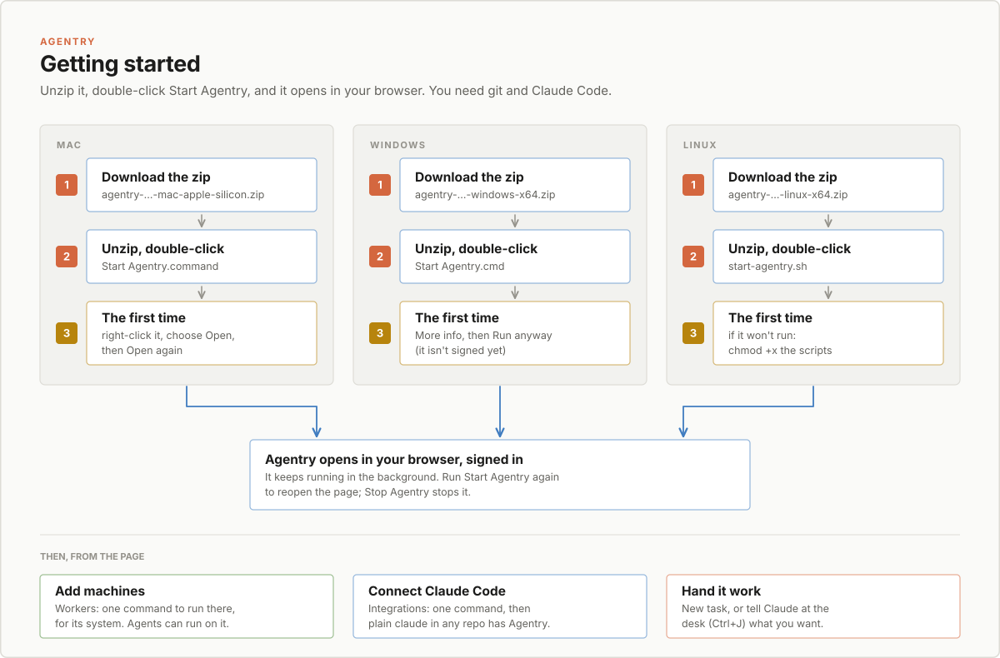
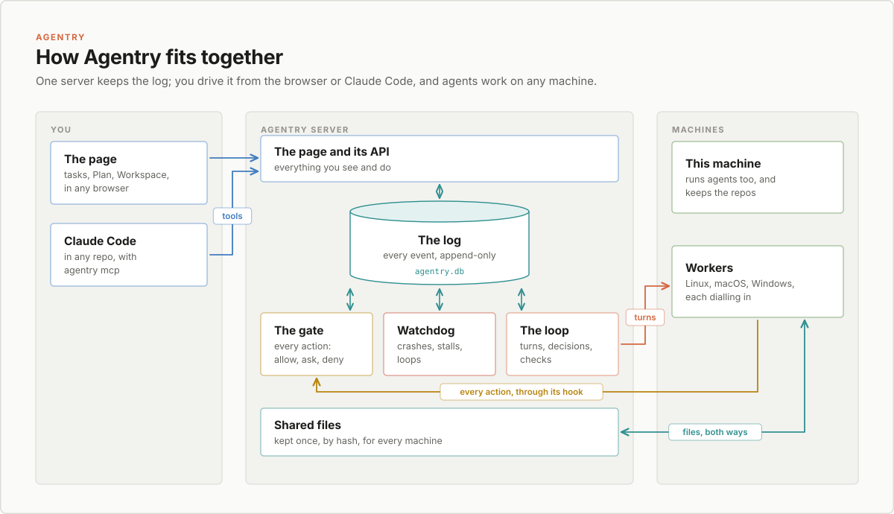
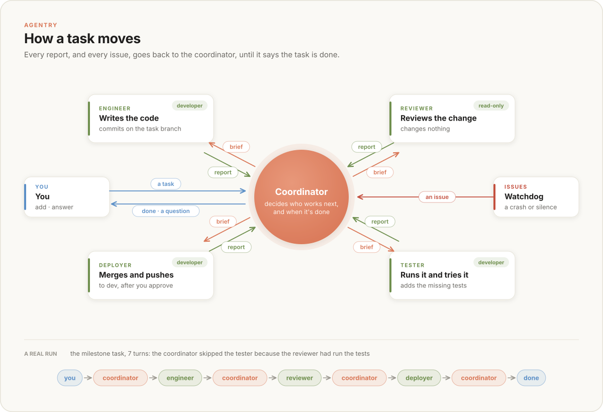
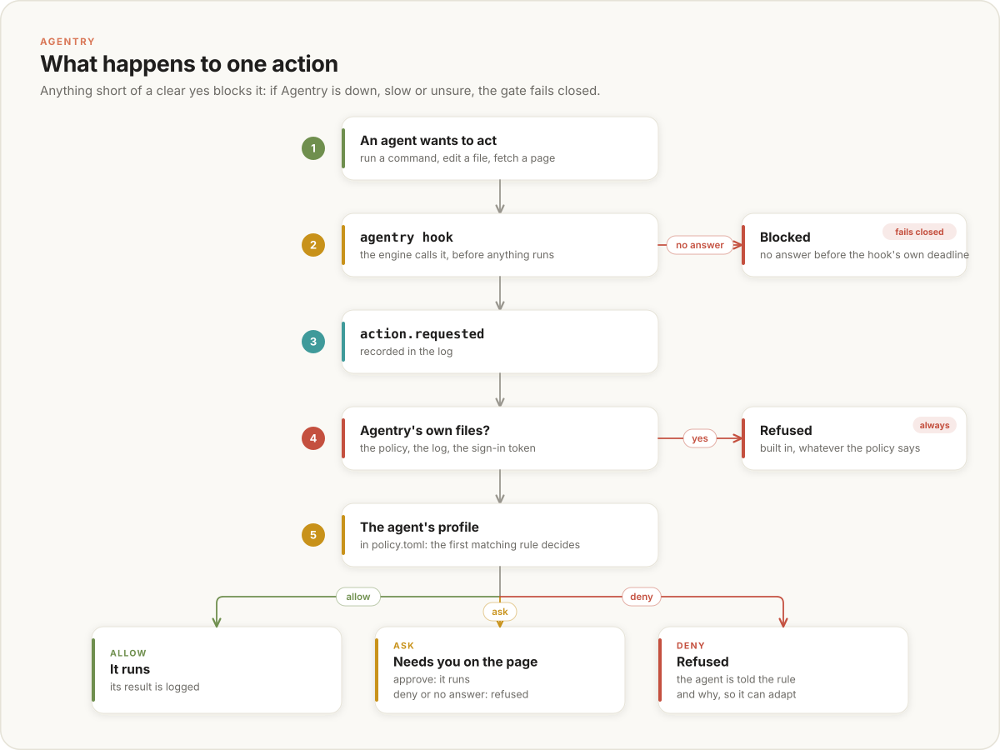
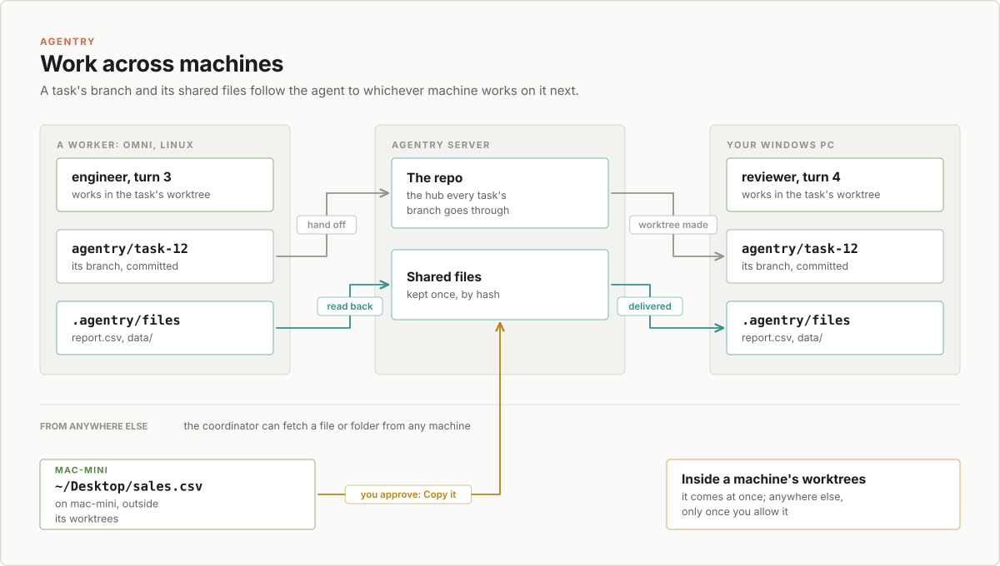

# Agentry

A task board where the workers are AI agents. You describe a task; a coordinator agent hands it from agent to agent (an engineer, a reviewer, a tester, a deployer, or another team's) and reads every report back, until the work is checked and done. You watch it all live, step in when you want, and approve what matters.

Every action an agent takes passes Agentry's gate first, and your policy decides what runs, what is refused and what waits for you. Agents can work on any of your machines, Linux, macOS or Windows, and you can drive it all from the browser or from Claude Code in any repo. Every step is an event in one append-only log.

`PLAN.md` has what's built, what's next, and the decisions behind it.

## Install

<p align="center">
  
  <br><sub>Download, unzip, double-click Start Agentry: the same three steps on every system.</sub>
</p>

### What you need

- **git:** [git-scm.com/downloads](https://git-scm.com/downloads)
- **Claude Code**, signed in: [claude.com/claude-code](https://claude.com/claude-code). The agents run in it. Codex works too, if you have it.

Agentry itself needs nothing else: no Docker, no Node, no tmux. Start Agentry says if git or Claude Code is missing.

The zips are on the [releases page](https://github.com/francischempa/agentry/releases/latest). Each is named for its version, such as `agentry-v0.1.0-mac-intel.zip`.

### Mac

1. [Download](https://github.com/francischempa/agentry/releases/latest) `agentry-<version>-mac-apple-silicon.zip` (M1 and later) or `agentry-<version>-mac-intel.zip`.
2. Unzip it, and double-click **Start Agentry.command** in the Agentry folder.
3. The first time, macOS says it can't check the developer, since Agentry isn't signed yet: right-click Start Agentry.command, choose **Open**, then **Open** again. After that it opens with a double-click.

### Windows

1. [Download](https://github.com/francischempa/agentry/releases/latest) `agentry-<version>-windows-x64.zip` (or `-windows-arm64.zip` on an ARM PC).
2. Unzip it (right-click, Extract All), and double-click **Start Agentry.cmd** in the Agentry folder.
3. The first time, Windows may say it protected your PC, since Agentry isn't signed yet: click **More info**, then **Run anyway**.

### Linux

1. [Download](https://github.com/francischempa/agentry/releases/latest) `agentry-<version>-linux-x64.zip` (or `-linux-arm64.zip`).
2. Unzip it with a tool that keeps permissions (`unzip` does), and run `./start-agentry.sh` in the Agentry folder.
3. If it won't run: `chmod +x agentry start-agentry.sh stop-agentry.sh`.

### What Start Agentry does

It starts Agentry in the background, if it isn't already running, prints a link for this computer and one for each of its network addresses, and opens the first in your browser. The links carry the page's token, which signs you in, so share them only with people you trust. On Windows the window waits for a key, so you can copy them. Close the browser or the window whenever you like: Agentry keeps running. Run Start Agentry again to open the page again, and **Stop Agentry** (`Stop Agentry.command`, `Stop Agentry.cmd` or `./stop-agentry.sh`) to stop it. Agents' sessions carry on across a stop and start.

- **Where things are:** the log, settings and the tasks' worktrees are in `.agentry` in your home folder; delete it to start afresh.
- **Your work:** new tasks work in the git repo `Agentry` in your home folder (made the first time), unless you give a task another repo, or a new one.
- **The address:** port 7800, or the next free one, on every network interface, so your other machines and your phone can open it too. The page's token keeps everyone else out; `agentry serve -addr 127.0.0.1:7800` keeps it to this computer.
- **As an app:** Install app, in the page's top bar, installs Agentry as an app with its own window. Browsers install only from a secure page: open it at `http://localhost:7800` on the computer it runs on, or over https (`-public-url`), not at a plain `http://` network address.
- **The other programs in the folder** (`agentry-linux-amd64` and so on) are what Agentry hands other computers that join as workers. Keep them next to `agentry`.

### Signing in the installed app, or another device

The printed link signs a browser in; the installed app opens without it, and so does a phone you haven't sent the link to. Either one shows a sign-in page:

- **Paste the link or the token** that `agentry serve` printed, and Sign in.
- **Or use a one-time code.** On a device that is signed in, open the person button in the top bar and pick **Sign in another device**. It shows a code such as `ABCD-EFGH` and a QR code: type the code on the other device, or scan the QR code with its camera, which opens Agentry there and signs it in. Pick the address the other device reaches if the server has several. A code works once, for 5 minutes; **New code** makes another. Wrong codes are limited (five a minute from one address), so codes can't be guessed.
- **Sign out**, in the same menu, signs that device out: it forgets its token and the server clears its cookie.

The device keeps the token, and a cookie that lasts a year, so it stays signed in; an app that kept only the cookie, as on iOS, stays signed in too. Installing needs a secure page: `http://localhost` on the computer Agentry runs on, or https.

### From the source

You need Go 1.27 and git.

```sh
go build -o bin/agentry ./cmd/agentry
./bin/agentry open                          # start in the background and open the browser
./bin/agentry serve -repo /path/to/repo     # or run it in the foreground
```

`serve` prints a link with the page's token in it (`open` prints one per address, as above), which signs the browser in and stays the same across restarts. The UI is built into the binary, so this needs no Node; to change the UI, see [Work on it](#work-on-it). `make package` makes the zips above, for every system, from any one machine, into `release/`. [Make a release](#make-a-release) says how they get published.

- **Repo:** `-repo` sets the default repo for new tasks; the page can name another, or make a new one.
- **Data:** `-data` moves `~/.agentry`.
- **Budget:** `-budget` is the tokens a new task may use before it asks you; 0 for no limit.
- **Turn limit:** `-max-turns` (default 24) is the turns a new task may have without your answer before it asks you; 0 for no limit.
- **Address:** `-addr` (default `0.0.0.0:7800`, every interface; `127.0.0.1:7800` for this computer only); on every interface it prints a link for each of this machine's network addresses as well. `-public-url` is the address people and machines reach, for links and install commands; with it, it prints only that one, and the install commands start on it.

## First steps

1. **Add a task:** New task (or press `n`). Describe what you want in your own words; the coordinator reads it, names it, and decides who works on it. A big one becomes an epic, split into stories.
2. **Watch it:** the task's page shows its plan, the path its work took, a chat with its coordinator, the live terminal of the agent at work, and everything that happened.
3. **Answer it:** when a coordinator asks you something, or an agent needs your approval, it shows in Questions (`Ctrl+J`), and in Claude Code if you connected it.
4. **Add a team:** Agentry starts with a Software team. Add Writing, Research or Design on the Agents page.

## Add machines

Agents can run on your other computers, so work can go where the tools, the data or the power are. On the **Workers** page, Add worker shows one command for the machine's system. Run it there:

| System | Run |
| --- | --- |
| macOS, Linux | `curl -fsSL '<server>/worker/install.sh?code=…' \| sh` in a terminal |
| Windows | `irm '<server>/worker/install.ps1?code=…' \| iex` in PowerShell |

It installs `agentry` (in `~/.local/bin`, or `%LOCALAPPDATA%\Agentry\bin` on Windows, added to your PATH), joins with a code that works once, and starts the worker in the background, started again at login: a systemd user service on Linux, a launchd agent on macOS, a Task Scheduler task on Windows. Run on a machine that has joined, it updates it instead. The machine needs git and Claude Code signed in; it dials out to the server, so it needs no open port.

`<server>` is an address that machine reaches. The command comes for every address the server has: `-public-url`, each network address, the one the page is open at, and localhost (this computer only). A picker above the command switches between them; it starts on the public URL, or on the first network address when the page is open at localhost.

On the worker, `agentry worker` does the rest:

| Command | Does |
| --- | --- |
| `agentry worker status` | the server, the service, the link, the engines and tools found, the tasks running here |
| `agentry worker logs [-f]` | its log, `~/.agentry-worker/worker.log` |
| `agentry worker stop` / `start` / `restart` | stop or start the background service |
| `agentry worker update` | get the server's agentry now and restart; the worker also does this whenever it connects |
| `agentry worker leave [-purge]` | take the machine off the server and stop; `-purge` deletes its repos and worktrees too |
| `agentry worker run` | run in the foreground (what the service runs) |

Give an agent its machines under Runs on in its settings. A coordinator can also send an agent to a particular machine, among those it may run on. A task's branch and its shared files follow the work to whichever machine runs the next turn.

## Use it from Claude Code

With Agentry in Claude Code, plain `claude` in any repo can hand work to Agentry and hear back from it. On the **Integrations** page, make an install command and run it on the machine you use Claude Code on:

| System | Run |
| --- | --- |
| macOS, Linux | `curl -fsSL '<server>/integrations/claude-code.sh?code=…' \| sh` in a terminal |
| Windows | `irm '<server>/integrations/claude-code.ps1?code=…' \| iex` in PowerShell |
| The machine Agentry runs on | `agentry mcp install` |

As on the Workers page, the command comes for every address the server has, with a picker to choose the one that machine reaches.

Then, in any repo:

- **Hand it work:** "make a task to add retries to the webhook sender", or an epic, in the repo you're in; file stories under epics, set their order, start them.
- **See your board:** ask, or type `/mcp__agentry__board`. Claude Code's status line shows `agentry · 1 needs you · 3 running`.
- **Hear from it:** Claude tells you, without being asked, when something needs you, a task finishes, a coordinator replies, or a machine goes offline. A notification shows on your computer too.
- **Answer and approve:** send a coordinator your answer. Approving an agent's action, closing an epic or copying a file from outside a machine's worktrees is asked of you by Claude Code itself, so the model can't approve for you.
- **Share files:** `attach_file` shares a file from your machine with a task; `get_file` downloads one.

Each machine connected gets its own credential (the log keeps only its hash); the Integrations page lists them, and Revoke stops one at once. Everything it does is on the page at once.

## How it works

### How it fits together

Everything is one program. Its pieces never call each other to say what happened: they write events to the log, and the others read the log. Each agent runs in its own terminal session, which Agentry keeps itself, so it runs on when Agentry restarts, in its own git worktree, and every action it takes comes back through the gate.

<p align="center">
  
  <br><sub>One server keeps the log; you drive it from the browser or Claude Code, and agents work on any machine.</sub>
</p>

### How a task moves

The coordinator is an ordinary agent. It never starts anyone itself: it ends each turn with a decision, and the loop carries it out. Every agent's report, and every issue the watchdog finds, goes back to the coordinator. It can't finish until the checks approve the last change, so a fix made after a review always gets reviewed again.

<p align="center">
  
  <br><sub>The coordinator hands out each step and reads every report; nothing is done until the checks approve it.</sub>
</p>

### What happens to one action

Before an agent runs a command, edits a file or fetches a page, its engine calls `agentry hook`. Anything short of a clear yes blocks the action, including the server being down or slow: the gate fails closed.

<p align="center">
  
  <br><sub>Four checks before anything runs, and every way out that isn't a clear yes blocks it.</sub>
</p>

### Work across machines

A task's work is its branch, which goes through the repo on the server, and its shared files, kept on the server: both follow the agent to whichever machine works on it next. A coordinator can also bring a file from any machine: from inside its worktrees at once, from anywhere else only once you allow it.

<p align="center">
  
  <br><sub>The branch and the shared files follow the agent.</sub>
</p>

## Use it

The page is an admin console: Tasks and Plan, then Agents, Workers, Integrations and the policy, in the sidebar. Everything updates live.

- **Add a task:** New task is a modal over any page (`n`, or the buttons on Tasks and Plan); its address (`?new=task`, `?new=epic`, `?new=story&newIn=task-E`) can be linked. Describe it in your own words; a title, team, kind, labels, files, a token budget and a turn limit are optional (each defaults to the server's, or can be unlimited). Its work goes in the default repo, another repo, or a new repo Agentry makes at the path you give. Another repo can be a folder on this machine or an address to copy it from: any git address (`git@github.com:team/app.git`, `https://…`, `ssh://…`), which Agentry clones into `~/.agentry/repos` and brings up to date for each new task, or a link to a `.zip` or `.tar.gz`, which it downloads and makes a repo. Name one in a task's description and its coordinator moves the task there itself. Every task works in a worktree of its repo, so a new project should be a new repo. A task made in the wrong repo moves with Change repo in its Details.
- **Tasks:** a list, or a board (keys `1` and `2`) with To do, In progress, Review and Done (the Backlog when you ask). Drag a card onto any column to tell the coordinator what you want: park it, start it, have it reviewed, send it back, wrap it up, or reopen a finished one. Drag within a column, or a row in the list, to set your priority order. Done keeps the last 7 days; the list keeps everything. Labels filter with a click.
- **A task:** its plan down the left, and the path its work took (`engineer › reviewer › tester`) above the tabs. Each agent writes its plan before it starts and ticks it off as it works; the page follows it live. The tabs: Coordinator, a chat with the task's coordinator (what you send stops the turn in progress so it reads it at once, and it replies with what it changed); Activity, everything that happened, newest first; the agent's live Terminal (Take control lets you type into it); Files; Handoffs, Actions, Events and Details.
- **Plan:** a page for shaping work before it runs: each epic is a column of its stories, and one more holds the tasks of no epic. Drag a card up or down to set its priority, or to another column to file it there. A story that hasn't started has Start, and each epic has Start the ready ones.
- **Epics and stories:** a task is a story: one goal, on one branch, checked before it is done. A goal too big for that is an epic, which its coordinator splits into stories, each a task of its own, run by its team's coordinator (another team's, for a story given to them). New stories wait in your Backlog until you start them; one that builds on others starts once they are done, from dev with their work in it. Each finished story's summary goes back to the epic. Only you close an epic: once its stories are all done, it asks you, once, and asks nothing more while you leave the question be. Say what else it needs and its coordinator plans it; say to leave it open and it stays open with every story done, quietly, no longer waiting for you. Close it later with Close the epic on its page, `close_epic` in Claude Code, or by telling its coordinator, which asks you to approve. A story you add wakes it, and once that is done too it asks again. A story can't be split, so there are only two levels. File tasks you have already under an epic from Plan, a task's Details, or the epic's Stories tab.
- **Shared files:** what agents and you hand each other that isn't in git (data, builds, documents, images). In a worktree they are the folder `.agentry/files`, which git ignores: before each turn Agentry fills it with the task's files on whichever machine runs it, and after the turn it reads it back. A story also has its epic's files, in `.agentry/files/epic`. Each file is kept once on the server, by the hash of what is in it, up to 2 GB. A coordinator can `fetch` a file or folder from any machine. The Files tab drops files in, downloads them and takes them away.
- **Checks:** each agent's work counts as building, review or shipping. The reviewer, tester, fact-checker and critics end their reports with `Verdict: approved` or `Verdict: changes needed`; after the last change, every one that has checked the work must approve it again before the coordinator may finish. To finish a task unchecked, drag it to Done.
- **Teams:** each team has a coordinator, which hands a task's steps only to its own agents. Agentry starts with Software; Add a team adds Writing, Research or Design, each agent with a prompt written for that work. By default the coordinators decide whose work a task is. A coordinator that needs something from another team asks it: that team gets a task, and the asking task carries on with its summary.
- **Machines:** a coordinator can choose where an agent works, with `"machine"` on an assign, among the machines that agent may run on. Unchosen, a turn runs where the work is, if the agent may run there.
- **Agents:** add, edit, rename and remove them: prompt, engine, model, policy profile, colour, what their work counts as, and the machines they may run on. Remove team takes a team and all its agents; Agentry refuses while an unfinished task needs them.
- **A task's Workspace** (its button on the task page): the worktree as an editor's git view shows it, with what isn't committed, the branch's commits, every file with its git status, and previews of Markdown and SVG. Its dock has the Coordinator chat, Claude, the agent's Terminal and the agents who worked there.
- **Claude in the Workspace:** a Claude Code session of your own in the task's worktree, for your questions. When you ask it to send the coordinator a change, it runs `agentry send "..."`, which Claude Code asks you before it runs.
- **Showing work:** agents write what they want you to see as files (a design in Markdown, its SVG diagrams) and link them in the chat; a link opens the file in the Workspace, in its preview.
- **The dock:** `Ctrl+J`, or Terminal in the status bar. Questions has everything waiting for you, from every task; Claude is a Claude Code session in the default repo that drafts tasks for you (`agentry task`), but can't approve anything.
- **Budgets and turn limits:** every task has a token budget (`-budget`, 5M by default) and a limit of turns without your answer (`-max-turns`, 24 by default), its own to change at any time, or to make unlimited. At its budget a task stops and asks you to raise it or wrap up; at its turn limit it stops and asks for guidance. Raising either, or making it unlimited, while the task is stopped at that limit is your answer, and the coordinator carries on; it never answers any other question, such as the other limit's stop, a request to copy a file or a stop for issues in a row, even after you lower the limit below what the task has used. Stops asked before Agentry recorded their limit are known by their words. In the Questions list such a stop has kind `budget` or `turns`, with the numbers it stopped at, and a task's `stoppedAt` names it. Through the API: `PUT /api/tasks/{task}/budget` `{"budget": N}` and `PUT /api/tasks/{task}/turns` `{"maxTurns": N}`, 0 or -1 for no limit, each replying with the new limit and `answered`, whether it answered the stop; a new task (`POST /api/tasks`) takes `budget` and `maxTurns`, left out or 0 for the server's default, -1 for no limit. Tasks made before turn limits were each task's own keep 24.
- **Keys:** `Ctrl+K` searches everything, and `?` lists every shortcut.

## The policy

What agents may do is in `~/.agentry/policy.toml`, written on first start from [`internal/policy/default.toml`](internal/policy/default.toml), which documents every field. Save the file and it takes effect within two seconds. A file with a mistake is refused, the policy before it stays in force, and the page says what's wrong.

- **Profiles:** each agent has one. The reviewer and coordinator are `read-only`, and the engineer, tester and deployer are `developer`. There are also `autonomous` (anything on this machine, asks before acting outside it) and `allow-everything`.
- **Rules:** in a profile, rules are read top to bottom and the first match decides `allow`, `ask` or `deny`. A rule can match `tools`, commands (`runs_any`, `runs_only`), `paths`, and `where` (the workspace or outside). Every rule has a `why`, which the page shows.
- **Allow everything, as shipped:** the default sets `use_for_everyone = "allow-everything"`, so every agent runs anything. Comment that line out to give each agent its own profile instead.
- **Built in:** no agent may touch the policy, the log or the sign-in tokens, whatever the file says.

## Deploy it

`agentry.chempa.dev` runs from the `dev` branch: GitLab tests the commit, builds the image (`Dockerfile`: the server, git and Claude Code) and asks Berth to deploy `docker-stack.dev.yml`, pinned to one node (`NODE` in the app's .env). Everything worth keeping is in the container's home, a volume: Claude's sign-in, the repos under `~/work`, and Agentry's log and policy in `~/.agentry`.

- **The link:** the server prints it with its token: `ssh <manager> berth logs agentry dev server`.
- **Signing Claude in:** once, after the first deploy: open the dock's Claude tab and follow Claude's sign-in. The agents use the same sign-in.
- **Repos:** clone them into `~/work` and name them on a task.

## Work on it

```sh
make test       # go vet, go test, and the UI's type and format checks
make            # rebuild the UI, then the binary
make workers    # the builds other machines download, next to bin/agentry
make package    # the zips for every system, in release/
```

The UI lives in `ui/`: React, TypeScript, Vite and Tailwind, built into `internal/web/dist`, which is committed. `cd ui && npm run dev` serves it with live reload against a running `agentry serve`. Its components go `atoms` (spend the design tokens in `src/styles/globals.css`), `molecules`, `organisms` (own state) and one template, `AdminShell`, that every page renders in. The figures in `docs/diagrams` are drawn by `docs/diagrams/source/figures.py`.

Each folder in `internal/` does one job, and folders only depend on the ones below them:
- `events` lists what can happen.
- `store` keeps the log.
- `tasks`, `agents`, `workers` and `connections` compute state from the log.
- `rules` checks each event before it's written.
- `policy`, `hooks`, `engines`, `worktrees`, `sessions`, `sharedfiles` and `turns` run the agents.
- `coordinator` and `watchdog` move tasks along.
- `machines` and `workerlink` reach this machine and the workers.
- `terminal` and `web` serve the UI and its live terminals.
- `desk` runs the Claude you talk to; `mcp` is Agentry for Claude Code in any repo.

### Make a release

Releases live on GitHub only; GitLab just checks, builds and deploys.

1. Tag the commit on `dev` and push the tag: `git tag v0.1.0 && git push github v0.1.0`.
2. Run `make package` on the tagged commit in a clean checkout. The zip names come from the tag; a tree with changes adds `-dirty`.
3. Publish the zips: `gh release create v0.1.0 release/agentry-v0.1.0-*.zip --repo francischempa/agentry --title v0.1.0 --notes "What changed"`. The version in the name keeps older zips in `release/` out of the release.
