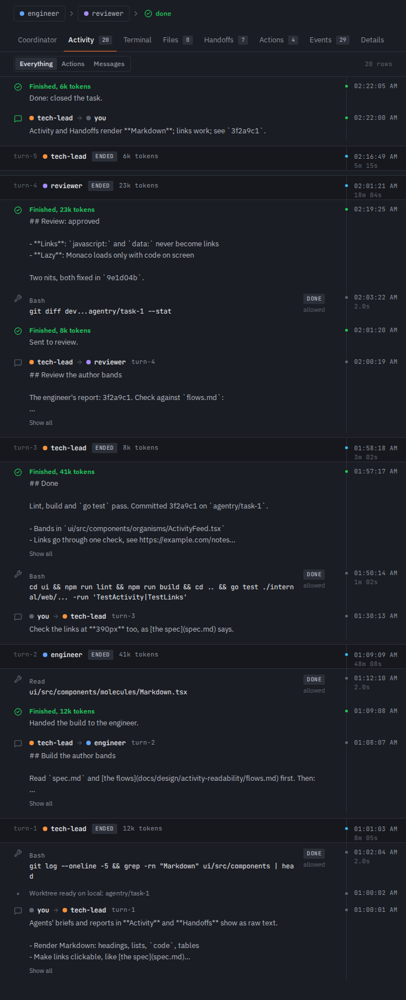
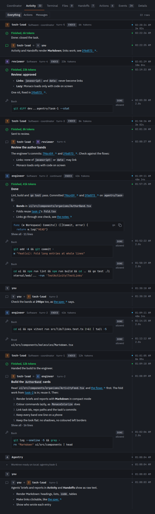
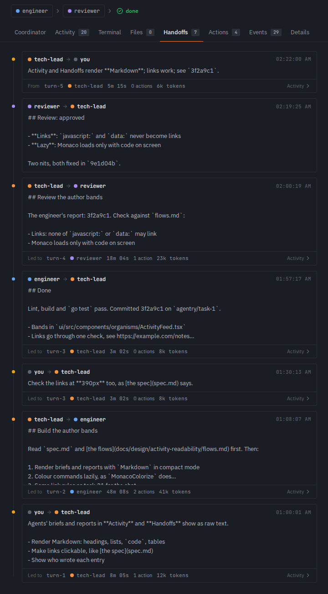
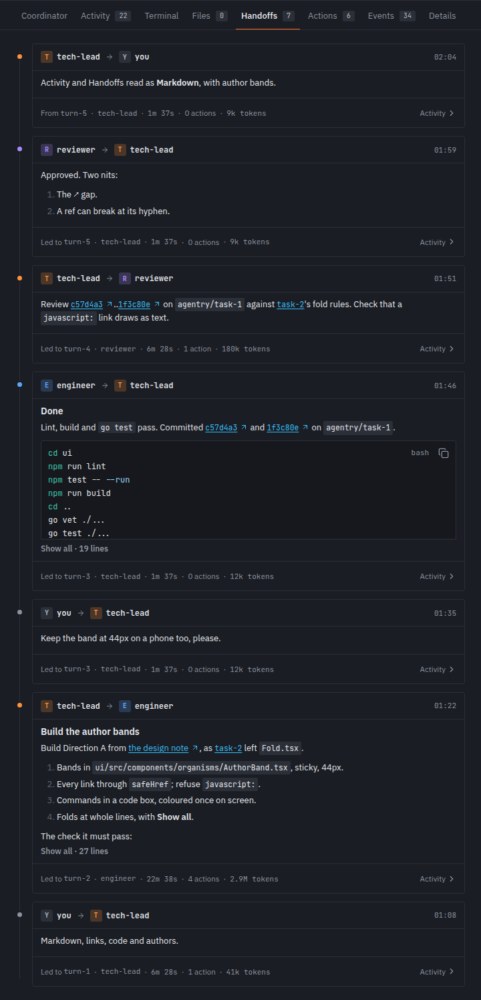
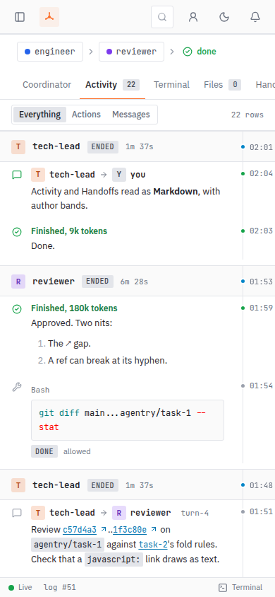
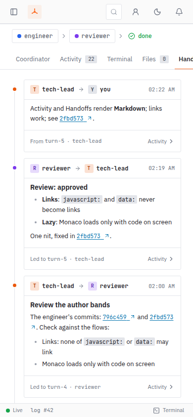
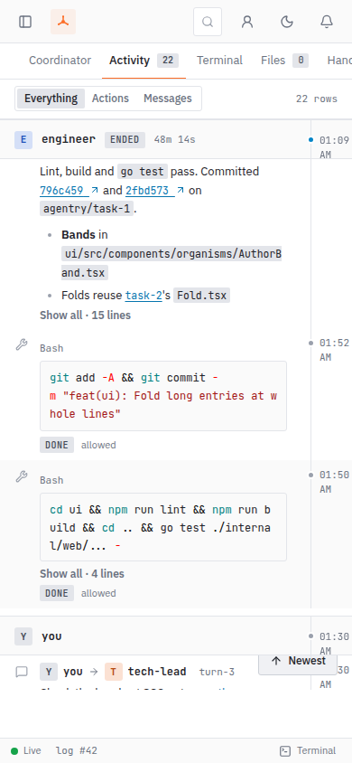
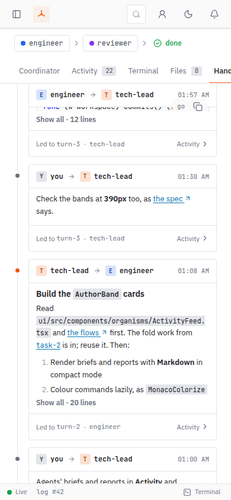

# Readable Activity and Handoffs

A design note for the user and for the engineer who builds it. The detail is in [the flows](activity-readability/flows.md); the words are in [the copy deck](activity-readability/copy.md).

## The problem

A task's Activity and Handoffs tabs show agents' briefs and reports as raw text: `##`, `**bold**`, backticks and `[label](url)` stay as typed, links don't open, commands are plain mono, and long entries are cut mid-line. In a long feed it's hard to tell who wrote what: the author is a small coloured dot and a name on the first row of a turn, and nothing after it.

## The direction, in a line

**Author bands** ([spec decision 1](activity-readability/brief.md)): every row in a turn already belongs to that turn's agent and the turn band already sticks, so making the band the author header names the author of every row on screen, with the least new UI and today's density.

## Before and after

Before: the tabs as they were, from a fresh demo server with an empty data dir (dark theme, the default). After: the build, from a fresh demo server on port 7910 with an empty data dir, seeded with two finished tasks (every turn closed, so no agent ran), in light and dark at 1280 wide and light at 390. The wireframes it was built from stay linked below.

| Before | After |
|---|---|
|  |  |
|  |  |

Light: [Activity](activity-readability/after/activity-light.png), [Handoffs](activity-readability/after/handoffs-light.png). Scrolled with the wheel, a band or card header stuck at the top: [Activity](activity-readability/after/activity-scrolled.png) (the engineer's `turn-2` band), [Handoffs](activity-readability/after/handoffs-scrolled.png).

Phone, 390 wide:

| Activity | Handoffs |
|---|---|
|  |  |
|  |  |

Wireframes: [Activity, desktop](activity-readability/activity-desktop.svg), [Activity, dark](activity-readability/activity-dark.svg), [Activity, phone](activity-readability/activity-mobile.svg), [Handoffs](activity-readability/handoffs.svg), [states](activity-readability/states.svg).

### Found while taking the after shots

- **Out of scope:** the task's Done banner above the tabs still shows its summary's raw `**Markdown**`.

Fixed, and the shots above re-taken from a fresh demo server (the screenshots in [found/](activity-readability/after/found/) are the before):

- **The page scrolled past Activity into blank space** ([before](activity-readability/after/found/activity-page-scrolls-into-blank.png)). Screen-reader-only text in the rows (` to `, "(opens in a new tab)") was positioned against a box outside the tab's scroller, so the page grew to the feed's height. The scroller is that box now, in Activity and the coordinator chat: at 1280×924 and 390 the page's scrollHeight equals its clientHeight and only the tab's scroller scrolls (on a phone the task page's own column scrolls as it always has, to exactly its content).
- **A code box's language and Copy drew over a stuck Handoffs header** ([before](activity-readability/after/found/codebox-controls-over-handoff-header.png)). The corner has no z-index of its own now, so stuck headers and bands cover it in both tabs; the top bar and the phone drawer stay above the tab.
- **Activity's rail times wrapped on a phone** (`01:09` over `AM`). Rail and Handoffs times are `{hh:mm}` as the copy deck says, five characters on the 24-hour clock, on one line.
- **Small:** a link's underline stops at its label (the gap before ↗ is a margin); task ids, commits and one-word code such as a branch move to the next line whole instead of breaking at a hyphen, with no sideways scroll at 390; a fold that cuts through a code box ends with a 1px divider at the cut.
- **A long path took a line of its own on a phone** (`ui/src/components/organisms/AuthorBand.tsx` as a full-width box, with `, sticky, 44px.` pushed under it). Only short one-word code and refs, up to 24 characters (task ids, commits, branches), move to the next line whole; longer code and links wrap inline as text does ([phone, scrolled](activity-readability/after/handoffs-phone-scrolled.png)).
- **The desktop rail showed seconds and AM/PM** (`01:09:23 AM`). It shows `{hh:mm}` at every width now, as the copy deck says; the rail column is unchanged and the time still sits above the duration ([Activity](activity-readability/after/activity-light.png), [scrolled](activity-readability/after/activity-scrolled.png)).

## What changes

**Markdown, folded.** Briefs, reports, questions, issues, notes with a body and your own messages render with the existing `Markdown` component in compact mode, through one `EntryText` piece used by both tabs. Long entries fold by measured height behind `Show all · {n} lines` ({n} is about the length, not an exact count): briefs, reports and questions at about 10 lines, Handoffs briefs at 8, note bodies at 4, commands at 3 and fenced code at 12. The cut snaps to a whole line, with no fade; folding clips the text and takes links below the cut out of the Tab order; `Show less` scrolls the entry's first line back under the band when it has gone above it.

**Links.** One check, `safeHref`, in `lib/links.ts`, used by `linkInto` and by `Markdown`'s own fallback. It returns the href to render, and callers never render the raw string.

| In the text | Goes to |
|---|---|
| `https://…`, `http://…`, `mailto:`, and `//host`, `\\host`, `/\host`, `\/host` | a new tab, `rel="noopener noreferrer"`, with a ↗ |
| a repo path (`docs/design.md`, `./x`, `/x`) | that file in the task's Workspace, new tab, ↗ |
| a task id (`task-21`) known to the board | that task's page, same tab, its title as tooltip |
| a commit SHA (7 to 40 hex) that starts one of the task's commits | the commit view, `/tasks/:id/workspace?commit=…`, new tab, ↗ |
| `#anchor` | in-page |
| unknown task ids and SHAs; `javascript:`, `data:`, `vbscript:`, `file:`, any other scheme; paths above the root | plain text, no link |

A task id or commit written in backticks links the same way and reads like the bare one: mono, link colour, underlined, no code background.

**Code.** Commands in action rows and fenced blocks go in a `CodeBox`: plain mono at once, coloured by `MonacoColorize` only when the box is on screen, so a feed with no code on screen loads no Monaco. Commands wrap to the column; past 3 lines they fold. Fences show their language and a Copy button (commands have none); wide tables and fences scroll in their own box, never the page.

**Author bands (Activity).** Every run of rows by one author sits under a band: chip in the agent's colour, the **name in text**, team and role (dropped when the role is the name), turn id, `continued` and `on {worker}` when they apply, status, tokens. On desktop the turn's start time and duration stay in the time rail, as today. Your rows and Agentry's get neutral bands, so nothing is unattributed; a message from you during a running turn gets its own `you` band, and the turn resumes under a `continued` band. Each band sticks until the next section pushes it out; bands are 44px at every width, stuck or not, and each is an `h3`. On a phone the band shows only chip, name (truncated past 120px), status and duration, on one line: the rail there has room for the time only, so the duration moves into the band; team, role, turn id and tokens stay in the band's accessible name.

**Card headers (Handoffs).** Each card is an `<article>` whose header, `from → to` with chips and names and the time, sticks while you read a long brief. The card stops being one big button; its footer (`Led to turn-5 · engineer · 48m · 14 actions · Activity ›`; while the turn runs, a `running` badge and the action count instead of the duration) opens the turn's Activity, so links in the brief work. On a phone the header stays on one line (names truncate at 96px each) and the footer keeps only the turn, the agent and the badge: `Led to turn-6 · reviewer · running · Activity ›`. There the agent's name shrinks to fit, at most 72px, while the badge and `Activity ›` never shrink, so `turn-100` and above still fit ([spec decision 11](activity-readability/brief.md)).

## Accessibility and look

- The author is always in text; colour is only on chips and dots, and the Handoffs footer has no dot. Light-theme fixes: `link` and `success-ink` aliases and a darker chip letter keep text at 4.5:1; dark passes as it is.
- `scroll-padding-top` (44px Activity, 40px Handoffs) keeps focus out from under stuck headers; on a phone `scroll-padding-bottom: 48px` keeps it clear of the Newest button.
- Each tab has a screen-reader-only `h2`; bands are `h3`s you can jump between. Targets are 44px; inline links are exempt.
- Flat: hairlines, square corners of 4px or less, no shadows, glows, gradients or left accent stripes.
- Out of scope: agent filters, a compact/detailed toggle, search, and the site-wide focus outline and badge contrast (follow-ups).

## Found while taking the before shots

- Handoffs cuts a long brief mid-line (`3. Same link rules…`, half drawn above the footer); the fold fixes it.

## Documents

- [brief.md](activity-readability/brief.md): who, the problem, constraints, decisions 1 to 11
- [flows.md](activity-readability/flows.md): the five flows, states, the URL check and its tests, the build checklist
- [copy.md](activity-readability/copy.md): every string and accessible name
- [critique.md](activity-readability/critique.md): the critique and the turn 14 re-check
- [directions.md](activity-readability/directions.md): the three directions; [A](activity-readability/direction-a.svg), [B](activity-readability/direction-b.svg), [C](activity-readability/direction-c.svg)
- Wireframes: [Activity, desktop](activity-readability/activity-desktop.svg), [Activity, phone](activity-readability/activity-mobile.svg), [Activity, dark](activity-readability/activity-dark.svg), [Handoffs](activity-readability/handoffs.svg), [States](activity-readability/states.svg); drawn by [activity_bands.py](source/activity_bands.py)
