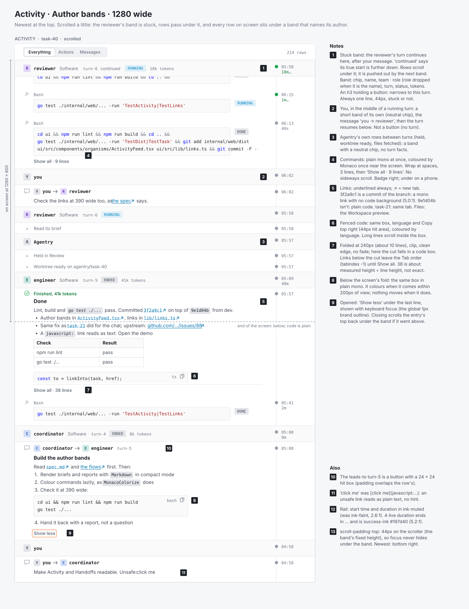
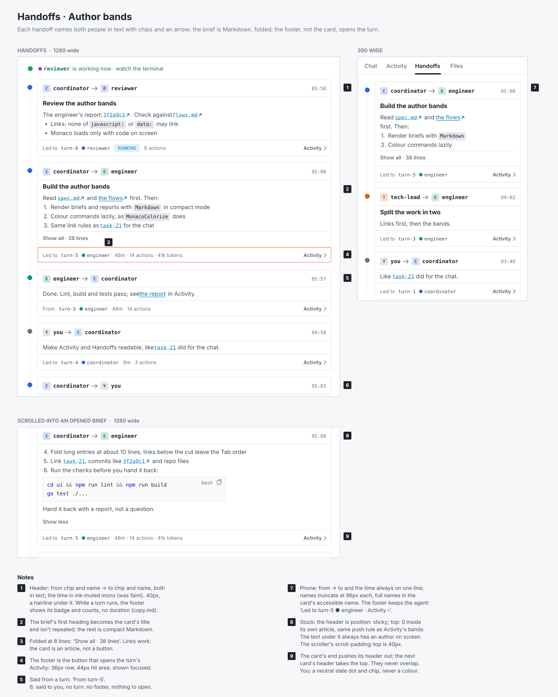

# Readable Activity and Handoffs

A design note for the user and for the engineer who builds it. The detail is in [the flows](activity-readability/flows.md); the words are in [the copy deck](activity-readability/copy.md).

## The problem

A task's Activity and Handoffs tabs show agents' briefs and reports as raw text: `##`, `**bold**`, backticks and `[label](url)` stay as typed, links don't open, commands are plain mono, and long entries are cut mid-line. In a long feed it's hard to tell who wrote what: the author is a small coloured dot and a name on the first row of a turn, and nothing after it.

## The direction, in a line

**Author bands** ([spec decision 1](../../spec.md)): every row in a turn already belongs to that turn's agent and the turn band already sticks, so making the band the author header names the author of every row on screen, with the least new UI and today's density.

## Before and after

Before: today's tabs, from a fresh demo server with an empty data dir (dark theme, the default). After: the wireframes (light; the dark one is [activity-dark.svg](activity-readability/activity-dark.svg)).

| Before | After |
|---|---|
|  |  |
|  |  |

Phone and states: [activity-mobile.svg](activity-readability/activity-mobile.svg), [states.svg](activity-readability/states.svg).

## What changes

**Markdown, folded.** Briefs, reports, messages, plans and your own messages render with the existing `Markdown` component in compact mode, through one `EntryText` piece used by both tabs. Long entries fold at about 10 lines (commands at 3) behind `Show all · {n} lines`; folding clips the text and takes links below the cut out of the Tab order; `Show less` scrolls back to the entry's first line.

**Links.** One check, `safeHref`, in `lib/links.ts`, used by `linkInto` and by `Markdown`'s own fallback. It returns the href to render, and callers never render the raw string.

| In the text | Goes to |
|---|---|
| `https://…`, `mailto:`, and `//host`, `\\host`, `/\host`, `\/host` | a new tab, `rel="noopener noreferrer"`, with a ↗ |
| a repo path (`docs/design.md`, `./x`, `/x`) | that file in the task's Workspace, new tab, ↗ |
| a task id (`task-21`) known to the board | that task's page, same tab |
| a commit SHA (7 to 40 hex) that starts one of the task's commits | the commit view, `/tasks/:id/workspace?commit=…`, new tab, ↗ |
| `#anchor` | in-page |
| unknown task ids and SHAs; `javascript:`, `data:`, `vbscript:`, `file:`, any other scheme; paths above the root | plain text, no link |

**Code.** Commands in action rows and fenced blocks go in a `CodeBox`: plain mono at once, coloured by `MonacoColorize` only when the box is on screen, so a feed with no code loads no Monaco. Commands wrap to the column; past 3 lines they fold. Fences show their language and a Copy button; wide tables and fences scroll in their own box, never the page.

**Author bands (Activity).** Every run of rows by one author sits under a band: chip in the agent's colour, the **name in text**, team and role (dropped when the role is the name), turn id, status, duration, tokens. Your rows and Agentry's get neutral bands, so nothing is unattributed. Bands are 44px at every width, stuck or not, and each is an `h3`. On a phone the band keeps chip, name, status and duration on one line.

**Card headers (Handoffs).** Each card is an `<article>` whose header, `from → to` with chips and names and the time, sticks while you read a long brief. The card stops being one big button; its footer (`Led to turn-5 · engineer · 48m · 14 actions · Activity ›`) opens the turn, so links in the brief work.

## Accessibility and look

- The author is always in text; colour is only on chips and dots. Light-theme fixes: `link` and `success-ink` aliases and a darker chip letter keep text at 4.5:1; dark passes as it is.
- `scroll-padding-top` (44px Activity, 40px Handoffs) keeps focus out from under stuck headers; on a phone `scroll-padding-bottom: 48px` keeps it clear of the Newest button.
- Each tab has a screen-reader-only `h2`; bands are `h3`s you can jump between. Targets are 44px; inline links are exempt.
- Flat: hairlines, square corners of 4px or less, no shadows, glows, gradients or left accent stripes.
- Out of scope: agent filters, a compact/detailed toggle, search, and the site-wide focus outline and badge contrast (follow-ups).

## Found while taking the before shots

- Handoffs cuts a long brief mid-line (`3. Same link rules…`, half drawn above the footer); the fold fixes it.

## Documents

- [spec.md](../../spec.md): who, the problem, constraints, decisions 1 to 10
- [flows.md](activity-readability/flows.md): the five flows, states, the URL check and its tests, the build checklist
- [copy.md](activity-readability/copy.md): every string and accessible name
- [critique.md](activity-readability/critique.md): the critique and the turn 14 re-check
- [directions.md](activity-readability/directions.md): the three directions; [A](activity-readability/direction-a.svg), [B](activity-readability/direction-b.svg), [C](activity-readability/direction-c.svg)
- Wireframes: [Activity, desktop](activity-readability/activity-desktop.svg), [Activity, phone](activity-readability/activity-mobile.svg), [Activity, dark](activity-readability/activity-dark.svg), [Handoffs](activity-readability/handoffs.svg), [States](activity-readability/states.svg); drawn by [activity_bands.py](source/activity_bands.py)
