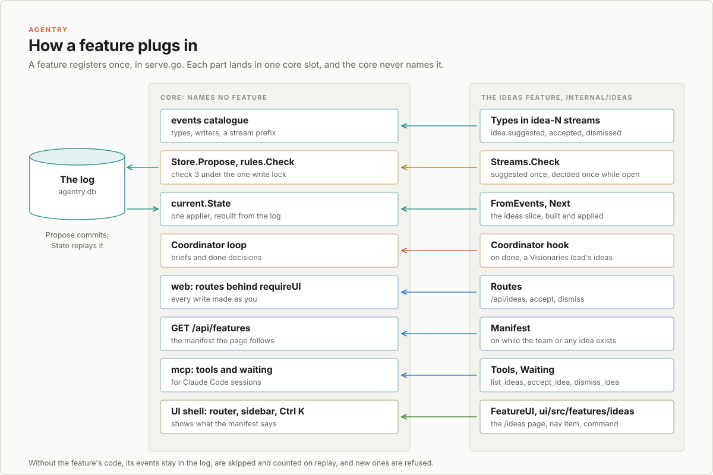

# Extensions: how teams bring features and UI

Status: proposed, for task-46 ("Research how teams contribute features and
UI: the shape of Agentry's extensions").
Research only: nothing in the server or the page changes with this document.
It covers the inventory, what an extension is, how the page learns what
is on, the options, the core API, replay, versioning, security, what moves
first, and a phased plan ready to file as Backlog stories.

## In short

Adding the Visionaries team brought a whole feature with it: ideas. Ideas
have their own event types, rules, state, a hook in the coordinator's done
decision, an API, MCP tools, a waiting entry and a page. Each of those was
written straight into a core package: `current.State` has an `ideas` map,
`rules.State` has an `Idea` method, `coordinator.Decision` has an `Ideas`
field, `web.Server` mounts `/api/ideas`, and the sidebar and Ctrl K list
Ideas whether or not you have the team. Section 2 counts 27 shared files the
feature touched, besides its own 16.

The recommendation is option (a): a feature is a Go package (and a folder in
`ui/src/features`) that registers with a small, explicit core API,
`internal/features`. That package is a leaf: core packages import it, and it
imports none that could import it back. Core asks each feature for its
event types, its rules, its slice of the in-memory state, its coordinator
hooks, its routes and MCP tools, what of it waits for you, and a manifest
entry that says whether the page should show it. A feature never holds the
store: it writes through a proposer that refuses any type it didn't
declare. The page reads one list, `GET /api/features`, and the sidebar,
Ctrl K, routes and board columns follow it. Ideas is the pilot: it shows
while a Visionaries team exists or any idea does.

Out-of-process extensions (option b) can't add rules: rules run inside
`Store.Propose` under the store's one write lock, so a network call there
would stall every proposal. They stay possible later as clients of the API
that read events and write proposals, which the MCP server already is.

Turning a feature off never touches the log. Disabled (no team), its data
stays readable and actionable; absent (no code), its streams and types are
skipped on replay, refused for new proposals and counted, by a stated rule
in place of today's accident (section 7). A task's stream is known by its
`task-` name alone; whether the task exists, or is archived, is the rules'
test. Event types change only by adding optional fields, or by a new name,
and a feature's types in task streams are namespaced from the first one
(sections 6 and 8). Team templates gain an ID and a list of features, and
each agent records the template it came from, which fixes the name matching
that misses a second "Visionaries 2" team. A feature's agents go through the
gate like any other; a feature owns its prefix and types, names the core
types it writes, and its rules can only refuse (section 9). Tasks, the gate,
agents and machines stay core (section 10).

The Visionaries agree with (a) now and (c) later, and reordered what comes
after the pilot (section 13): "Users won't feel the extension model.
They'll feel whether they can say yes from their phone and see that their
work actually shipped." The plan (section 11) starts small: phase 1 is five
stories that make Ideas show only while a Visionaries team or an idea
exists, through `internal/features`, `GET /api/features` and the page's
feature registry. Phase 2 moves the rest of Ideas onto the API, and phase 3,
approving from anywhere with Web Push, can run beside it. Then come the
Shipping column with T-019, per-team profiles, and schedules. Senior
approval (T-024) waits for a second human.

## 1. Where this comes from

The trigger is small: Ideas is hard-coded in
`ui/src/components/organisms/Sidebar.tsx` (`SECTIONS`) and in the Ctrl K
list in `ui/src/components/templates/AdminShell.tsx` (`paletteItems`), so
it shows on an install with no Visionaries team and no ideas. The pattern
behind it is larger. A team can bring a capability with it, and more teams
will. The user's principle for extensions, from the decisions behind this
project, is that "extensions read events, write proposals and add rules.
They are not read-only." PLAN.md names three that fit: T-019 (GitHub
extension: open the PR after `review.approved`; notifications and email),
T-024 (senior approval: route some requests to someone other than the
ticket owner) and T-036 (a JSON Schema per event type, which "matters once
extensions write events").

Two designs constrain any answer here. `docs/design/read-model.md`: the log
is the only thing stored, `current.State` is rebuilt from it at every start
and changed only by the store, one event at a time, after it commits, and
reads of the log never pass the applied position. `docs/design/log-growth.md`:
old logs must keep replaying, as events are never rewritten.

## 2. Inventory: what Visionaries and Ideas touched

The feature landed in tasks 24 to 28 (commits from 191b4e2 to dfb8e40).
The table lists every file it changed or added, outside tests, by concern.
"Own" means the file or function is only about ideas and would move into
the extension whole. "Hook" means a core file that gained an ideas-specific
branch, field or line, which the extension API has to replace with a
generic point. "Core" means a generic change that stays.

| Concern | File(s) | What it does | Extension owns it? |
|---|---|---|---|
| Team template | `internal/agents/teams.go` (`Templates`, the `Visionaries` entry) | Five agents, all `Profile: "read-mostly"`, `visionary-lead` coordinates, `skeptic` has `Column: Reviews` | Own: the template entry |
| Prompts | `internal/agents/defaults/visionaries/*.md` (visionary-lead, product-strategist, user-advocate, technologist, skeptic) | What each viewpoint does; the lead hands ideas over on its done decision | Own |
| Policy profile | `internal/policy/default.toml` (`[profiles.read-mostly]`, "It suggests ideas; the engineers commit.") | Read-only plus reading the task board, no commit or push (also `git -C`) | Own the need, core keeps profiles (task-35) |
| Profile check on add | `internal/web/agents_api.go` (`unknownProfile`, used by `addTeam` and by `agentFrom` for `createAgent` and `changeAgent`) | Refuses a team whose agent needs a profile the policy file in force lacks, and says to copy it | Core (generic, came with this feature) |
| Event types | `internal/events/types.go` (`IdeaSuggested`, `IdeaAccepted`, `IdeaDismissed`, `IdeaPrefix = "idea-"`) | Three types in `idea-N` streams | Own |
| Catalogue | `internal/events/catalogue.go` (`catalogue` entries, `ideaTypes`, `IsIdeaStream`, `IsTaskStream` excludes ideas, `belongsIn`) | Fields and writers per type; idea types only in idea streams | Hook: registration of a stream prefix and its types |
| Task field | `internal/tasks/task.go` (`Task.Idea`), `internal/tasks/apply.go` (`task.created` reads `"idea"`) | A task remembers the idea it was made from | Hook: a feature-neutral "made from" stream |
| Idea state | `internal/ideas/idea.go` (`Idea`, `State`, `FromEvents`, `Next`, `apply`) | An idea's state from its events, same shape as `tasks` | Own |
| Accept | `internal/ideas/accept.go` (`Accept`, `madeFrom`, `ideaOf`, `makeTask`, `kindOf`, `description`, `Board`) | Makes one Backlog task per idea, however often accepted, then marks it accepted | Own |
| Lists | `internal/ideas/list.go` (`Load`, `List`, `Dismissals`) | Reads ideas from the log (`store.IdeaIDs`, `Store.Stream`), not from `current.State` | Own (and should read the state: section 11, story 1) |
| Read model | `internal/current/current.go` (`State.ideas`, `Load` and `Apply` branches on `IsIdeaStream`, `State.Idea`) | Keeps each idea in memory | Hook: a state slice per stream prefix |
| Read model check | `internal/current/equal.go` (`IdeaIDs` loop) | The equivalence test covers ideas | Hook: loop over every slice |
| Log reads | `internal/store/read.go` (`IdeaIDs`), `internal/store/store.go` (`Create`, `made`) | `idea-N` named under the store lock by counting `idea.suggested` | Core: `Create(prefix, p)` is generic already; `IdeaIDs` becomes `StartedBy(type)` |
| Rules | `internal/rules/idea_rules.go` (`checkIdea`, `aGoodSuggestion`, `madeFromIt`), `internal/rules/rules.go` (`State.Idea`, the `IsIdeaStream` branch in `Check`) | Suggested once from a real task, accepted or dismissed once while open | Own the rules; hook in `Check` |
| Coordinator hook | `internal/coordinator/ideas.go` (`VisionariesTeam`, `isVisionaries`, `Idea`, `IdeasFormat`, `suggest`, `dismissedFor`, `dismissedText`) | On done, writes each idea with `Store.Create(events.IdeaPrefix, ...)` as the loop | Own |
| Decision | `internal/coordinator/decision.go` (`Decision.Ideas`) | The done decision's `ideas` field | Hook: a field a feature claims |
| Loop | `internal/coordinator/loop.go` (`apply`, `case Finish`; `startOn` passes `l.dismissedFor`) | Only a Visionaries coordinator's ideas are kept | Hook: on-done and brief hooks |
| Brief | `internal/coordinator/brief.go` (`coordinatorBrief(..., dismissed)`, the "Ideas the user dismissed" section, `IdeasFormat` appended to "Your decision") | Tells the lead what was dismissed and how to hand ideas over | Hook: brief sections from features |
| HTTP API | `internal/web/ideas_api.go` (`listIdeas`, `acceptIdea`, `dismissIdea`, `ideaExists`), `internal/web/server.go` (three `api(...)` routes), `internal/web/views.go` (`ideaView`, `viewOf`, `acceptance`) | `GET /api/ideas`, `POST /api/ideas/{idea}/accept`, `.../dismiss` | Own the handlers; hook to mount them |
| MCP tools | `internal/mcp/ideas.go` (`listIdeas`, `acceptIdea`, `dismissIdea`, `openIdeas`, ...), `internal/mcp/tools.go` (three entries in `tools()`, the ideas note in the status line) | `list_ideas`, `accept_idea`, `dismiss_idea` over the HTTP API | Own the tools; hook to list them |
| Waiting and notices | `internal/mcp/waiting.go` (`WaitingFor` adds `openIdeas`, `Kind "ideas"`), `internal/mcp/notify.go` (title "Agentry: a new idea") | Open ideas count as waiting for you | Hook: a waiting source per feature |
| MCP instructions | `internal/mcp/server.go` (the "Ideas:" paragraph), `cmd/agentry/claudecode.go` (`sayWhatWaits` names `list_ideas`) | Tells Claude Code how to relay ideas | Hook: instruction lines per feature |
| UI types | `ui/src/api/types.ts` (`Idea`, `IdeaAcceptance`) | The API's shapes | Own |
| UI page | `ui/src/pages/IdeasPage.tsx`, `ui/src/components/organisms/IdeaCard.tsx`, `ui/src/components/organisms/IdeaDialogs.tsx` | Open, accepted and dismissed ideas; accept and dismiss | Own |
| UI route | `ui/src/App.tsx` (`{ path: "/ideas", element: <IdeasPage /> }`) | The page's address | Hook: routes from features |
| Sidebar | `ui/src/components/organisms/Sidebar.tsx` (`SECTIONS`, "Work") | Ideas, always | Hook: nav items from features, shown by the manifest |
| Ctrl K | `ui/src/components/templates/AdminShell.tsx` (`paletteItems`, `go-ideas`) | Go to Ideas, always | Hook: commands from features |
| Ask the visionaries | `ui/src/lib/visionaries.ts` (`useAskVisionaries`), `ui/src/lib/teams.ts` (`VISIONARIES`, `addTeam`) | Adds the team from its template if missing, then opens New task with it picked | Own `visionaries.ts`; `addTeam` is core |
| New task preset | `ui/src/lib/new-task.ts` (`useNewTask(kind, epic, team)`, `&newTeam=`), `ui/src/components/organisms/NewTaskDialog.tsx`, `ui/src/components/organisms/NewTaskForm.tsx` (`asksVisionaries`, `visionariesMissing`, the "Theme or question" field, kind forced to `story`) | `?new=task&newTeam=Visionaries` opens New task for a session | Core for `newTeam`; hook for the team-specific form |
| Agents page | `ui/src/pages/AgentsPage.tsx` (uses `addTeam`) | Add a team from a template | Core |
| Form a11y | `ui/src/components/molecules/Field.tsx` (`labelId`), `SegmentedControl.tsx` (`labelledBy`) | Labelled groups, found while building this | Core |
| Docs | `README.md` (team template, Ideas section, Ideas page, Ask the visionaries, MCP tools, profiles) | How to use it | Own a section |

Tests the feature added or changed, which move with it or become generic:
`internal/ideas/ideas_test.go`, `next_test.go`, `export_test.go`;
`internal/coordinator/ideas_test.go`; `internal/web/ideas_api_test.go` and
the profile count in `internal/web/api_test.go`
(`TestThePolicyShowsWithItsProblem`); `internal/mcp/ideas_test.go` and
`server_test.go`; `internal/events/catalogue_test.go`;
`internal/store/store_test.go`; `internal/agents/agents_test.go` and
`prompts_policy_test.go`; `internal/policy/default_test.go` and
`file_test.go`.

Counted by kind: 16 files are the feature's own (Go, prompts and UI); 27
shared files (core Go, the policy file, the UI shell and the README) gained
an ideas-specific line, field or branch; 7 were generic changes made on the
way (`agents_api.go`, `store.go`, `new-task.ts`, `NewTaskDialog.tsx`,
`AgentsPage.tsx`, `Field.tsx`, `SegmentedControl.tsx`).

### Other features that are already team-like

| Feature | What it depends on | Where it hangs off core today |
|---|---|---|
| Shipping column | A team having an agent with `Column: agents.Ships` (`"ship"`) | Deep in core: `agents.Agent.Column`; `tasks.TeamHas` and `Task.UndoesYourColumn` (`internal/tasks/column.go`); `tasks.apply` (`TaskAssigned`'s `"ships"`, `Task.Shipped`, `Handoff.Ships`); `coordinator/next.go` and `checks.go`; `web/board_api.go` refuses a move when "`<team>` has no agent that ships work"; `web/views.go` `workColumn`. The page shows the column always: `ui/src/pages/TasksPage.tsx` lists it statically. |
| Review column | A team having an agent with `Column: agents.Reviews` | Same places as Shipping; every template has a reviewer, so it is always useful. |
| Per-team policy profiles | Each template's agents name a `Profile`; `read-mostly` exists only for Visionaries | `internal/policy/default.toml` (no inheritance, so it copies `read-only`); `web.unknownProfile` refuses the team on an older policy file; task-35 tracks profiles per team. |
| Integrations | Claude Code connections | Core: the `connections` stream (`events.ConnectionInvited`, `ConnectionMade`, `ConnectionRevoked`), `connections.Roster` in `current.State`, `agentry mcp` (`internal/mcp`, a separate process over `client.Client`), `ui/src/pages/IntegrationsPage.tsx`. |
| Design, Research, Writing templates | Nothing but data | Only entries in `agents.Templates` and prompts under `internal/agents/defaults/<folder>/`. They need no code: their agents use `read-only` and `developer`, and their critic has `Column: Reviews`. |
| Server capabilities | How the server was started | `GET /api/config` already carries `hasTerminal`, `hasDesk` and `canAddWorkers`; only `canAddWorkers` is read by the page (`WorkersPage`). This is the one precedent for "the page follows what the server says is on". |

So the line between a team and a feature is already visible: Design,
Research and Writing are pure data, Shipping is a capability of an agent's
role that core logic depends on, and Ideas is a feature with its own data.

## 3. What an extension is

An extension is a named unit that can contribute any of the kinds below.
Most contribute a few. A team template is the commonest way to turn one
on, but not the only one (T-019 is turned on by a GitHub token, not a
team).

| Kind | Example | What core must offer |
|---|---|---|
| Agents and prompts | The Visionaries template and its five prompts | A template list it can add to (`agents.Templates`), prompts by folder, and a way to say which feature a template turns on |
| Policy profiles | `read-mostly` | A way to declare a needed profile and its rules, and the existing `unknownProfile` check when the file in force lacks it (section 8, with task-35) |
| Event types and streams | `idea.suggested`, `idea.accepted`, `idea.dismissed` in `idea-N` | Registering types with their fields and writers (`events.spec`, today unexported), and a stream prefix the core treats as not a task (`IsTaskStream`) |
| Rules | `checkIdea`: once, while open, from a real task | Check 3 for its own streams, plus a guard on core types it cares about (T-024 needs one on approvals), run inside `Store.Propose` like `rosterRules` |
| State slice | `current.State.ideas` | A slot in `current.State` for its streams, built by `Load` and changed by `Apply`, under the same lock, guard and broken-stream handling |
| Coordinator hooks | On done, keep ideas; in the brief, name dismissed ideas and the ideas format | Points in `Loop.apply` and `coordinatorBrief`, given the task and the coordinator, returning text or proposals |
| HTTP endpoints | `/api/ideas` and accept, dismiss | Mounting routes behind `requireUI` (or `requireUIOrDesk`), with `reply`, `decode`, `failed` and `propose` |
| MCP tools | `list_ideas`, `accept_idea`, `dismiss_idea` | The tool list (`mcp.tool`, today unexported), a waiting source, and lines in the server instructions |
| UI: pages and nav | `/ideas`, its sidebar item and Ctrl K command | A list of routes, nav items and commands the shell iterates, shown when the manifest says so |
| UI: task page tabs, cards, settings | T-019 would show the PR on the task; a feature might add a settings section | Slots on the task page and settings that iterate the same list |
| UI: board columns | Shipping, when a team ships | The manifest's list of columns; the board already takes its columns from a list (`TasksPage.tsx` `columnsFor`) |
| Notifications | "Agentry: a new idea" (`mcp/notify.go`); T-019's email | A waiting source with a `Kind` and a title |
| Background jobs | T-019: after `review.approved`, open the PR | A subscriber that reads the log after a position and writes proposals (`Store.NewReader`, as the loop does) |

Two things are not extensions. A supervisor is an ordinary agent, as the
project decided early. And a pure template (Design, Research, Writing) is
data: it needs no feature unless it brings data or behaviour of its own.

## 4. How the page learns what is on

### Installed, enabled, visible

Three words, kept apart:

- Installed: the feature's code is in this binary and registered.
- Enabled: its trigger is present, so it can produce new data. For Ideas,
  some team's coordinator is a Visionaries coordinator. For T-019, a GitHub
  token is set.
- Visible: the page shows it. A feature is visible while it is enabled or
  while it has data you can still look at or act on. Ideas stays visible
  while any idea exists, even after you remove the team: your open ideas
  must still be accepted or dismissed, and the history must stay readable.

Turning a feature off never hides data. Its route also stays: a bookmark
to `/ideas` on an install with neither the team nor ideas shows the page
with an empty state that offers "Ask the visionaries" (which adds the team),
not a 404.

### The manifest

The server computes the manifest from the current state on every request,
which is a map lookup per feature (`current.State` holds the roster and
every idea already). One new endpoint, kept apart from `GET /api/config`,
because config is how the server was started and the manifest is state
that changes with events:

```
GET /api/features
{
  "features": [
    {
      "name": "ideas",
      "enabled": true,
      "visible": true,
      "why": "the Visionaries team suggests ideas",
      "badge": 3
    }
  ],
  "board": { "columns": ["backlog", "todo", "in-progress", "review", "shipping", "done"] }
}
```

- `name` matches the page's own registry (section 6); the page decides how a
  feature looks (label, icon, page), the server decides whether it shows.
- `why` is one line for the page to show where the feature is off or kept
  only for its data ("kept while 4 ideas remain; the Visionaries team was
  removed").
- `badge` is optional: open ideas for Ideas, so the sidebar can count them
  as Tasks counts what needs you.
- `board.columns` is core's own entry: `shipping` is listed while any team
  has an agent with `Column: agents.Ships` or any task is in Shipping, so
  the column follows the same rule as Ideas.

A feature the page doesn't know is ignored; a feature the server doesn't
list is hidden. That makes an old page with a new server, and the reverse,
safe.

### Staying fresh

No new mechanism. The page already long-polls `GET /api/changes?after=`
(`ui/src/live/LiveProvider.tsx`) and every `useResource` refetches when the
log position moves (`ui/src/live/use-resource.ts`). Adding a team writes
`agent.created` events, and a new idea writes `idea.suggested`, so the
manifest is refetched exactly when it can change. `AdminShell` reads it
once, through `useResource`, and passes it down by context to the sidebar,
Ctrl K and the board.

## 5. Options compared

- (a) Compiled-in. A feature is a Go package that registers with a small,
  explicit core API: event types, rules, a state slice, coordinator hooks,
  HTTP routes, MCP tools, and a manifest entry. Its UI is a folder in
  `ui/src/features/` built into the one bundle.
- (b) Out of process. A feature is a separate program that talks to the
  server over its API and event stream, and adds UI through a manifest
  that points at pages shown in sandboxed iframes.
- (c) Hybrid. Built-in features use (a); third parties use (b).

| Weighed against | (a) Compiled-in | (b) Out of process | (c) Hybrid |
|---|---|---|---|
| Single Go binary | Kept: one `agentry`, UI by `go:embed` | A second program to install, run, upgrade and supervise per extension | Both, but the second kind only when someone needs it |
| Event log as the truth | Events go through `Store.Propose` like any other | Same, over HTTP: an extension writes proposals; it can't write past the checks | Same |
| Rules (extensions "add rules") | A rule runs in `rules.Check`, inside `Store.Propose`, under `Store.mu`, in microseconds | Can't, in practice: a rule would need a network call while the store's one write lock is held, so one slow extension stalls every proposal and every agent. It could only react after the fact. | Rules only from (a) |
| In-memory read model | A state slice applied by `current.State.Apply` in the one applier, rebuilt at `Load`, checked by `current.Equal` | Keeps its own copy from the event stream: its own replay, its own position, its own bugs, and nothing the core rules can read | Slices only from (a) |
| Replay of old logs | The feature's code replays its streams; without the code they are skipped and counted (section 7) | The core replays nothing of it; the extension replays its streams itself on every start | Both cases |
| Workers on other machines | No change: workers run agents, not features | No change, but the extension must reach the server like a worker does | Same |
| Security: agents | Its agents go through the gate and policy as any agent (`Profile`, the hook) | Same | Same |
| Security: who writes what | The catalogue's `writers` and the feature's rules decide, in process | Needs its own credential and a list of types it may write; today `carriesUIToken` lets a connection's credential do anything the page can, which is too much for third-party code | (a) for writes that need rules; (b) behind scoped credentials |
| Readability, separation | One folder per feature, one registration list; core files lose their ideas branches | Clear process boundary, but every feature also needs a client, a protocol and a deployment story | Two models to learn |
| Testability | `storetest.Open` and the existing equality check cover it; one `go test ./...` | Integration tests across processes | Both |
| UI bundle | Typed React in the one bundle, shares components, theme and `useResource` | Iframes, like a question's page today (`ui/src/lib/sandbox.ts`: own origin, `allow-scripts`, no network): safe but can't use the app's components, routes or live data without a message bridge | Both |
| Who can add one | Someone who builds Agentry | Anyone with the API | Anyone, for (b)'s narrower powers |

### Recommendation

Build (a) now, and keep (b) as what it already is: a client of the public
API. Reasons:

1. The user's own definition of an extension includes adding rules, and
   only (a) can add a rule without holding the store's write lock across a
   process boundary.
2. Agentry is one binary with one applier. (a) keeps both: a feature's state
   is one more slot in `current.State`, built and checked the same way, and
   the equivalence test covers it for free.
3. Readability first: today ideas reach into 27 shared files. Under (a)
   the feature's code is one Go package and one UI folder, and each core
   file has a generic loop where it had an ideas branch. A few parts stay
   in core files by design: the prompts under
   `internal/agents/defaults/visionaries/`, the template entry in
   `agents.Templates`, and the `read-mostly` profile in the policy file
   (section 8). That is the separation the user ranks first.
4. Every feature anyone has asked for (Ideas, T-019, T-024, Shipping,
   profiles) is first-party. A plugin protocol for third parties would be
   built for nobody yet.
5. (b) costs nothing to keep open. `agentry mcp` is already an out-of-process
   extension in all but name: it reads the API (`client.Client`), waits on
   changes and writes through the same endpoints. When a third party
   arrives, the work is scoped credentials (which types a credential may
   propose) and a manifest entry that points at a sandboxed page. That is
   (c), reached when it is needed, on the same manifest.

## 6. Core API sketch

Small and explicit: one package, `internal/features`, with one struct that
lists everything a feature can contribute. Every field is optional.
`cmd/agentry/serve.go` puts the list together. No package registers itself
from `init`: the list is written out once, so a reader sees every feature
in one place.

### Which way the imports go

`features` is a leaf. It imports only `events`, `agents`, `tasks`,
`workers`, `connections` and `client`, and none of those imports anything
that imports `features`. Checked with `go list -deps` on dev: `events` and
`client` import no Agentry package, `agents` and `workers` import only
`events`, `connections` imports `events` and `workers`, and `tasks` imports
`events`, `agents` and `workers`.

The types that cross the line are defined in `features` itself: `Reader`
(the read side of the state), `Rule`, `Proposer`, `Tool` and `Waiting`.
Core packages (`current`, `rules`, `coordinator`, `web`, `mcp`) import
`features` and use those types, so `rules.State` becomes `features.Reader`
and `mcp`'s unexported `tool` becomes `features.Tool`, not the other way
round. A feature package (`internal/ideas`) imports `features` and the
core types it already uses. `features` never imports
`store`, `current`, `rules`, `coordinator`, `web`, `mcp` or a feature, so
there is no cycle to break, and only `serve.go` imports both a feature and
the core that runs it.

### Go

```go
// Package features is what a feature, such as ideas, adds to Agentry. It is
// a leaf: core packages import it, and it imports none that could import it
// back. Core reads a list of features; it never names one.
package features

// A Feature is one capability a team or a setting turns on. Every field but
// Name may be left out.
type Feature struct {
	Name    string // "ideas": its manifest entry, routes and UI folder use it
	Version int    // raised when its events or state change (section 8)

	Streams   *Streams                    // the streams it owns, if any
	TaskTypes map[events.Type]events.Spec // its types in task streams, in its own namespace: "git.pr_opened"
	Writes    []events.Type               // core types it proposes: ideas makes a task.created
	Guards    map[events.Type]Rule        // extra checks on core types, as rules.rosterRules

	Coordinator *Coordinator                        // its part in coordinators' briefs and decisions
	Routes      func(Core) []Route                  // its HTTP API
	Tools       func(client.Client, string) []Tool  // its MCP tools, for the session's repo, run in agentry mcp
	Waiting     func(Reader) []Waiting              // what of it waits for you, worked out in the server
	Manifest    func(Reader) Entry                  // whether the page shows it, and why
}

// Streams are the feature's own streams: every one starts with Prefix and
// holds only Types.
type Streams struct {
	Prefix string                      // "idea-"
	Types  map[events.Type]events.Spec // fields and writers, checked as the core's are
	// FromEvents builds a stream's state at Open; Next is the state after one
	// more event, on a copy. Both as tasks.FromEvents and tasks.Next.
	FromEvents func(accepted []events.Event) any
	Next       func(prev any, e events.Event) any
	Check      Rule // check 3 for a proposal on one of its streams
}

// Reader is the read side of current.State, for features and for the rules:
// current.State implements it, and rules.State is this type.
type Reader interface {
	Task(id string) (*tasks.Task, error)
	TaskIDs() []string
	Roster() agents.Roster
	Workers() workers.Roster
	Connections() connections.Roster
	Broken(stream string) error
	Owned(stream string) (any, error) // a feature's stream, as its Next left it
	OwnedIDs(prefix string) []string  // the streams with a prefix, in log order
}

// Rule is check 3 for one proposal, given the state it would be appended to.
type Rule func(p events.Proposal, state Reader) *events.Rejection

// Proposer writes to the log. *store.Store has both methods, but a feature is
// only ever given the one Checked made for it.
type Proposer interface {
	Propose(p events.Proposal) (events.Event, *events.Rejection, error)
	Create(prefix string, p events.Proposal) (events.Event, *events.Rejection, error)
}

// Checked is log for one feature: it refuses, with the rule "features", any
// type the feature neither registered nor listed in Writes.
func Checked(f Feature, log Proposer) Proposer

// Core is all a feature's routes and hooks may use. It has no *store.Store.
type Core struct {
	Log    Proposer // from Checked
	Read   Reader
	Budget int // the token budget a new task gets, as web.Config.Budget
}

// Coordinator is a feature's part in the loop, for coordinators For says.
type Coordinator struct {
	For      func(coordinator agents.Agent) bool                           // a Visionaries coordinator
	Brief    func(task *tasks.Task) []Section                              // more sections for its brief
	Decision string                                                       // what its done decision may add, for "Your decision"
	Field    string                                                       // the decision's field it reads: "ideas"
	OnDone   func(c Core, task *tasks.Task, field json.RawMessage) string // acts on it; returns a note for the summary
}

// Section is one more part of a coordinator's brief.
type Section struct{ Heading, Text string }

// A Route is one HTTP endpoint. Auth says which of the core's wrappers
// mounts it; there is no way to mount one without.
type Route struct {
	Pattern string // "GET /api/ideas"
	Auth    Auth
	Handler http.HandlerFunc
}

// Auth is UI (behind requireUI), Desk (requireUIOrDesk) or Signed(verify),
// for a webhook whose body verify checks against that hook's secret.
type Auth struct{ /* unexported */ }

var UI, Desk Auth

func Signed(verify func(r *http.Request, body []byte) error) Auth

// A Tool is one MCP tool, as mcp's tool is today, with exported fields.
type Tool struct {
	Name, Description string
	Input             map[string]any // JSON Schema of its arguments
	Run               func(ctx context.Context, arguments json.RawMessage) (string, error)
}

// Waiting is one thing waiting for you, as mcp.Waiting is today.
type Waiting struct {
	Key, Task, Line, Kind string
}

// Entry is the feature's line in GET /api/features.
type Entry struct {
	Enabled bool   `json:"enabled"`
	Visible bool   `json:"visible"`
	Why     string `json:"why,omitempty"`
	Badge   int    `json:"badge,omitempty"`
}
```

`Core` is what a feature's routes and hooks may use: a `Proposer` that
checks its types, a `Reader` over `*current.State`, and the server's
budget. It never holds the `*store.Store`: `serve.go` wraps the store once
per feature with `features.Checked`, so what a feature can write is what
its `Feature` value says (section 9). `Owned` and `OwnedIDs` are the two new
generic reads for owned streams; a feature wraps them in typed helpers
(`ideas.Get(r, id) (*Idea, error)`), so the `any` stays inside its package.

Two choices are made now because the log keeps them. A feature's types in a
task's stream are registered as `TaskTypes`, each in a namespace of the
feature's own that no core type uses: T-019 writes `git.pr_opened`, never a
bare `pr.opened` or a `task.` name. Core already uses many namespaces in
task streams (`task.`, `turn.`, `action.`, `file.`, `worktree.` and more),
so the catalogue refuses a feature namespace that collides. Once T-019
writes its first event under a name, that name is in the log for good. The
others (`Route.Auth` in place of a `Desk` flag, `Waiting` worked out in the
server rather than in `agentry mcp`) are cheap now and could change later,
because under (a) a field change is a compile error fixed in one commit.
`Waiting` in the server is what lets a sink there, such as Web Push, use the
same list as Claude Code (section 13).

How each core package changes, with the real types:

- `events`: `spec` becomes `Spec`. There is no global `Register`: the
  catalogue becomes a value. `events.NewCatalogue(extra ...Registration)
  (*Catalogue, error)` builds it once, in `serve.go`, from the core types
  plus each feature's prefix, stream types and task types, and returns an
  error (the server doesn't start) if a prefix or type is taken, a prefix
  starts with `task-`, or a type is outside its feature's namespace.
  `store.Open` takes the catalogue, and `CheckShape`, `CheckWriter` and
  `IsTaskStream` become its methods, which `Store.Catalogue()` hands to the
  rules and the coordinator. A test passes the catalogue it wants
  (`events.Core()` has none, the default for `storetest.Open`), so tests
  that open many stores never trip over a global. A catalogue has no method
  that changes it, so it is fixed for as long as a log is open.
  `IsTaskStream` stays stateless: not core, not a registered prefix, and
  starting with `task-` (section 7). `ideaTypes`, `IdeaPrefix` and the
  three `Idea*` constants move to `internal/ideas`.
- `current`: `State.ideas` becomes `owned map[string]any` plus the
  `*features.Streams` for each prefix. `Load` and `Apply` keep their
  `switch` for the core streams; the `default` asks the owning `Streams`
  (found by prefix) before falling back to `tasks`. The lock, `guard`,
  `breaks` and `broken` are unchanged, so a feature's panic breaks only its
  stream, as a task's does. There is still one applier. `Equal` loops over
  every prefix with `FromEvents`. `*State` implements `features.Reader`.
- `rules`: `State` becomes a type alias for `features.Reader`, so `Check`'s
  callers don't change; `State.Idea` goes, and `Owned` replaces it. `Check`
  runs `Guards[p.Type]` beside `rosterRules`, the owning `Streams.Check`
  where it now calls `checkIdea`, and section 7's test that a task stream's
  task exists or is archived.
- `tasks`: `Task.Idea` becomes `Task.MadeFrom` (any feature's stream that
  made the task), read from `"from"` on new events and `"idea"` on old ones,
  so old logs replay unchanged (section 7).
- `store`: `Open` takes the catalogue; `IdeaIDs` goes, and the
  `streamsStartedBy` it wraps is exported as `StartedBy(events.Type)`;
  `Create` is already generic. No feature sees the `*store.Store`.
- `coordinator`: `Decision.Ideas` goes; `Decision` keeps the raw reply so a
  feature's `Field` can be read from it. `coordinatorBrief` appends the
  sections and decision text of each feature whose `For` matches;
  `Loop.apply`'s `case Finish` calls `OnDone` for it with that feature's
  `Core`. The "only a Visionaries coordinator suggests them" note becomes
  generic: a field no feature of this coordinator claims is reported, not
  kept.
- `web`: `Handler` mounts each feature's `Route` with `api` for `UI`,
  `deskToo` for `Desk`, and a new `signed` wrapper for `Signed` (with the
  first feature that needs one, T-019); `reply`, `decode`, `failed` and
  `propose` move to a small exported kit both use. `GET /api/features`
  calls every `Manifest`.
- `mcp`: `tool` becomes `features.Tool`; `tools()` appends every feature's.
  `WaitingFor` reads `GET /api/waiting`, where the server lists the core's
  waiting entries and every feature's `Waiting`. The MCP process reads
  `GET /api/features` at `initialize` and lists only the tools of enabled or
  visible features. So that a session doesn't go stale when the team is
  added mid-session, it declares `tools.listChanged` in its capabilities
  (`internal/mcp/server.go` declares `tools` with no options today) and
  sends `notifications/tools/list_changed` when the set changes, which it
  sees on the `GET /api/changes` long-poll it already waits on.

Ideas then is `internal/ideas` plus `feature.go`:

```go
// Feature is ideas: the features a Visionaries session suggests.
func Feature() features.Feature {
	return features.Feature{Name: "ideas", Version: 1,
		Streams:     &features.Streams{Prefix: Prefix, Types: types, FromEvents: fromEvents, Next: next, Check: check},
		Writes:      []events.Type{events.TaskCreated}, // accepting an idea makes its task
		Coordinator: &features.Coordinator{For: isVisionaries, Brief: dismissedSection, Decision: Format, Field: "ideas", OnDone: suggest},
		Routes:      routes, Tools: tools, Waiting: openIdeas, Manifest: manifest}
}

// manifest shows Ideas while a Visionaries team can suggest them, or any
// idea is left to see.
func manifest(r features.Reader) features.Entry {
	enabled := hasVisionaries(r.Roster()) // a team whose coordinator's template lists "ideas" (section 8)
	ids := r.OwnedIDs(Prefix)
	return features.Entry{Enabled: enabled, Visible: enabled || len(ids) > 0, Badge: open(r, ids), Why: why(enabled, len(ids))}
}
```

and `serve.go` lists it: `all := []features.Feature{ideas.Feature()}`.

That is the end state. `OwnedIDs` only exists from phase 2 (story 8), so in
phase 1 (story 3) `features.Reader` has no owned reads yet, and Ideas'
manifest reads story 1's `State.Ideas()` through a small interface of its
own: `ideas.Feature(source interface{ Ideas() []*Idea })`, which `serve.go`
calls with the `*current.State`. Story 8 drops the parameter and switches
the manifest to `r.OwnedIDs(Prefix)`. That keeps `features` from naming
ideas even for one phase.

### TypeScript

A feature's UI is one folder, `ui/src/features/<name>/`, whose `index.ts`
exports one object. The shell, the router and the board iterate a list of
them, and the manifest decides which show.

```ts
// ui/src/features/index.ts
export interface FeatureUI {
  name: string; // the server's feature name in GET /api/features
  routes?: RouteObject[]; // always mounted, so a bookmark works when the feature is off
  nav?: { section: "work" | "setup"; to: string; label: string; icon: ReactNode }[];
  commands?: (navigate: NavigateFunction) => PaletteItem[]; // Ctrl K, under "Go to" or "Commands"
}

export const FEATURES: FeatureUI[] = [ideas];

// useFeatures reads GET /api/features (refetched when the log moves) and
// says which features show. Unknown names on either side are ignored.
export function useFeatures(): { visible: (name: string) => boolean; badge: (name: string) => number; columns: BoardColumn[] };
```

```ts
// ui/src/features/ideas/index.ts
export const ideas: FeatureUI = {
  name: "ideas",
  routes: [{ path: "/ideas", element: <IdeasPage /> }],
  nav: [{ section: "work", to: "/ideas", label: "Ideas", icon: <Lightbulb /> }],
  commands: (navigate) => [{ id: "go-ideas", group: "Go to", label: "Ideas", icon: <Lightbulb />, run: () => navigate("/ideas") }],
};
```

- `App.tsx` spreads `FEATURES.flatMap((f) => f.routes ?? [])` into the
  shell's children. Routes are static because `createBrowserRouter` runs
  once; the page itself shows the empty state when its feature is off.
- `Sidebar.tsx` keeps its core items and appends `nav` items of visible
  features to their section, with `badge` as the count.
- `AdminShell.tsx` appends `commands` of visible features to
  `paletteItems`.
- `TasksPage.tsx` keeps its column definitions and shows those in
  `columns`.
- `IdeasPage.tsx`, `IdeaCard.tsx`, `IdeaDialogs.tsx`, `lib/visionaries.ts`
  and the `Idea` types move into `ui/src/features/ideas/`. The Visionaries
  part of `NewTaskForm.tsx` stays where it is in phase one: the `newTeam`
  preset is core; the form's theme field is the next thing to move, through
  a "new task for this team" slot, once a second team needs one.

### Slots to add when a feature needs them

None of these is built in phases 1 or 2. Each comes with the first feature
that uses it, and under (a) adding one is a field and its loop, fixed at
compile time in the same commit:

- `Jobs func(ctx context.Context, c Core)`: a background loop that
  `serve.go` starts beside the others (it starts `loop.Run`, the watchdog
  and the policy watch the same way), under `recover`, so a panic logs and
  stops that job, not the process. T-019 ("after `review.approved`, open
  the PR") and schedules need it.
- `taskTabs` on `FeatureUI`: tabs on the task page, appended to the `Tabs`
  in `TaskPage.tsx` and shown when the manifest says so. T-019's pull
  request and pipeline go there.
- `System` in `Writes`: a job writes as Agentry itself, not as you or an
  agent. `task.created` allows only `Human` and `Agent` today
  (`events/catalogue.go`), so schedules need `System` added to its writers,
  by the change that brings them.
- Settings and secrets: a file beside `policy.toml`, watched the same way
  (`policy.Live.Watch`), for a feature's settings and secrets, such as a git
  host token or a webhook's secret. Secrets never go in the log, which is
  replayed, kept in snapshots and shown on the page.
- A Settings page that lists the features that are off, each with its
  `why` and a button that turns it on (adds the team, or asks for the
  token), so a hidden feature can still be found. It is also where the
  unknown tally goes (section 7).

## 7. Enable, disable and replay

### What turning a feature off means

A feature is turned off in one of two ways, and neither touches the log:

- Disabled: its code is in the binary but its trigger is gone (you removed
  the Visionaries team, or the GitHub token). Its streams still load, its
  state is still in `current.State`, its routes and tools still answer, and
  its manifest entry says `enabled: false` and stays `visible` while it has
  data. Nothing new is made: no Visionaries coordinator means no done
  decision with ideas, so no `idea.suggested`.
- Absent: the binary has no code for it (a build without the feature, or an
  older binary on a newer log). Its events stay in the log untouched; the
  core skips them on replay, refuses new ones, and counts them. That holds
  only for binaries that have story 7. Today's binary, on a log a newer one
  wrote with a feature it lacks, sends the unknown streams to `tasks.Replay`
  (which loads nothing for them) and to the coordinator, which logs a
  "reading the task" error for each of their events. The log is unharmed,
  but the errors are real noise.

Events are never deleted or rewritten to turn a feature off, as
`docs/design/log-growth.md` requires of every change. Archiving there moves
only a done task's rows, under a `task.archived` marker; a feature's
streams are not tasks and are never archived by it.

### How the core classifies a stream

Today the rule is accidental. `current.Load` sends any stream that is not
`agents`, `workers`, `connections` or `policy` and does not start with
`idea-` to `tasks.Replay`, and `Replay` returns nil for a stream with no
`task.created`, so without the ideas code an `idea-N` stream would load as
nothing. Three other places would not be so quiet. `events.IsTaskStream`
would call `idea-3` a task's stream, so `rules.Check` would treat a
proposal into it as one for a task: it refuses most (a `task.renamed` gets
"task idea-3 doesn't exist"), but a `task.created` into `idea-3` would pass
and start a task there. `coordinator.touchedTasks` would hand `idea-3` to
`Loop.act`, which logs "reading the task" as an error for every idea event.
And `current.Equal` would never look at it.

The stated rule, by stream name:

1. A core stream is one of the fixed names: `agents`, `workers`,
   `connections`, `policy`.
2. An owned stream starts with a prefix a feature registered (`idea-`). Its
   events go to that feature's `Streams`.
3. A task stream is not core, not owned, and starts with `task-`, the
   prefix every `Store.Create("task-", ...)` uses (`web/api.go`,
   `coordinator/loop.go`, `ideas/accept.go`). This is
   `Catalogue.IsTaskStream`, and it is stateless, because `CheckShape` and
   `belongsIn` call it with no state.
4. Anything else is a foreign stream: its prefix belongs to no feature in
   this binary. Its events stay in the log and are skipped in apply.

Whether a task stream's task exists is a separate test, made where the
state is: in `rules.Check` and in the coordinator. A proposal into a task
stream is accepted only if `current.State` holds the task, or holds it
archived, or the proposal is the `task.created` that `Store.Create` names.
Archived means what `docs/design/log-growth.md` section 4 says: after its
`task.archived` marker the state holds a `tasks.Summary`, and `Task()`
returns nil with `ErrArchived`. So `task.unarchived`, and then
`task.reopened`, are still accepted on an archived task's stream, and
nothing else is until it is back. The coordinator's `touchedTasks` uses the
same test: it skips a foreign stream as not a task's, and an archived
task, which has nothing to act on until it is unarchived. `tasks.Replay`
is unchanged: it starts a task at any `task.created` in the stream, so
every old log replays the same.

So `rules.Check` refuses any proposal into a foreign stream ("stream
idea-3 belongs to a feature this build doesn't have"), and the coordinator
acts only on task streams. A new proposal of an unknown type is refused
already, by `CheckShape` ("unknown event type"); only replay meets unknown
types, and it skips them.

The same rule covers a feature's types inside a task's stream. T-019 would
write `git.pr_opened`, registered as one of its `TaskTypes` (section 6).
`tasks.apply` has no case for it and ignores it (it only moves
`LastActiveAt`, as every event does); that stays true and gets a test: a
task stream with an unknown type in the middle replays to the same task as
without it, apart from `LastActiveAt`.

### Counting what was skipped

`current.State` keeps a small tally while it loads and applies: per foreign
stream prefix (the stream name up to its last `-`) and per unknown type in
a known stream, the number of events and the last position. It is never
an error and never breaks a stream. `GET /api/features` returns it beside
the features:

```
"unknown": [
  { "prefix": "idea-", "streams": 12, "events": 31, "last": 48211 },
  { "type": "git.pr_opened", "events": 4, "last": 48190 }
]
```

The page shows it in one place, as one line ("31 events from a feature
this build doesn't have: idea-"), so a downgrade is explained rather than
silent. It goes on the Settings page of section 6's slots, beside the
features that are off. The server logs one line per prefix at startup, not
one per event.

### Re-enabling

Re-enabling is never a migration. Disabled to enabled: the state was kept
all along, and the manifest flips on the next `agent.created` that brings
the team back. Absent to present: the next start replays the log, and the
feature's `FromEvents` builds its streams from every event it ever wrote,
including the ones the older binary only counted. A feature must therefore
replay any event it ever wrote, in every version (section 8), exactly as
`tasks.apply` must.

### The applied gate, snapshots and the equivalence test

- The applied position (`docs/design/read-model.md`, section 4) moves for
  every committed event, skipped or not, as it does for a
  `proposal.rejected` today. A reader of the log after position N still
  sees foreign events, as raw events: `GET /api/changes` and
  `Store.NewReader` return what the log holds, and each consumer ignores
  types it doesn't know (the page's `LiveProvider` only uses positions).
- `current.Equal` loops over every registered prefix with that feature's
  `FromEvents`, beside tasks and rosters, so a feature's slice is proven
  equal to a replay like any other. Foreign streams are compared by their
  tally only.
- Snapshots (`docs/design/log-growth.md`, section 2) are tagged with the
  binary's hash, and any doubt means a full replay. That already covers a
  feature arriving or leaving: a different binary is a different hash. The
  snapshot also lists the feature names and versions it holds slices for,
  so a later change to the tag rule can't load a slice its code can't read.
  A snapshot never holds a foreign stream's state, only its tally.

### Task.Idea becomes Task.MadeFrom

`task.created` carries `"idea": "idea-7"` when you accept an idea, read by
`tasks.apply` into `Task.Idea`. The field becomes `Task.MadeFrom`, the
stream of whatever made the task, so the task package names no feature:

- New events carry both `"from": "idea-7"` and `"idea": "idea-7"`, so a
  binary from before the change, opening the same log, still fills
  `Task.Idea`. Writing both costs nothing. `apply` reads `"from"`, and falls
  back to `"idea"` when `"from"` is absent, so every old `task.created`
  replays to the same task. The fallback stays for as long as old logs
  exist, which is always; writing `"idea"` can stop, in a change of its
  own, once going back to a binary that lacks `"from"` no longer matters.
- The page shows "Made from" with a link the owning feature supplies (the
  feature whose prefix starts the stream), and nothing when that feature
  is absent: the stream name alone.
- `rules.madeFromIt` (accepting an idea needs the task that says it was
  made from it) reads `MadeFrom`.
- The `catalogue` comment on `TaskCreated` says "may carry the stream it
  was made from".

## 8. Versioning, and templates that declare what they need

### Event types

An event type is a contract with every log ever written: a stored event is
never rewritten, so `apply` reads every shape a type has had. The rules:

- A type's meaning never changes. Adding an optional data field is a minor
  change: old events lack it, and `apply` gives it the old default, as
  `task.created`'s `maxTurns` does today ("a task made before keeps the
  old limit").
- A required field is never added to an existing type, because
  `events.CheckShape` would only enforce it on new proposals while replay
  still meets events without it. If a type must change its shape, it gets a
  new name (`idea.suggested` and, say, `idea.proposed`), the old one stays
  registered for replay with no writers, and `apply` handles both.
- `events.Spec` gains a `Since` (the feature version that added the type)
  and a `Retired` flag (registered for replay only: `CheckWriter` refuses
  it). No version is stored on each event: the type name and the fields
  present already say which shape it is, and the `events` table stays as
  it is.

T-036 (a JSON Schema per event type) fits here: the `Spec` a feature
registers is the place to generate it from, and a schema test per type
checks that every fixture event still validates, so an incompatible change
fails in CI rather than on someone's log. With features writing events,
T-036 moves from "later" to a story of its own, right after the one
that makes `Spec` public (stories 6 and 25).

### Features

A `Feature` gains `Version int`, raised when its events or state change.
The manifest carries it, so a page built for a newer version can say so,
and the snapshot tag lists it (section 7). There is no `feature.enabled`
event: enabled is worked out from state (a team, a token) on every
request, so it can't drift from what is there.

### Templates declare what they need

`agents.Template` today has `Team`, `Description`, `Folder` and `Agents`.
It gains two fields:

```go
type Template struct {
	ID          string   // "visionaries": stable, recorded on the agents it makes
	Team        string   // "Visionaries": the default name, which you may change
	Description string
	Folder      string
	Agents      []Agent
	Features    []string // "ideas": what a team made from it turns on
}
```

- Profiles are already declared, per agent, by `Agent.Profile`. `addTeam`
  checks each with `web.unknownProfile` and refuses the team with "copy
  `[profiles.read-mostly]` from `internal/policy/default.toml`". That
  stays the gate; task-35 (profiles per team) decides how the profile gets
  into the user's `policy.toml` in one step, for example a button that
  appends the shipped profile to the file, which reloads it with a
  `policy.loaded` as any save does. The feature does not bring policy of
  its own: the policy file stays the user's, and the only thing a template
  may do is name a profile.
- `Features` is what makes the manifest's `enabled` true. A feature's
  `Manifest` asks the roster for a team made from a template that lists
  it, instead of matching a team name.

### Recording which template a team came from

The feature is bound to a team by name today, in three places that must
agree: `coordinator.VisionariesTeam` ("Visionaries", compared by
`isVisionaries` with `strings.EqualFold` on `TeamName()`), `VISIONARIES` in
`ui/src/lib/teams.ts`, and the template's `Team`. Two bugs follow:
`agents.AddTeam` names a second copy "Visionaries 2", which `isVisionaries`
doesn't match, so that team's sessions suggest nothing; and a team you
build by hand and call "Visionaries" does get ideas.

The fix: `AddTeam` puts `"template": "visionaries"` in each
`agent.created` it proposes, and `agents.Agent` gains `Template string`.
`Roster.TemplateOf(team)` is the template of the team's coordinator.
`isVisionaries` becomes a check that the coordinator's template lists the
`ideas` feature. `Agent.Proposal` writes the key on every `agent.created` and
`agent.changed`, empty for an agent you make by hand, so a missing key
means an event from before the field. Only for those does the roster fall
back, at replay: a team whose name equals a template's `Team`, or that name
plus " N", counts as made from it. That keeps today's Visionaries teams
working with no new event.

Editing an agent must keep its template. `changeAgent` builds the agent
from the request body (`agentFrom`), so as it stands, saving a Visionaries
agent on the Agents page would write `"template": ""` and unbind the team.
`changeAgent` copies `Template` from the roster's agent instead, as it
already takes `Name` from the path, not the body.

On the page, "Ask the visionaries" finds the team by `template` on
`GET /api/agents` and adds one from the `visionaries` template when none
exists; `VISIONARIES` becomes the template ID.

## 9. Security

### A feature's agents

They are agents: every tool call goes through the hook gate and is judged
with the agent's own `Profile`, as T-041 made it. A feature cannot add
allow rules, cannot widen a profile and cannot run anything outside an
agent's turn. The Visionaries' `read-mostly` profile is in the user's
`policy.toml`, where they can read and change it. Agentry's own files stay
protected in code, whatever profile is in force.

### Who may write which events

Compiled-in code is trusted code: it is reviewed and built into the
binary. The point of the rules below is legibility and catching mistakes,
so a reader can see from a `Feature` value what that feature can write.

- A feature owns its prefix and its types. `events.NewCatalogue` refuses
  to build, and the server doesn't start, if a prefix or a type name is
  already taken (by core or another feature), if a prefix starts with
  `task-`, or if a type's name is outside the feature's namespace (`idea.`,
  `git.`). Types it registers for its own streams can go only there
  (`belongsIn`, as today for ideas); its `TaskTypes` can go only in task
  streams.
- Each type's `writers` (`Human`, `Agent`, `System`, ...) work as now:
  `CheckWriter` refuses an `idea.accepted` from anyone but you.
- A feature names the core types it writes, in `Writes`: Ideas lists
  `task.created`, which accepting an idea makes (`ideas.makeTask`). A
  feature never holds the `*store.Store`. The only way it can write is
  `Core.Log`, the proposer `features.Checked` made for it in `serve.go`,
  which refuses any type the feature neither registered (in
  `Streams.Types` or `TaskTypes`) nor listed in `Writes`, with the rule
  "features", before the proposal reaches the store. Nothing is written for
  such a refusal; it comes back to the feature as any rejection does, so a
  mistake fails that feature's own tests rather than someone's log.
- Guards can only refuse, never change a proposal. A feature may guard
  core types and its own, but not another feature's: one feature depending
  on another is a reason to merge them or move the shared part to core.
  Each refusal names its feature ("ideas: ..."), so it is clear whose rule
  said no.
- A feature's rule, guard, `FromEvents` and `Next` run under `recover`.
  Most of core is already covered: net/http recovers a panicking request,
  and `Loop.apply` defers `recoverDecision` (`coordinator/loop.go`), which
  turns a panic into an issue on the task. The goroutines `Loop.beside`
  starts (`coordinator/files.go`) recover nothing, so a panic there ends
  the whole process; feature code is never run there unwrapped, and a
  feature's jobs get a `recover` of their own (section 6). Inside a
  feature's code, a panic in a rule is a refusal, and a panic in apply
  breaks only that stream, as `current.guard` already does.

### HTTP and MCP

A feature's routes are mounted by the core through the same wrappers as
every route, chosen by `Route.Auth`: `features.UI` with `api` (behind
`requireUI`), `features.Desk` with `deskToo` (behind `requireUIOrDesk`),
and `features.Signed(verify)` with a new `signed` wrapper, for a git host's
webhook (T-019), which refuses the request unless `verify` accepts its
body against that hook's secret from the settings file. A `Route` can't
choose to skip them, and no feature route can sit behind
`requireRealUIToken`, which hands out the token. Every UI or desk write is
made as `you` (`web.you`), so a feature's endpoint has your authority and
no more; a signed route writes as `System`, and only the types its feature
declared.

That includes connections. A Claude Code session's credential passes
`carriesUIToken`, so `accept_idea` through MCP writes `idea.accepted` as
you. The MCP instructions say "never accept or dismiss an idea on your
own", but that is a prompt, not a check. For first-party code that is the
accepted trade today; it is the first thing to close for (b).

### What (b) and (c) would need

An out-of-process extension must not get the page's authority. It would
need:

- A credential of its own (a new `ActorKind`, `Extension`, with an ID), so
  its events say who wrote them and `writers` can allow or refuse it.
- A scope on that credential: the types it may propose and the streams it
  may read, checked in the core before `Store.Propose`. A connection's
  credential could take the same scopes, which would also close the
  `accept_idea` gap above.
- No rules: its checks run after the fact, as proposals of its own.
- Its UI only in a sandboxed frame (`ui/src/lib/sandbox.ts`), with a
  message bridge that exposes reads, never the token.

## 10. What moves first, and what stays core

| Feature | When | Why then |
|---|---|---|
| Ideas and Visionaries | Phase 1 (visibility), phase 2 (the rest) | The trigger, the clearest case, and the one that touched 27 shared files; everything the API needs, it uses |
| Approve from anywhere, Web Push | Phase 3, beside phase 2 | Approvals and questions are where you are the bottleneck, and alerts reach only a desktop running Claude Code. The waiting list stays core and moves into the server; Web Push is its first delivery sink. It doesn't need the Feature API, so it needn't wait for phase 2 |
| Shipping column and T-019 | Phase 4 | The column is already "on" only when a team has `Column: agents.Ships`, but it always shows; the manifest's `board.columns` fixes that without moving code (the column logic in `tasks` and `coordinator` stays core, because a task's column is how the board and the coordinator agree). T-019 is the first feature with a job, signed routes and types in task streams, so it proves those parts of the API |
| Per-team policy profiles | Phase 5, with task-35 | Template `ID` and `Features` from section 8, plus one-step profile setup; the gate stays core. task-35 is close to landing and nothing in the model blocks it |
| Schedules | Phase 6 | Needs `Jobs` and `System` writing `task.created`. Last because an unattended run stalls on approvals until phase 3 lands |
| An Audit team | Not planned yet | Its findings would become tasks, as ideas do. It fits the model and tests whether the API is generic or shaped around Ideas; it waits for the duplicate check on accept |
| Senior approval (T-024) | Still open | There is no second human yet (section 13), so it is core identity work first |
| Design, Research, Writing templates | Not features | Data only: they gain an `ID` and no `Features` |

What stays core, and why:

- Tasks, epics and stories, the board's columns and the trail: every
  feature reads them, and the coordinator loop, the rules and the read
  model are written around them. A feature adds to a task; it is never one.
- The gate, the policy and profiles: security must not depend on which
  features are installed.
- Agents, teams, templates and the roster: a feature is turned on by a
  team, so teams can't be a feature.
- Workers and machines, connections, files and worktrees: how agents run
  at all.
- The log, `Store.Propose`, `current.State` and the applied gate: the
  thing every feature plugs into.
- Questions and approvals, the waiting list and notifications as
  mechanisms; features add sources and sinks to them.

## 11. Phased plan

Each story is one reviewable change, with a title and what done looks like,
ready to file as Backlog stories under one epic.

### Phase 1: Ideas shows only when it is useful, on the new mechanism

1. **List ideas from the read model.** `current.State` gains `Ideas()` (in
   log order, broken ones left out, as `Tasks()`); `ideas.List`, `Load`,
   `ideaExists` and `dismissedFor` read it; `store.IdeaIDs` leaves the
   request path. Done: `GET /api/ideas` makes no SQL query (a test with a
   counting store), the existing ideas tests pass, and `current.Equal`
   still covers ideas.
2. **Record the template a team came from.** `Template.ID` and
   `Template.Features`; `AddTeam` writes `"template"` on each
   `agent.created`; `Agent.Template`, `Roster.TemplateOf`, the name
   fallback for old events; `isVisionaries` uses the template;
   `changeAgent` copies `Template` from the roster. Done: tests for a
   second team ("Visionaries 2") suggesting ideas, a hand-made team called
   "Visionaries" not suggesting them, an old log with no `template` field
   still treating its Visionaries team as one, and a `PUT
   /api/agents/{name}` on a Visionaries agent keeping its template.
3. **The features package and `GET /api/features`.** `internal/features`
   with `Feature{Name, Version, Manifest}` and a `Reader` with no owned
   reads yet, the list in `serve.go`, and Ideas' `manifest`, which reads
   story 1's `State.Ideas()` through `ideas.Feature(source)` (section 6).
   Done: `go list -deps ./internal/features` names no core package but
   `events`, `agents`, `tasks`, `workers`, `connections` and `client`; API
   tests for no team and no ideas (hidden), a Visionaries team (enabled and
   visible), the team removed with ideas left (visible, not enabled, `why`
   says so), and the badge counting open ideas.
4. **The page's feature registry.** `ui/src/features/` with `FeatureUI`,
   `FEATURES`, `useFeatures` (through `useResource`, so it refetches as the
   log moves); Ideas' page, card, dialogs, types and `visionaries.ts` move
   into `ui/src/features/ideas/`; `App.tsx` mounts feature routes;
   `Sidebar.tsx` and `AdminShell.tsx`'s `paletteItems` add nav items and
   commands of visible features. Done: `npm run lint` and `npm run build`
   clean; on a scratch install, Ideas is absent from the sidebar and Ctrl K,
   appears when the Visionaries team is added, and stays after removing it
   while ideas exist; `/ideas` always opens.
5. **The empty Ideas page.** With the feature off, `/ideas` shows what
   Ideas is and an "Ask the visionaries" button that adds the team.
   "Ask the visionaries" finds the team by template, not by name. Done: a
   bookmark to `/ideas` on a fresh install shows the empty state, not a
   404, and the button adds the team and opens New task.

### Phase 2: Ideas as a feature package

6. **The catalogue as a value.** `events.Spec`, `Registration` (prefix,
   stream types, task types) and `NewCatalogue`, built once in `serve.go`
   and passed to `store.Open`; `CheckShape`, `CheckWriter` and
   `IsTaskStream` become its methods; ideas registers its three types;
   `IsIdeaStream` and `IdeaPrefix` leave `events`. Done: the catalogue
   tests pass with ideas registered in the test's catalogue; `NewCatalogue`
   returns an error for a taken prefix or type, a `task-` prefix, and a
   task type in a core namespace (`task.`, `turn.`); one test opens two
   stores with different catalogues.
7. **The stream rule and the unknown tally.** Section 7's four kinds of
   stream in `current` and `events`; the existing-or-archived test in
   `rules.Check` and `coordinator.touchedTasks`; the tally in
   `GET /api/features`; one log line per prefix at startup. Done: a fixture
   log with `idea-N` streams replays on a build without ideas registered,
   with the same tasks as before, the tally counting them, no "reading the
   task" errors, and a proposal into `idea-3` refused. (The archived case
   gets its test when log-growth's archiving lands.)
8. **Owned state slices.** `current.State.ideas` becomes the owned map;
   `Load`, `Apply` and `Equal` go through `Streams`; `Reader` gains `Owned`
   and `OwnedIDs`, and `rules.State` becomes `features.Reader`; Ideas'
   manifest uses `OwnedIDs` and `ideas.Feature` loses its parameter;
   feature code runs under `recover`. Done: the equivalence test passes
   over every fixture log, and a feature whose `Next` panics breaks only
   its stream.
9. **Task.MadeFrom.** New `task.created` events carry both `"from"` and
   `"idea"`; `apply` reads `"from"`, then `"idea"`. Done: an old log's
   accepted idea and a new one both show "Made from idea-N" on the task,
   and a new event still fills `Task.Idea` when read the old way.
10. **Coordinator hooks.** `features.Coordinator`; `Decision.Ideas` and
    the ideas lines in `coordinatorBrief` and `Loop.apply` go. Done: the
    coordinator's ideas tests pass through the hook, and a done decision
    with `ideas` from a non-Visionaries coordinator is reported, not kept.
11. **Routes, tools and the checked proposer.** `Route` with `Auth` (`UI`
    and `Desk`), the exported reply kit, `features.Tool`, the MCP
    instructions per feature, `Writes`, `Core` and `features.Checked`.
    Done: `internal/web` and `internal/mcp` name no ideas type; the MCP
    process lists the ideas tools only while the feature is enabled or
    visible, and sends `notifications/tools/list_changed` when the team is
    added mid-session; a test where a feature proposes a type outside
    `Writes` gets the "features" rejection and nothing is stored.

### Phase 3: approve from anywhere (beside phase 2)

12. **Keep a timed-out approval open** (idea-7). Done: a test in which the
    gate's wait (`GateTimeoutSeconds`, 30 minutes) runs out, and the
    request is still listed as waiting and can still be answered, as
    idea-7 describes.
13. **The waiting list in the server.** `mcp.WaitingFor`'s work moves into
    the server as `GET /api/waiting` (the core's entries, plus each
    feature's `Waiting(Reader)` once phase 2 has features), and
    `agentry mcp` reads it. Done: the MCP waiting tests pass against the
    endpoint, with the same list as before on a fixture log.
14. **Web Push subscriptions.** VAPID keys and subscriptions kept in a
    file beside the log, never in it; an endpoint to subscribe; push needs
    an https `-public-url`, and the page says why it is off without one.
    Done: a subscription survives a restart, and with no https address the
    page shows the reason instead of the button.
15. **Push what waits.** A sink, started from `serve.go`, that sends one
    push per new waiting key; a `push` handler in `ui/public/sw.js` that
    opens `/tasks/{t}`. It becomes a feature with a `Jobs` slot once that
    exists. Done: a test with a fake push service gets one push per new
    entry and none for an old one; on a phone, tapping the push opens the
    task and its approval can be answered there.

### Phase 4: the Shipping column and T-019

16. **Board columns from the manifest.** `board.columns` lists Shipping
    while a team ships or a task is in Shipping; `TasksPage.tsx` shows
    those. Done: an install of only Writing has no Shipping column; adding
    Software brings it.
17. **Jobs and the settings file.** `Feature.Jobs` started under
    `recover`; a settings and secrets file watched like `policy.toml`.
    Done: a job that panics logs and stops without ending the server; a
    setting changed in the file reaches the job without a restart; a test
    checks that no secret appears in the log.
18. **Signed routes.** `Auth` gains `Signed(verify)`, mounted by a new
    `signed` wrapper that writes as `System`. Done: tests for a good
    signature (accepted, written as `System`), and a bad or missing one
    (refused, nothing written).
19. **A design note for T-019.** Its `git.*` task types, the job after
    `review.approved`, a `show_pipeline` tool, a waiting entry when a
    pipeline fails, a `taskTabs` slot, and its webhook. Done: the note is
    in `docs/design` and the user has reviewed it; its build stories are
    filed from it.

### Phase 5: per-team profiles

20. **One-step profiles for a template** (with task-35). Done: adding the
    Visionaries team to an install whose `policy.toml` lacks
    `read-mostly` offers to add it, and does so with one click.

### Phase 6: schedules

21. **A design note for schedules.** `schedule.*` streams, a state slice,
    routes, MCP tools and a page; a job as the clock; `System` among
    `task.created`'s writers. Done: the note is in `docs/design` and the
    user has reviewed it.

### Not tied to a phase

22. **A duplicate check on accept.** Accepting an idea that looks like an
    open task (the same or a close title) shows that task and asks before
    making another. Done: a test with two ideas made into tasks with
    near-identical titles, where the second accept shows the first task
    and makes nothing until you confirm. The board already holds such
    duplicates (tasks 41 to 43 repeat 38 and 39).
23. **A Settings page for features that are off.** Lists each feature that
    is installed but not visible, its `why` and a button that turns it on,
    and the unknown tally. Done: on a fresh install it lists Ideas with
    "Ask the visionaries"; with a fixture log from a missing feature it
    shows the tally line.
24. **Use or drop `hasTerminal` and `hasDesk`.** `GET /api/config` sends
    both and the page reads neither. Done: either the terminal dock and the
    desk entry hide when the server has none, or the fields are gone; no
    flag is sent that nothing reads.
25. **T-036 schemas** generated from the registered `Spec`s (after story
    6), checked against every fixture log. Done: a schema per type, and a
    test that fails when a fixture event stops validating.

## 12. Diagram



The core (grey panel) owns the log, `Store.Propose` with the rules,
`current.State`, the coordinator loop, the web server, the MCP process and
the UI shell. The Ideas feature (right) registers once, in `serve.go`, and
each of its parts lands in one core slot: its types in the catalogue, its
rule in `Check`, its state slice in `current.State`, its hook in the loop,
its routes in `web`, mounted by their `Auth`, its tools in `mcp`, its
manifest entry and waiting entries in `GET /api/features` and
`GET /api/waiting`, and its page, nav item and command in the UI
registry. It writes only through `Core.Log`, which checks its types.
Nothing in the core names it. The source is
`docs/design/source/figures.py`.

## 13. What the Visionaries think

The Visionaries team held a short session on this document (task-58,
checking the code at dev `dfb8e40`). Their skeptic approved the result;
they filed no ideas. In their words: "Users won't feel the extension
model. They'll feel whether they can say yes from their phone and see that
their work actually shipped."

What users want next, ranked, and whether the model fits:

1. **Approve from anywhere.** You are the bottleneck at approvals and
   questions, and alerts reach only a desktop running Claude Code
   (`internal/mcp/notify.go` uses `notify-send` or `osascript`; the page
   has no Notification API). Most of it exists: the page approves, the
   gate waits on the log rather than on Claude Code's prompt (`askTheUser`
   in `internal/hooks/handler.go`), other devices sign in with codes
   (`web/signin.go`), and the page installs as an app (`ui/public/sw.js`).
   Missing: VAPID keys, subscriptions in a file, a push handler that opens
   the task, and an https public address. It needs idea-7 (keep a
   timed-out approval), or a push often arrives after the gate's 30-minute
   denial. Fit: the waiting list stays core; Web Push is the first sink.
2. **Shipping and the git host (T-019).** Open the PR or MR after review,
   report the pipeline back, show a Shipped badge. Backlog tasks 41, 44 and
   45 all say "Done isn't shipped". Fit: yes, but it needs five things the
   sketch lacked: a `Jobs` slot, settings and secrets, signed webhooks,
   task-stream types and a task-page slot.
3. **Per-team policy profiles** (task-35). They cut how many approvals
   arrive at all. Core plus template data; nothing in the model blocks
   them.
4. **Schedules** (a nightly "continue Portside", a weekly Visionaries
   pass). Fit: yes, given a clock (`Jobs`) and `System` as a writer of
   `task.created`. Last, because unattended runs stall on approvals until
   1 to 3 land.
5. **An Audit or Reviewers team** whose findings become tasks. It fits
   fully, and tests whether the API is generic or shaped around Ideas: if
   findings copy ideas, extract a shared "suggestions" core. It is gated on
   a duplicate check at accept.

They dropped senior approval (T-024): there is no second human. Every human
proposal is `Actor{Human, "you"}` and every device shares one token, so it
is core identity work whatever the extension model.

On the options, they agree with (a) now: Agentry is one binary, rules run
under the store lock, and every request so far is first-party. They agree
with (c) later, noting that T-019 needs signed inbound webhooks (a secret
per hook), not scoped credentials; scoped credentials, which would also
close the `accept_idea` gap, stay a separate open item. They agree Ideas
goes first, then reorder: approve from anywhere with Web Push (which
doesn't depend on the Feature API, so it can run beside Ideas phase 2), the
Shipping column with T-019, profiles, schedules.

What changed in this document because of them:

- Section 6: task-stream types are namespaced now (`TaskTypes`,
  `git.pr_opened`), before T-019 writes its first event; `Route.Auth`
  (`UI`, `Desk`, `Signed(verify)`) replaces a `Desk` flag; `Waiting` is
  worked out in the server from a `Reader`. A new list of slots to add when
  needed: `Jobs`, `taskTabs`, `System` in `Writes`, a settings and secrets
  file, and a Settings page for features that are off.
- Section 9: signed routes, and jobs under `recover`.
- Sections 10 and 11: phases 3 to 6 reordered as above; T-024 moved to
  Still open; an Audit team noted; a duplicate check on accept as its own
  story, not tied to a phase.

## Still open

- Whether a connection's credential should be scoped now (section 9), or
  only when (b) arrives. It would stop a Claude Code session from
  accepting ideas on its own, which today only the MCP instructions do.
- Senior approval (T-024) waits for a second human: today every human
  proposal is `you` and every device shares one token. When it comes, it is
  the first guard on a core type.
- Whether to close tasks 41 to 43 as duplicates of 38 and 39 now, or leave
  them for the duplicate check (story 22). That is the tech lead's call.
- The principle is not written in the repo. A proposed line for PLAN.md's
  decisions: "Extensions are compiled-in features that read events, write
  proposals and add rules through `internal/features`. They are not
  read-only, and they never write past the rules. Turning one off never
  deletes or hides its data, and a log replays whether or not its code is
  present."
