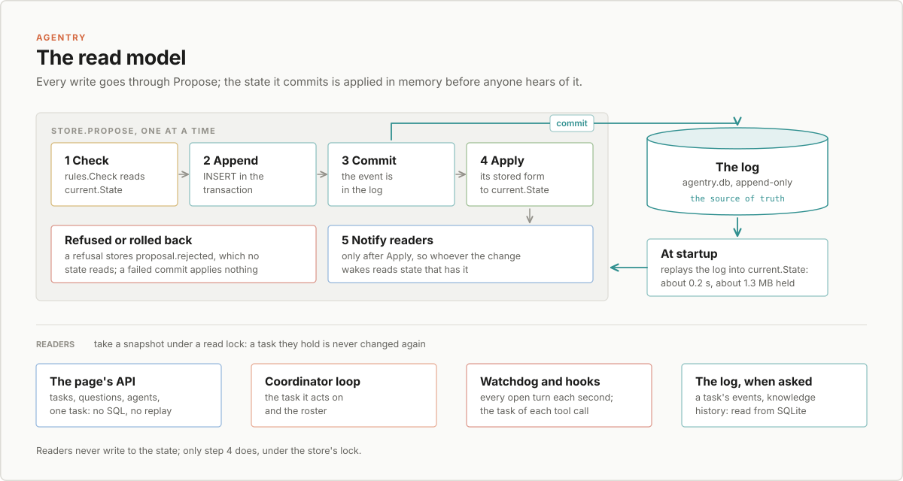

# Read model: stop replaying the log on every read

Status: proposed, for task-21 ("Make the task list load fast on refresh").
Research only: nothing in the server changes with this document.

## In short

Agentry keeps one source of truth, an append-only event log in SQLite
(`internal/store`). Everything else, such as a task's status, its turns or
the agents' roster, is computed by replaying events (`tasks.FromEvents`,
`agents.FromEvents`). Today that replay happens on every read: every API
request, every proposal's rules check, every coordinator step, the watchdog
every second, and every hook call. Each one reads whole streams from
SQLite, decodes their JSON and replays them, and the cost grows with
history.

The recommendation is an in-memory read model: one `current.State` holding
every stream's state, built once at startup from the log and kept up to
date by the store itself, which applies each event right after it commits.
The store keeps the position it has applied up to, and its reads of the log
never go past it, so no reader sees an event before the state has it. The
log stays the only thing stored;
the state is rebuilt from it at every start, so it can't drift. Rules
checks read the same state, under the store's write lock, so a check sees
exactly the state the next event is appended to. The page then stops
fetching everything twice and refetching what it already has.

On a copy of the real database, `/api/tasks` takes 147 ms on an idle
machine and about 0.5 s while agents work, and `rules.Check` takes 106 ms
on every proposal. With the read model the reads become map lookups.
Targets: `/api/tasks` and `/api/questions` under 10 ms, `rules.Check`
under 1 ms, startup under 1 s.



## 1. Measurements

### The data

A copy of the live database, made read-only with `VACUUM INTO` (it is not
in git: it holds the user's data). Only counts and sizes are quoted here.

| | |
|---|---|
| Events | 18,967, of which 27 are `proposal.rejected` |
| Streams | 26: 22 tasks, `agents`, `workers`, `connections`, `policy` |
| Database | 20 MB (5,041 pages of 4 KB); 16.8 MB of it is event `data` |
| Biggest task stream | 7,726 events, 4.0 MB |
| Busiest 10 minutes | 991 events, about 1.65 a second |

Bytes by stream kind:

| Streams | Events | Data |
|---|---|---|
| `agents` | 442 | 8.97 MB |
| 22 task streams | 17,977 | 7.75 MB |
| `workers` | 537 | 42 KB |
| `connections`, `policy` | 11 | 1.4 KB |

Bytes by event type (the top seven are 98% of all data):

| Type | Events | Data | Biggest | What makes it big |
|---|---|---|---|---|
| `agent.learned` | 372 | 8.87 MB | 53 KB | the agent's whole knowledge file, each time it changes |
| `action.requested` | 4,893 | 3.10 MB | 32 KB | the command text of every tool call |
| `turn.ended` | 435 | 1.69 MB | 8.6 KB | the agent's final report |
| `plan.updated` | 784 | 1.63 MB | 14 KB | the whole plan, each time a box is ticked |
| `task.assigned` | 204 | 0.76 MB | 6.3 KB | the instructions handed to the agent |
| `action.approved` | 4,885 | 0.33 MB | 68 B | |
| `agent.changed` | 44 | 0.07 MB | 2.4 KB | the agent's prompt |

There is no terminal output in events, and no activity text beyond the
commands. The bytes are whole texts copied into each event that changes
them. Half of all data is knowledge files, and every rules check reads them
(below).

### The schema and how streams are read

One table, `events (position INTEGER PRIMARY KEY, at, stream, actor_kind,
actor_id, type, correlation, data TEXT)`, with one index,
`events_by_stream (stream, position)`, and triggers that refuse `UPDATE`
and `DELETE`.

- `Store.Stream(name)` reads one stream through the index, leaves out
  rejections, and decodes each row's JSON into `map[string]any`. It does
  not read the whole log and filter.
- `Store.TaskIDs()` finds `task.created` events with no index on `type`:
  a full table scan, on every list request and every watchdog tick.
- The store opens SQLite with `SetMaxOpenConns(1)`. That makes proposals
  strictly sequential, which the rules check relies on, but it also puts
  every read in the same single queue as every write. A slow read delays
  every proposal, and the reverse.
- Row scanning and JSON decoding happen while the connection is held; the
  replay runs after it is released.

### The reads, timed

On a copy of the copy, on an idle 32-core Linux machine, median of 5 runs:

| Request | Time | Response |
|---|---|---|
| `GET /api/tasks` | 147 ms | 13 KB |
| `GET /api/questions` | 150 ms | 3 B (nothing waiting) |
| `GET /api/agents` | 33 ms | 180 KB |
| `GET /api/tasks/task-8` (the biggest) | 155 ms | 8.5 MB |

Where `/api/tasks` goes (all 22 task streams):

| Step | Time | |
|---|---|---|
| SQLite scan, no decoding | 44 ms | 17,959 rows, 7.75 MB of data |
| JSON decoding (`Store.Stream` less the scan) | 55 ms | |
| `tasks.FromEvents` | 51 ms | 39 ms of it for task-8 alone |
| Summaries to JSON | under 0.1 ms | 13 KB |

So it is a third I/O, a third decoding and a third replay; the response
itself is free. `/api/questions` does the same work and then drops the done
tasks. Replaying task-8 is slow because `Task.Turn(id)` and
`Task.Action(id)` scan their slices on every event, which makes a replay
quadratic in the number of actions.

The agents stream: 9.5 ms to scan its 9 MB, 29 ms with decoding, and the
replay itself under 0.1 ms. It is all knowledge files.

**`rules.Check`, inside every `Propose`, takes 106 ms** for a proposal on
task-8: it reads and replays the agents stream (29 ms), then the task's
stream (38 ms) and replays it (39 ms), all while holding the only
connection. Every tool call is three proposals (`action.requested`,
`action.approved`, `action.result`).

What an in-memory model would cost at startup: reading the whole log with
`Store.After` takes 109 ms, replaying every stream 51 ms, and keeping every
task and the roster in memory holds 1.3 MB of heap.

### Under load, and the 2.8 s on the live server

The user saw `/api/tasks` and `/api/questions` take about 2.8 s each on the
live server. The benchmark could not time the live server (reading its UI
token is off limits to agents), and on an idle copy a single request takes
0.15 s, so the gap is load. Two things multiply the work:

- **The page refetches everything on every event.** `useResource`
  refetches its path whenever the log's position changes. The tasks page
  shows `AdminShell` (tasks, questions, agents, config) and `TasksPage`
  (tasks and agents again), so each event costs two `/api/tasks`, one
  `/api/questions` and two `/api/agents`, per open tab. A refetch aborts the
  one in flight in the browser, but the server finishes the aborted request
  anyway: the store's reads don't take a context.
- **A refresh loads the page twice.** The long poll starts at position 0,
  `/api/changes?after=0` answers at once, the position jumps from 0 to the
  newest, and every resource fetches again, aborting the first round, whose
  work the server still does.

Meanwhile the server does its own replays (section 2): the watchdog
replays every task every second, the coordinator loop loads the task and
the roster for every batch, and each tool call's hook reads the task and
the roster on top of its three proposals.

The benchmark replays the busiest 10 minutes' rate, an event every 600 ms,
each one refetching one tab's tasks page:

| | `/api/tasks` median | slowest |
|---|---|---|
| Page refetches and proposals only | 373 ms | 387 ms |
| Plus the loop, hook and watchdog reads | 522 ms | 744 ms |

Counting only the time the single connection is held, that second line is
about 0.6 s of work every 0.6 s: the queue is at capacity on an idle
machine with one tab, no hooks gating and no refresh. A second tab, a
refresh, or the CPU the agents' own builds use, pushes the work past what
one connection can do per second, and then waits grow until the load
drops. That fits seconds-long requests; it is a model, not a measurement of
the live server.

### Rerun the benchmark

```sh
# a read-only copy of the live database (never write to the live one)
mkdir -p .agentry/files/bench
sqlite3 'file:'"$HOME"'/.agentry/agentry.db?mode=ro' \
  "VACUUM INTO '$PWD/.agentry/files/bench/agentry.db'"

AGENTRY_BENCH_DB=$PWD/.agentry/files/bench/agentry.db \
  go test ./internal/web -run TestReadModelBench -v -count=1
```

The benchmark is `internal/web/readmodel_bench_test.go`; it is skipped
unless `AGENTRY_BENCH_DB` is set, and copies the file again so the run
never writes to it. It takes about 30 s, 20 of them the load scenario.

## 2. Every place that replays

Found with `grep -rn 'FromEvents(\|\.Stream(\|TaskIDs()'`. "Every event"
means once per event, per open tab for the page.

| Where | Reads and replays | Needs | Freshness | How often |
|---|---|---|---|---|
| `web.listTasks` (`GET /api/tasks`) | `TaskIDs`, every task stream | every task's summary | as of the last event | every event, twice per tab |
| `web.listQuestions` (`GET /api/questions`) | every task stream | open questions of unfinished tasks | last event | every event, per tab |
| `web.showTask` (`GET /api/tasks/{id}`) | the task, its `Log`, each task it waits for, its epic, each story | the detail, plus every event of the task | last event | every event while open; the MCP `show_task` tool too |
| `web.roster` (`GET /api/agents`, creating a task) | the agents stream | the roster | last event | every event, twice per tab |
| `web` handlers that change a task (answer, approve, rank, repo, ...) | the task | the task, to decide what to propose | last event; the proposal is checked again | per click |
| `web.needing`, `renameAgent`, `tasksByMachine` | every task stream | which tasks name an agent or a machine | last event | per removal or rename; the workers page |
| `web.knowledgeHistory`, `showWorker`, `listConnections` | the agents, workers or connections stream | history of events, or the connections roster | last event | when opened |
| `web.waitForChanges` (`GET /api/changes`) | a `Reader` and `LastPosition` | the newest position | live | the page's long poll: no replay |
| `rules.Check`, inside `Store.Propose` | agents stream always; workers or connections for their rules; the task's stream | the roster and the task, exactly as of the event before | inside the write | every proposal |
| `coordinator.Loop.act` via `load` | the task and the agents stream | the task, the roster | last event | each task touched by each batch |
| `coordinator.Loop.portsInUse` | every task, with the agents stream each time | ports in use on a machine | last event | each worktree prepared |
| `coordinator.Loop.machines` | the workers stream | the workers roster | last event | each decision naming a machine |
| `coordinator.Loop.newTask`, `web.createTask` | `TaskIDs` | the number of tasks, for the next id | inside the write (a clash is refused and retried) | each task made |
| `watchdog.Check` | `TaskIDs`, every task stream | tasks with an open turn | within a second | every second |
| `turns.Runner.MachineOf` | the task | where its worktree is | last event | per stop, liveness check (the watchdog, per open turn) and terminal attach |
| `hooks.Handler` | the task (`machineOf`, `gate`, `recordPlan`); the agents stream (`profileOf`, `recordWhatWasLearned`) | worktree, turn, agent profile and knowledge | last event | every hook call: each tool call and turn event |
| `hooks.DenyOrphanedAsks` | every task stream | actions waiting on you | at startup | once |
| `workerlink.ForgetConnections`, `serve.seedAgents`, `policy` setup | workers, agents, policy streams | the roster | at startup | once |
| `serve` helper terminal | the task | its worktree | last event | per helper opened |

Every reader except the rules check wants "the state as of the newest
event", and none needs a state older than that. The rules check needs the
state as of the event before the one it checks, with no event slipping in
between. Readers of the log itself (`Log`, `knowledgeHistory`, the
workers' history, `/api/changes`, the coordinator's `Reader`) want events,
not state, and keep reading SQLite, but only up to the position the state
has applied (section 4, the store): the coordinator acts on the state as
soon as its reader returns an event, so it must never read an event the
state doesn't have yet.

## 3. Options compared

| | (a) In-memory state, applied on commit | (b) Persisted snapshots | (c) Read-model table in SQLite | (d) Cheap fixes alone |
|---|---|---|---|---|
| What it is | every stream's state in memory, built at startup, each committed event applied by the store | state saved at position N per stream, replay only newer events | a table of state per stream, written in the append's transaction | an index, lazy or split payloads, trimmed responses |
| Read cost | a map lookup | a snapshot decode plus a short replay | a row read plus JSON decode | still a replay per read |
| Startup | about 0.2 s now, grows with the log (about 1 s per 100k events) | fast | none | none |
| Memory | 1.3 MB now | small | none | none |
| Correct with rules | yes: applied under the store's write lock | needs a cache on top, or every check decodes snapshots | yes, in the same transaction | unchanged |
| When `apply` changes | nothing to do: the next start replays | every snapshot is stale and must be versioned and rebuilt | a migration rebuilds the table | nothing |
| Source of truth | the log; state is never stored | the log, plus snapshots that can disagree with it | the log, plus a table that can disagree with it | the log |
| New code | one small package, `Clone` for tasks, a store hook | serialising `Task` (it has unexported fields), versioning, invalidation | the same apply code, writing a whole task's JSON (up to about 1 MB for task-8) on each of its events | small |

**(b)** solves startup, which is not a problem: replaying the whole log
takes 0.2 s. It adds a stored copy of derived state that must be versioned
every time `tasks.apply` changes, which happens in most feature work. It
contradicts the `tasks` package's own promise: "The state is never stored,
so it can never disagree with what happened."

**(c)** is correct but writes the whole derived state on every event: for
task-8 that is about a megabyte of JSON written on each of its tool calls'
three events. Reads still decode JSON. It also stores derived state, with a
schema to migrate.

**(d)** on its own can't fix it. An index on `type` only speeds up
`TaskIDs`. Splitting payloads (knowledge as a diff, plans as patches) would
halve the bytes but changes the event format, and the replay and the
quadratic lookups remain. Trimming the task detail's 8.5 MB events list is
worth doing for the task page, but the list's 13 KB response is already
small. The cost is in building state, not in sending it.

**(a)** turns every replay site into a lookup with one mechanism, keeps
the log the only thing stored, and its consistency with `Propose` comes
from the lock the store already needs. Its costs are startup (small, and
it grows only with history) and keeping a `Clone` correct, which a
reflection test checks mechanically.

### Recommendation

(a), plus two pieces of (d) and the page fixes:

1. The in-memory state `current.State`, fed by the store on commit, used
   by every reader in section 2 and by the rules check.
2. The page: fetch once per path, never refetch what it already has, don't
   abort in flight. The list never waits on slower calls.
3. A second read connection pool, so reads of the log itself (`Log`,
   `After`) no longer queue behind writes.
4. Later, separately: the task detail's events list loaded on demand
   instead of 8.5 MB with every detail.

Snapshots, a state table and payload splitting are not needed. If startup
ever passes a few seconds (several hundred thousand events), snapshots can
be added then, under the same `current.State` API.

## 4. The design

### Package `internal/current`

A new package, between the store and its readers. It imports `events`,
`tasks`, `agents`, `workers` and `connections`; the store does not import
it.

```go
// Package current keeps the state of every stream in memory, as of the
// last event the log committed. The log stays the only thing stored: the
// state is built from it at every start and changed only by the store,
// as each event commits, so it can't disagree with what happened.
package current

// State is every stream's state. A *tasks.Task or a roster it hands out is
// never changed afterwards: applying an event replaces it with a new one,
// so readers may keep what they got as long as they like, without a lock.
type State struct {
	mu          sync.RWMutex
	position    int64                  // of the last event applied, rejections included
	tasks       map[string]*tasks.Task // by stream
	taskIDs     []string               // oldest first, as Store.TaskIDs
	broken      map[string]error       // streams whose apply panicked: reads fail, as a replay would
	roster      agents.Roster
	workers     workers.Roster
	connections connections.Roster
}

func New() *State

// Load, Loaded and Apply are for the store only (store.Model).
func (s *State) Load(stream string, accepted []events.Event) // at Open, once per stream, built in place
func (s *State) Loaded(position int64)                       // at Open, once every stream is in
func (s *State) Apply(e events.Event)                        // after each commit

func (s *State) Position() int64
func (s *State) Task(id string) (*tasks.Task, error) // nil, nil when there is no such task
func (s *State) Tasks() []*tasks.Task               // oldest first
func (s *State) Roster() agents.Roster
func (s *State) Workers() workers.Roster
func (s *State) Connections() connections.Roster
```

`Apply` always records `e.Position`, and changes state only for accepted
events: a `proposal.rejected` is skipped, as `Store.Stream` skips it today.
A task stream's event becomes `s.tasks[id] = tasks.Next(old, e)`; the
agents, workers and connections streams become `s.roster =
s.roster.Next(e)` and so on. A `task.created` appends to `taskIDs`. If an
apply panics, the stream's error goes into `broken` and that stream's reads
return it (today the same panic would fail each request that replays it);
other streams carry on.

### Changes in the domain packages

- `tasks`: `func (t *Task) Clone() *Task`, a deep copy (every field the
  next bullet lists), and
  `func Next(t *Task, e events.Event) *Task`, which clones and applies:
  copy on write. `FromEvents` stays as it is, applying in place, and stays
  the reference the tests compare with. Optional, for startup only: index
  `Turn(id)` and `Action(id)` with maps, which takes replay of task-8 from
  39 ms to linear time.
- `agents`, `workers`, `connections`: move each `FromEvents` loop body into
  an unexported in-place `apply(r *Roster, e events.Event)`, the one apply
  body per package, and add `func (r Roster) Next(e events.Event) Roster`,
  which copies before it writes. Those bodies change the roster in place
  today: agents does `roster[i] = ...`, `roster[i].Name = ...`,
  `roster[i].Knowledge = ...` and `slices.Delete`; workers writes through
  `find`'s pointer into `r.Workers` and sets `r.invites[i].used`;
  connections sets `r.invites[i].used`; both use `slices.DeleteFunc`, which
  shifts and zeroes the shared array. `append` may write into spare
  capacity a reader's slice header shares. So `Next` first takes copies:

  ```go
  func (r Roster) Next(e events.Event) Roster {
  	r = slices.Clone(r)          // agents: Roster is the slice
  	apply(&r, e)
  	return r
  }
  // workers and connections: r.Workers (or r.Connections) and r.invites
  // are both cloned before apply.
  ```

  A shallow clone is enough: no apply body writes inside an element's own
  slices (`Agent.Workers`, `Worker.Engines`, `Worker.Missing` are replaced
  whole, never appended to). `FromEvents` keeps calling `apply` in place,
  for startup.
- `tasks.Clone` must copy everything `apply` may write through, which,
  checked field by field, is: the slices `Labels`, `After`, `Stories`,
  `StoriesDone`, `Trail` and `Asked.Options`; the maps `Files` and
  `collected`; the pointers `Worktree`, `Fetching`, `Handoff` and
  `Asked.Fetch`; and `Turns` and `Actions` element by element, since
  `apply` changes a `*Turn` or `*Action` found by `Turn(id)` or `Action(id)`
  in place. `Turn`, `Action`, `Step`, `SharedFile`, `Fetch` and `Worktree`
  hold only values (strings, numbers, `time.Time`), so a struct copy of
  each is deep. Copying the slices also covers `append` into spare
  capacity.

Cloning task-8 copies about 3,000 small structs, a fraction of a
millisecond, once per event on that task. At startup, `Load` builds each
stream with `FromEvents`, in place, so there is no clone per event and no
quadratic cost.

### The store

```go
// A Model is state kept from the log. The store fills it at Open and
// applies each event after it commits, before any reader of the log can
// read that event.
type Model interface {
	Load(stream string, accepted []events.Event) // at Open, once per stream
	Loaded(position int64)                      // at Open, the log's last position, rejections included
	Apply(e events.Event)                       // after each commit
}

// OrderCheck no longer gets a History: it reads the model it was made with.
type OrderCheck func(p events.Proposal) *events.Rejection

func Open(path string, model Model, check OrderCheck) (*Store, error)
```

- `Open` calls `model.Load` once per stream with that stream's accepted
  events, in order of each stream's first accepted event (`SELECT stream
  FROM events WHERE type != 'proposal.rejected' GROUP BY stream ORDER BY
  MIN(position)`), so tasks come in creation order, as `TaskIDs` returns
  them, then `model.Loaded(last)`, where `last` is `MAX(position)` read in
  the same pass, and sets `applied` (below) to `last`. Readers are created
  only after `Open` returns, so none can see the log before that.
- `Propose` holds a new `sync.Mutex` from the check to the apply:

  ```go
  s.mu.Lock()
  defer s.mu.Unlock()
  rejection := s.validate(p)          // shape, writer, then check(p): reads the model
  tx := begin; event := appendEvent(tx, stored); commit
  s.model.Apply(event)                // only after Commit returned nil
  s.applied.Store(event.Position)     // only after Apply: reads may now see it
  s.changes.notify()                  // only after applied moved
  ```

  The mutex, not `SetMaxOpenConns(1)`, now makes proposals one at a time,
  and it covers the apply, so the next proposal's check can never run
  before the previous event is in the model. A refusal stores
  `proposal.rejected`, which `Apply` skips. A failed commit returns before
  `Apply`, so the model never shows an event that was rolled back.
- **The applied position.** Calling `notify` after `Apply` is not enough on
  its own. `Reader.Next` queries SQLite whenever it is called, not only
  when woken: the coordinator finishes event N-1, calls `Next` again, and
  could read event N in the moment between N's commit and its `Apply`. It
  would then act on a state without N, and when N's notify came, `After(N)`
  would return nothing, so it would never act on N with the right state (a
  `turn.ended` seen while the turn is still open leaves the task stalled).
  `/api/changes` has the same gap through `LastPosition`. So the store
  keeps `applied atomic.Int64`, the last position whose event is in the
  model, rejections included, set only under `Store.mu` and only after
  `Apply`, and every read of the log stops there:

  ```go
  func (s *Store) After(position int64, limit int) ([]events.Event, error) {
  	return queryEvents(s.db, `SELECT `+columns+` FROM events
  		WHERE position > ? AND position <= ? ORDER BY position LIMIT ?`,
  		position, s.applied.Load(), limit)
  }

  func (s *Store) LastPosition() int64 { return s.applied.Load() }
  ```

  `Reader.Next` reads through `After`, so it inherits the gate; `Stream`
  and `Log` add the same `position <= applied`, so a task's events never
  run ahead of its state. A row at or below `applied` is committed (commit
  returned before `applied` moved), so every read connection sees it.
  Reading state after the gate may show *more* than the events read (a
  later event applied meanwhile); that is fine, because that later event's
  notify wakes the reader again. At startup `applied` is the log's last
  position, set in `Open` after `Loaded`. With a nil model (tests and tools
  that only read or write the log) the store sets `applied` right after
  the commit, so the gate then means "committed" and nothing else changes.
- **The stored form.** `appendEvent` returns the event as a reader would
  read it back, not as proposed: `Data` decoded from the JSON it wrote and
  `At` parsed from the text it wrote. Proposals carry Go values (`[]string{}`,
  `int`, `int64`) that replay sees as `[]any{}` and `float64`, and the
  accessors don't treat every pair alike (an empty `[]string{}` gives an
  empty list, an empty `[]any{}` gives nil; an `int64` reads as 0). `At`
  from `time.Now()` also carries a monotonic reading that the text drops.
  Applying the stored form makes the model equal to a replay by
  construction, and costs a few microseconds.
- `History`, `txHistory` and the check's reads inside the transaction go.
  `Stream`, `Log`, `After`, `LastPosition` and the `Reader` stay, for the
  readers of events, all gated on `applied`. `LastPosition` no longer
  queries SQLite and can't fail. `TaskIDs` goes once nothing uses it.
- Reads of the log get their own `*sql.DB` (read-only, a few connections;
  WAL allows readers beside the writer), so `Log` and `After` don't queue
  behind writes. Writes keep one connection.

### The rules

`rules.Check(p events.Proposal, state State) *events.Rejection`, with

```go
// State is what the rules read: the state the proposal would be appended to.
type State interface {
	Task(id string) (*tasks.Task, error)
	Roster() agents.Roster
	Workers() workers.Roster
	Connections() connections.Roster
}
```

`*current.State` satisfies it. `serve.go` wires them:

```go
state := current.New()
log, err := store.Open(path, state, func(p events.Proposal) *events.Rejection { return rules.Check(p, state) })
```

The check runs inside `Propose`, under the store's mutex, so nothing can
change the state while it reads. It takes the state's read lock only for
the moment of each lookup, and `Apply`, which takes the write lock, runs
later in the same goroutine: no deadlock. The rules' own logic does not
change.

### The readers

Each site in section 2 swaps `Stream` plus `FromEvents` for a lookup:

| Where | Becomes |
|---|---|
| `web.Server.task`, `roster`, `listTasks`, `listQuestions`, `needing`, `tasksByMachine`, `listConnections`, the workers list | `s.current.Task(id)`, `Tasks()`, `Roster()`, `Workers()`, `Connections()` |
| `coordinator.Loop.load`, `portsInUse`, `machines`, `newTask` | the same; `newTask` counts `len(Tasks())` |
| `watchdog.Watchdog.Check` | `Tasks()` |
| `turns.Runner.MachineOf`, `hooks.Handler`, `DenyOrphanedAsks`, `ForgetConnections`, `seedAgents`, the helper terminal | the same |

They get a `*current.State` where they get the `*store.Store` today. A
handler that both reads the state and then proposes keeps working as now:
the proposal is checked again against the newest state, under the lock.

### Locking, in one place

- `Store.mu`: one proposal at a time, from check to apply, and the only
  place `applied` is written. Readers of the log load `applied` without a
  lock (it is atomic).
- `State.mu` (`RWMutex`): `Apply` and `Load` take the write lock; every
  getter takes the read lock just long enough to read a pointer or a slice
  header.
- What a getter returns is never changed afterwards (copy on write), so
  readers hold no lock while they use it, however long: the coordinator
  can keep a task across a git command.
- `Tasks()` returns a new slice of pointers, so a caller may sort it.

### Freshness and the page's position

A reader sees every event applied before it asked, and nothing that
wasn't applied: the state and the log reads agree, because both stop at
`applied`. To let the page skip refetches, each `GET` reply carries
the position its state was read at, in an `X-Agentry-Position` header,
taken before the handler reads. If an event lands between the two, the
reply is newer than its header says, which only costs one extra refetch.
The header is the store's applied position (`LastPosition`, which
`/api/changes` reports too), not `State.Position()`: while an event is
being applied the state is one ahead of the log's reads, so a reply that
also reads the log (ideas, a task's events) would otherwise claim a
position its log read didn't see.

### The page

Today (section 1) each event refetches five requests per tab, and a
refresh does it twice. Changes, in `ui/src/live`:

1. **One fetch per path.** A small cache in `LiveProvider` keyed by path:
   `AdminShell` and `TasksPage` share one `/api/tasks` and one
   `/api/agents`.
2. **Refetch only what is older than the log.** Each cached path keeps the
   `X-Agentry-Position` it was read at, and refetches only when the live
   position is greater. The refresh's jump from 0 to the newest position
   no longer refetches anything.
3. **Don't abort, coalesce.** While a path is being fetched, a new
   position marks it stale instead of aborting; when the fetch returns, it
   fetches once more if it is stale. The server never does work the page
   throws away.
4. **The list never waits.** `TasksPage` already renders from
   `/api/tasks` alone (agents only colour it); keep it that way, and keep
   questions and agents as their own resources that fill in when they come.
5. Later, separately: the task detail without its events; the Events tab
   fetches `/api/tasks/{id}/events` when opened, newest first, a page at a
   time. That takes task-8's detail from 8.5 MB to the size of its turns,
   trail and actions, and helps the MCP `show_task` tool too.

### How the tests prove the state equals a replay

`FromEvents` stays the definition of state; every test compares against
it.

1. **Equality helper.** `current.Equal(s *store.Store, state *State) error`
   compares, for every stream, `state.Task(id)` with
   `tasks.FromEvents(store.Stream(id))` using `reflect.DeepEqual` (which
   includes unexported fields), the rosters likewise, the task order with
   `TaskIDs`, and the position with `LastPosition`. It returns the first
   difference, named by stream and field.
2. **Every existing scenario.** The test helpers that open a store
   (`newTestServer` in `web`, `openSeeded` in `rules`, the coordinator's,
   hooks' and watchdog's) open it with a `current.State` and call `Equal`
   in `t.Cleanup`. Every test in the suite then also proves the state it
   ends with equals a replay, including refusals.
3. **Every prefix of the real log.** An opt-in test (the same
   `AGENTRY_BENCH_DB`) loads the copy into a state through `Apply`, the
   live path with `Next` and `Clone`, event by event, and every 50 events
   and at the end compares with `FromEvents` over the same prefix.
4. **Random sequences.** A seeded generator proposes 2,000 steps through
   `Propose` from a small alphabet (create a task, assign, start and end a
   turn, request, approve, deny and finish actions, ask and answer, learn,
   change, rename and remove an agent, workers joining and leaving), with
   random actors and correlations, so most are refused. After each step,
   `Equal`. Refusals must never reach the state.
5. **Clone shares nothing.** A reflection test walks a `Clone` of a fully
   populated task and fails if any pointer, map or slice backing array is
   shared with the original. A field added to `Task` and forgotten in
   `Clone` fails it without anyone remembering to update the test. A second
   test checks `Next(t, e)` leaves `t` deep-equal to a copy taken before.
   The same for the rosters: for every event type of `agents`, `workers`
   and `connections` (create, change, rename, learn, remove; invite, join,
   connect, disconnect, remove; invite, make, revoke), build a roster with
   spare capacity (so an `append` could write in place), take a deep copy,
   call `Next`, and require the original still deep-equal to the copy,
   unexported `invites` included. Sabotage check: dropping the
   `slices.Clone` fails it.
6. **The stored form.** Proposals with `[]string{}`, `int64` and nested
   values give the same state live as after a restart.
7. **Races.** Readers calling every getter while proposals run, under
   `go test -race`.
8. **No event before its state.** In `store`, a fake `Model` whose
   `Apply` signals that it has started and then blocks on a channel.
   Propose event N in a goroutine; once `Apply` has started (N is
   committed), require that `After(N-1, ...)` returns nothing, that
   `LastPosition()` is N-1, and that a `Reader` at N-1 does not return
   within 100 ms. Release `Apply`; the reader must then return N, and
   `LastPosition()` be N. Sabotage check: moving `applied.Store` before
   `Apply` fails it. A second case opens a store on an existing log and
   checks `LastPosition()` equals the last event's position before any
   proposal, and a third does the same with a nil model.
9. **The page.** A refresh makes one request per path, an event refetches
   each shown path once, and N events during one read give one more read.
   Built as a vitest test of the cache (`ui/src/live/resource-cache.test.ts`,
   `npm test`) with a fake server and a fake live position; the browser
   numbers were measured once with Playwright, not as a committed test.

### Startup and migration

Nothing on disk changes: no new table, no new file. `Open` fills the state
from the log every start (0.2 s now). An older Agentry opening the same
database sees no difference. If the state is wrong, a restart rebuilds it,
and the equality tests say where.

### Target numbers

On the same copy and machine, with `TestReadModelBench` extended to time the
new path:

| | Now | Target |
|---|---|---|
| `GET /api/tasks` | 147 ms | under 10 ms |
| `GET /api/questions` | 150 ms | under 10 ms |
| `GET /api/agents` | 33 ms | under 5 ms (the 180 KB of knowledge to JSON) |
| `GET /api/tasks/task-8` | 155 ms | under 60 ms while it still sends 8.5 MB of events; under 10 ms after step 7 |
| `rules.Check` on task-8 | 106 ms | under 1 ms |
| Load scenario, `/api/tasks` median | 522 ms | under 20 ms |
| Startup: open and load the state | none | under 1 s |
| Heap held by the state | none | under 50 MB |
| Page refresh | 2 rounds of 6 requests | 4 requests (tasks, questions, agents, config) plus the long poll |

## 5. Build plan for task-21

Each step is one reviewable change, with `go test ./...`, `go vet ./...`
and, for UI steps, `cd ui && npm run lint && npm run build` passing.

1. **`Clone` and `Next` in the domain packages.** `tasks.Clone` (every
   field listed above), `tasks.Next`; in `agents`, `workers` and
   `connections` the loop body moves into one in-place `apply`, which
   `FromEvents` loops over and `Roster.Next` calls after cloning the
   slices it writes. Test 5 (clone shares nothing; `Next` leaves the task
   and every roster unchanged, per event type) and a check that
   `FromEvents` equals folding `Next` over the same events for every
   existing test log. Check: no behaviour change; all tests pass; removing
   any `slices.Clone` from a `Next` fails test 5.
2. **Package `current`.** `State` with `Load`, `Loaded`, `Apply`, the getters,
   `broken`, and `Equal`. Unit tests with hand-built event lists, including
   a rejected event and a panicking apply. Check: `go test -race
   ./internal/current`.
3. **The store feeds the model.** `store.Model`, `Open(path, model,
   check)`, `Propose` under `Store.mu` with apply-after-commit, then
   `applied` moved, then notify; `applied` set in `Open` after `Loaded`
   (and right after commit with a nil model); `After`, `Stream`, `Log` and
   `LastPosition` gated on it; the stored form from `appendEvent`,
   `OrderCheck` without `History`, `rules.Check` reading a `rules.State`,
   and `serve.go` wiring. Test helpers open stores with a `current.State`
   and run `Equal` in cleanup (test 2); tests 4, 6 and 8. Check: the whole
   suite passes with `Equal` in every cleanup; test 8 fails with
   `applied.Store` moved before `Apply`; the rules check on the copy is
   under 1 ms.
4. **Readers use the state.** Every site in section 2 swaps to the
   getters; `TaskIDs` goes once unused. Test 3 on the copy. Check:
   `TestReadModelBench` shows the targets for `/api/tasks`,
   `/api/questions`, `/api/agents` and the load scenario.
5. **Reads beside the writer.** A read-only pool for `Stream`, `Log` and
   `After`, still gated on `applied`. Check: a test that a `Log` read
   returns while a proposal holds the write connection; test 8 still
   passes on the pool; the suite passes.
6. **The page.** `X-Agentry-Position` on API replies; the shared,
   position-aware, non-aborting resource cache in `ui/src/live`. Test 9.
   Check: in the browser, a refresh of the tasks list makes one request per
   path, and each event one refetch per path shown.
7. **Optional, may be its own task: the task detail's events on demand.**
   `GET /api/tasks/{id}/events?before=&limit=`; the detail drops `events`;
   the Events tab and the MCP `show_task` tool adapt. Check: task-8's
   detail under 1 MB and 10 ms.

Steps 1 to 4 fix the reported slowness and the per-proposal cost; 5 and 6
remove the queueing and the wasted refetches; 7 is the task page.

## Risks and open points

- **`Clone` drift.** A new pointer field in `Task` that `Clone` forgets
  would let a reader see a later change. Test 5 catches it mechanically.
- **A read past `applied`.** Any new query on `events` that skips the
  gate lets a reader see an event before its state. Keep every log read in
  `store/read.go` going through the one `applied` bound; test 8 covers
  `After`, `LastPosition` and the `Reader`.
- **Startup grows with the log**, about 1 s per 100k events at today's
  sizes. Snapshots, under the same API, are the answer if that ever
  matters.
- **Memory grows with tasks**, about 60 KB per task today, including
  every action's command text. Fine for thousands of tasks.
- **Apply under the store's lock** adds a clone of the task to each
  proposal, a fraction of a millisecond against today's 106 ms check.
- **The live server was not timed** (its UI token is off limits to
  agents). The 2.8 s is explained above by load, not reproduced; after
  step 4, timing the live server once with the user would confirm it.
