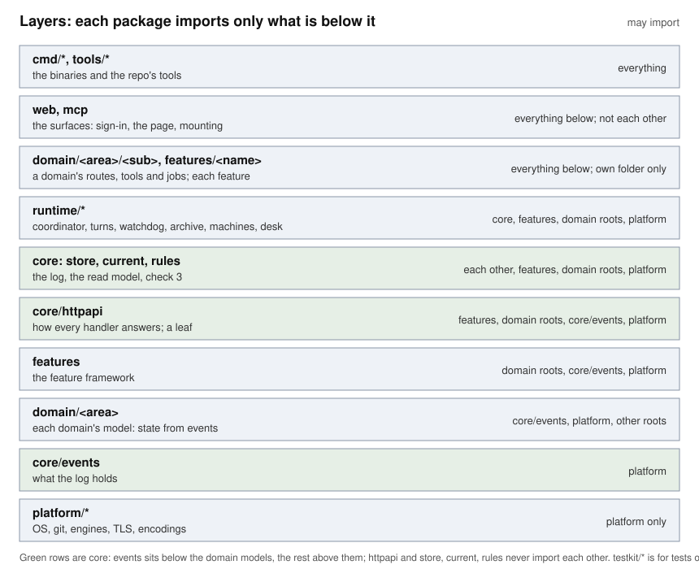

# Repo organization: the target layout

Status: proposed, for task-250. Design only: no code, package, route or
build file changes with this document. The moves it plans are later work.

## In short

`internal/` becomes eight folders in place of 46 packages side by side:
`platform`, `core`, `domain`, `features`, `runtime`, `web`, `mcp` and
`testkit`. Each folder sits on one layer, and a package imports only from
the layers below it. A test checks that on every `go test ./...`.

The user's proposal is mostly kept. It departs from the proposal in five
places, all because of what the import graph really is:

1. **A domain is a folder, not one package.** `current`, `rules` and `store`
   import `tasks`, `agents`, `workers`, `connections` and `settings`. So a
   domain package that also held its HTTP routes (which need `current` and
   `store`) would make an import cycle. The domain's model stays the folder's
   root package, low in the graph. Its routes, tools and background work go in
   subpackages of the same folder, high in the graph. One change to workers
   still touches one folder: `internal/domain/workers/`.
2. **`core` sits above the domain models, except `events`.** The proposal's
   "core knows no domain" is not true today and can't be made true by moving
   files: the read model is built from the domain models. The rule becomes
   "a domain model knows the log's words (`core/events`) and nothing else of
   core".
3. **The feature framework is the parent of the features.** The proposal had
   `core/features` and also `features/ideas`, two things called features. The
   framework stays `internal/features`, and each feature nests under it
   (`internal/features/ideas`), as `image/png` nests under `image`. The UI
   already has this shape in `ui/src/features/`.
4. **Some packages change group.** `machines` goes to `runtime`, not
   `platform`, because it imports `agents`, `workers` and `worktrees`.
   `sessions` and `terminal` go to `platform`, not `domain` or `runtime`,
   because they know no domain. Sign-in stays in `web`: it is how the web
   checks who you are.
5. **Moves and refactors are separate steps.** Moving a package is a
   script-made commit that changes only paths. Taking handlers out of `web`
   and tools out of `mcp` changes code, so each domain does that in its own
   reviewed task, after the moves.

Four questions are the user's to answer (see the end): whether to rewrite
history to drop the committed UI, whether a fresh clone may need Node to
build, what to do with `Agentry/` and `brag-output/`, and when the board is
quiet enough to run the moves.



## 1. What is there today

Measured on `fc373495` (lines are Go, without tests / tests):

- 46 folders under `internal/`, 48 packages with `sessions/sessionstest`
  and `tasks/taskstest`. The largest are `web` (6,221 / 12,009),
  `policy` (3,687), `cmd/agentry` (3,272), `coordinator` (2,842) and
  `store` (2,707).
- `internal/web` has 89 routes in `server.go` and imports 23 of Agentry's
  packages. Its files are already split by domain (`agents_api.go`,
  `workers_api.go`, `board_api.go`, ...), so the split exists, inside one
  package.
- `internal/mcp` is `agentry mcp`, a separate process that reaches the server
  only through its HTTP API (`client`). Its tools for tasks, files and
  waiting live in `mcp`; the ideas tools already live in `internal/ideas`,
  through `features.Tool`.
- `ideas` and `schedules` already work the way the proposal wants every
  domain to: one package with its events, state, rules, routes, tools and
  waiting entry, registered through `internal/features`.
- The real graph has layers. From the bottom:

| Layer | Packages today | Imports of Agentry's own |
|---|---|---|
| Know no Agentry concept | `exactgob`, `procs`, `hostaddrs`, `schema`, `engines`, `hookcall`, `sessions`, `terminal`, `worktrees`, `workspace`, `tlsca`, `pinned`, `client`, `launch` | only each other |
| What the log holds | `events` | none |
| Models: state from events | `agents`, `tasks`, `workers`, `connections`, `settings`, `policy`, `sharedfiles` | `events`, each other |
| The feature framework | `features` | the models |
| The log and the read model | `store`, `current`, `rules`, `httpapi` | the models, `features` |
| What runs | `coordinator`, `turns`, `watchdog`, `archive`, `machines`, `desk` | all of the above |
| A domain's or a feature's surface | `hooks`, `workerlink`, `workerservice`, `waitlist`, `settingsfile`, `webpush`, `ideas`, `schedules` | all of the above |
| The surfaces | `web`, `mcp` | everything |

  Today exactly one line of Go code breaks these layers:
  `coordinator/followups.go` calls `ideas.Visionaries`, a runtime package
  naming a feature. `docs/design/extensions.md` already plans to replace it
  with a `features.Coordinator` hook. (Tests import upward freely, as Go's
  external test packages may.)
- `tasks`, `current` and `coordinator` are tightly bound, but as a chain, not
  a cycle: `coordinator` imports `current`, `current` imports `tasks`. Each
  sits on its own layer, so they can live in different folders.
- `spec/functional/*.feature` names 16 areas, and each file already has a
  `# Sources:` comment naming its packages. Nothing checks those lines.
- `spec/constraints.md` section 1 lists every package by concern and is
  checked against `ls internal`. `internal/features/imports_test.go` and
  `internal/httpapi/imports_test.go` check that those two stay leaves.
- About 1,600 paths in `spec/` (`@test` citations and `# Sources:` lines) name code, `internal/web`
  (247), `internal/policy` (169) and `cmd/agentry` (165) most. Every move
  must rewrite them, or `spec/check` fails.
- At the root: `bin/` and `release/` are build output and already
  git-ignored. `Agentry/` (an unpacked release, 138 MB) and `brag-output/`
  (launch videos, 15 MB) are untracked leftovers in the main checkout.
  `internal/web/dist` is committed: 95 files, changed in 107 of 1,488
  commits, and 53 MB of the history's 65 MB of blobs (81%).

## 2. The target tree

```
cmd/
  agentry/            the one binary: flags, wiring, and each subcommand's own steps
  agentry-desktop/    the desktop app (its own go.mod, Wails)
internal/
  platform/           the outside world: OS, git, engines, TLS, encodings; no Agentry concept
  core/               what the log holds (events), the log (store), the read model (current),
                      check 3 (rules), and how every handler answers (httpapi)
  domain/             one folder per spec area; its root package is the model,
                      its subpackages are its routes, tools and background work
  features/           the feature framework (the package), and each feature (a subfolder)
  runtime/            what runs: the coordinator loop, turns, the watchdog, machines, the desk
  web/                agentry serve's HTTP side: sign-in, the page, mounting every route
  mcp/                agentry mcp: the protocol, notices, mounting every tool
  testkit/            what tests share across packages; never imported by code
tools/                programs that build or check the repo, never shipped
ui/src/
  components/         shared atoms, molecules, organisms, templates: no domain
  shell/              the frame every page sits in: sidebar, top bar, Ctrl K, toasts
  domains/<area>/     each domain's pages, panels, hooks and types
  features/<name>/    each feature's UI, listed by features/index.ts
  api/ live/ lib/     the HTTP client, the live event stream, helpers with no domain
spec/  docs/  deploy/  packaging files go to tools/; the rest of the root is as today
```

Inside `internal/`, in full:

```
platform/   client  engines  exactgob  hookcall  hostaddrs  launch  pinned  procs
            schema  sessions (+sessionstest)  terminal  tlsca  workspace  worktrees
core/       events  store  current  rules  httpapi
domain/
  agents/          the model (agents, teams, templates); later agentsapi/
  tasks/           the model (+taskstest); waitlist/; later tasksapi/
  workers/         the model; workerlink/  workerservice/; later workersapi/
  connections/     the model; later connectionsapi/
  policy/          the model (deciding one call); hooks/; later egress/ (proposal)
  settings/        the model; settingsfile/
  sharedfiles/     the model (Disk, Hub)
  notifications/   webpush/
features/   (the framework)  ideas/  schedules/; later githost/  email/ (proposals)
runtime/    coordinator  turns  watchdog  archive  machines  desk
web/        (one package; later only sign-in, the page, mounting)
mcp/        (one package; later only the protocol, notices, mounting)
testkit/    storetest  deeptest
```

Depth is at most four below the module: `internal/domain/workers/workerlink`.
Package names don't change, so `workers.Roster` and `workerlink.Server` read
as today; only import paths do.

### Where routes and tools go

A domain's HTTP routes and MCP tools go in one subpackage named after it:
`domain/tasks/tasksapi`, `domain/workers/workersapi`. It returns the same
types a feature does, `[]features.Route` and `[]features.Tool`, so `web` and
`mcp` mount a domain the way they mount a feature: one way, not two. A
domain's api package takes the dependencies it needs (the store, the fleet,
the loop) in its own struct; a feature gets only `features.Core`, because a
feature never holds the store.

What stays in `web` after that: sign-in and tokens (`signin.go`), the
embedded page and install scripts (`page.go`, `scripts.go`), addresses,
and the few routes that span every domain: `/api/events`, `/api/waiting`,
`/api/config`, `/api/features`. What stays in `mcp`: the protocol, the
server instructions, notices and the waiting list it words.

## 3. The dependency rules

From the bottom up. A package may import its own layer's packages where the
table says so, and anything in a lower layer.

| Layer | Folder | May import | Never |
|---|---|---|---|
| 1 | `platform/*` | other `platform` packages | anything else of Agentry's |
| 2 | `core/events` | `platform` | anything else of Agentry's |
| 3 | `domain/<area>` (the root: the model) | `core/events`, `platform`, other domains' roots | the rest of `core`, any subpackage, `features` |
| 4 | `features` (the framework) | domain roots, `core/events`, `platform` | the rest of `core`, any feature |
| 5 | `core/{store,current,rules,httpapi}` | each other, `features`, domain roots | runtime, subpackages, features' folders |
| 6 | `runtime/*` | each other, `core`, `features`, domain roots | subpackages, features' folders |
| 7 | `domain/<area>/<sub>` and `features/<name>` | everything below, and their own folder's other subpackages | another domain's subpackages, another feature |
| 8 | `web`, `mcp` | everything below | each other |
| 9 | `cmd/*`, `tools/*` | everything | |
| – | `testkit/*` | anything | being imported by code that isn't a test |

In words:

- A model knows only what its events mean. It never reads the log or the
  read model.
- The log and the read model know every model, so that they can build state,
  but no feature by name and nothing that runs.
- What runs reads the state and writes through the store. It never reaches
  into a domain's routes or a feature.
- Surfaces sit on top. A domain's surface may use the loop, the fleet and the
  store; another domain's surface it may not, so two domains talk through
  the state, not each other's handlers.
- Tests are exempt, as Go's external test packages already are: a test may
  import whatever proves its claim. Only `testkit` is test-only.

Checked against today's graph with the mapping in section 4, these rules
hold for every package but one edge: `coordinator` → `ideas` (section 1).
The import test starts with that edge on a list of known exceptions, which
may only shrink.

## 4. Every package, old path to new path

All Go packages of the module, both binaries and the tools. "Step" is the
migration step in section 7 that moves it.

| Old path | New path | Its job | Step |
|---|---|---|---|
| `internal/client` | `internal/platform/client` | calls a running server's API, for the commands beside it | 4 |
| `internal/engines` | `internal/platform/engines` | everything Agentry needs from an agent CLI | 4 |
| `internal/exactgob` | `internal/platform/exactgob` | gob that reads back nil and empty apart | 4 |
| `internal/hookcall` | `internal/platform/hookcall` | the contract between `agentry hook` and the server | 4 |
| `internal/hostaddrs` | `internal/platform/hostaddrs` | the addresses other machines reach this one on | 4 |
| `internal/launch` | `internal/platform/launch` | finds or starts the server, for `agentry open` and the desktop app | 4 |
| `internal/pinned` | `internal/platform/pinned` | clients that trust only Agentry's CA | 4 |
| `internal/procs` | `internal/platform/procs` | processes, Unix and Windows | 4 |
| `internal/schema` | `internal/platform/schema` | JSON Schemas of tools' arguments | 4 |
| `internal/sessions` | `internal/platform/sessions` | each agent in a session kept by a host process | 4 |
| `internal/sessions/sessionstest` | `internal/platform/sessions/sessionstest` | keeps a test run's sessions to that run | 4 |
| `internal/terminal` | `internal/platform/terminal` | a session live in the browser | 4 |
| `internal/tlsca` | `internal/platform/tlsca` | Agentry's own certificate authority | 4 |
| `internal/workspace` | `internal/platform/workspace` | reads a worktree for the Workspace page | 4 |
| `internal/worktrees` | `internal/platform/worktrees` | each task's worktree, branch and port | 4 |
| `internal/events` | `internal/core/events` | what the log holds | 5 |
| `internal/store` | `internal/core/store` | the append-only log, in SQLite | 5 |
| `internal/current` | `internal/core/current` | the state of every stream in memory | 5 |
| `internal/rules` | `internal/core/rules` | check 3 of every proposal | 5 |
| `internal/httpapi` | `internal/core/httpapi` | how every handler answers | 5 |
| `internal/agents` | `internal/domain/agents` | who can be handed work; teams and templates | 6 |
| `internal/tasks` | `internal/domain/tasks` | a task's state from its events | 6 |
| `internal/tasks/taskstest` | `internal/domain/tasks/taskstest` | logs for tests of tasks | 6 |
| `internal/waitlist` | `internal/domain/tasks/waitlist` | the core's part of what waits for you | 6 |
| `internal/workers` | `internal/domain/workers` | the machines that joined | 6 |
| `internal/workerlink` | `internal/domain/workers/workerlink` | a worker's one websocket to the server | 6 |
| `internal/workerservice` | `internal/domain/workers/workerservice` | keeps `agentry worker run` running | 6 |
| `internal/connections` | `internal/domain/connections` | the Claude Codes that have Agentry's tools | 6 |
| `internal/policy` | `internal/domain/policy` | decides one tool call | 6 |
| `internal/hooks` | `internal/domain/policy/hooks` | the server side of `agentry hook`, the gate | 6 |
| `internal/settings` | `internal/domain/settings` | your settings from the settings stream | 6 |
| `internal/settingsfile` | `internal/domain/settings/settingsfile` | features.toml: features' settings and secrets | 6 |
| `internal/sharedfiles` | `internal/domain/sharedfiles` | a task's shared files | 6 |
| `internal/webpush` | `internal/domain/notifications/webpush` | Web Push keys and subscriptions | 6 |
| `internal/features` | `internal/features` (stays) | the feature framework | – |
| `internal/ideas` | `internal/features/ideas` | the Ideas feature | 7 |
| `internal/schedules` | `internal/features/schedules` | the Schedules feature | 7 |
| `internal/coordinator` | `internal/runtime/coordinator` | the loop | 8 |
| `internal/turns` | `internal/runtime/turns` | starts and stops turns | 8 |
| `internal/watchdog` | `internal/runtime/watchdog` | catches agents that go quiet | 8 |
| `internal/archive` | `internal/runtime/archive` | moves done tasks out of the live log | 8 |
| `internal/machines` | `internal/runtime/machines` | where agents work, local or a worker | 8 |
| `internal/desk` | `internal/runtime/desk` | the Claude session in the dock | 8 |
| `internal/web` | `internal/web` (stays) | `agentry serve`'s HTTP side | – |
| `internal/mcp` | `internal/mcp` (stays) | `agentry mcp` | – |
| `internal/storetest` | `internal/testkit/storetest` | opens stores for tests as serve does | 3 |
| `internal/deeptest` | `internal/testkit/deeptest` | checks copies of state by reflection | 3 |
| `internal/speccheck` | `tools/speccheck` | `spec/check` | 3 |
| `packaging` | `tools/packaging` | `make package`, `make desktop`, `make release-check` | 3 |
| `tools/measure` (shell) | `tools/measure` (stays) | the measuring scripts | – |
| `cmd/agentry` | `cmd/agentry` (stays) | the binary | – |
| `cmd/agentry-desktop` | `cmd/agentry-desktop` (stays) | the desktop app; its imports of `client`, `engines`, `launch` and `procs` change in step 4 | – |

Packages the proposals in `spec/proposals/` will add: `githost` and
`email` are features (each has a `feature_test.go`), so
`internal/features/githost` and `internal/features/email`. `egress`, the
network gate, is part of policy: `internal/domain/policy/egress`.

`cmd/agentry` stays one package. Its 21 files are subcommands, and each
holds steps its tests call directly, so it is not just wiring. The rule for
it is the one already in force: when a step grows logic another command or
the server would share, it moves to the package it is about.

### The spec areas and their code

The `# Sources:` line of each feature file names these.

| Spec file | Where its code is |
|---|---|
| `tasks-and-board`, `epics-and-stories` | `domain/tasks` |
| `teams-and-templates` | `domain/agents` |
| `agents` (the agents' turns) | `runtime/turns`, `domain/agents` |
| `coordinator-and-handoffs` | `runtime/coordinator`, `runtime/watchdog` |
| `approvals-and-questions` | `domain/policy/hooks`, `domain/tasks/waitlist` |
| `policy` | `domain/policy`, `domain/policy/hooks` |
| `workers` | `domain/workers`, `runtime/machines` |
| `shared-files` | `domain/sharedfiles` |
| `settings` | `domain/settings` |
| `notifications` | `domain/notifications` |
| `sessions` | `platform/sessions`, `platform/terminal`, `runtime/desk` |
| `worktrees-and-branches` | `platform/worktrees`, `platform/workspace` |
| `sign-in` | `web` |
| `claude-code-tools` | `mcp`, `domain/connections` |
| `ideas` | `features/ideas` |

A spec area doesn't have to be a domain: sessions and worktrees know no
domain, so their code is platform. The map goes from spec areas to code,
not the other way.

### The UI

`ui/src` is 31k lines in atomic tiers (`components/atoms` to `templates`),
`pages/`, `lib/`, `api/`, `live/` and `features/ideas`. The UI mirrors the
Go domains in folder names only; it does not copy Go's layers.

| Today | Target |
|---|---|
| `components/atoms`, `molecules` | stay: shared, no domain |
| `components/organisms` used by one domain (`TaskBoard`, `HandoffTimeline`, `TeamPanel`, `AgentForm`, `AddWorkerDialog`, `SharedFiles`, `PolicyHistory`, `RedactText`, ...) | `domains/<area>/` |
| `components/organisms` shared across domains (`Toasts`, `CommandPalette`, `Sidebar`, `TopBar`, `StatusBar`, `ShortcutOverlay`, `AccountMenu`) and `components/templates` | `shell/` |
| `pages/TasksPage`, `TaskPage`, `PlanPage` | `domains/tasks/` |
| `pages/AgentsPage`, `AgentPage`, `AgentEditPage` | `domains/agents/` |
| `pages/WorkersPage` | `domains/workers/` |
| `pages/PolicyPage` | `domains/policy/` |
| `pages/SettingsPage` | `domains/settings/` |
| `pages/IntegrationsPage` | `domains/connections/` |
| `pages/WorkspacePage` with `WorkspaceDock`, `SourceControl` | `domains/workspace/` |
| `pages/SignInPage` with `SignInDeviceDialog`, `lib/signin.ts`, `lib/trust.ts` | `domains/signin/` |
| `pages/ErrorPage`, `NotFoundPage` | `shell/` |
| `lib/*.ts` about one domain (`teams.ts`, `templates.ts`, `epics.ts`, `plan.ts`, `push.ts`, `shared.ts`, `profiles.ts`, ...) | that domain's folder |
| `lib/*.ts` with no domain (`cn`, `time`, `rows`, `stored`, `drag`, `theme`, `monaco`, ...) | stay |
| `api/`, `live/` | stay |
| `features/` | stays: the registry and each feature |

The UI is named `domains/`, not `features/`, because `ui/src/features`
already means what `internal/features` means: something a team or a
setting turns on. One rule is checked, by ESLint's `no-restricted-imports`:
`components/` imports neither `domains/` nor `features/`.

## 5. The repo root

| What | Today | Target |
|---|---|---|
| `internal/web/dist` | built by `make ui`, committed so `go build`, CI and the Dockerfile need no Node | git-ignored. A committed `internal/web/dist/README` keeps `//go:embed all:dist` compiling, and the page then says "The UI is not built: run make ui". CI's check job and the Dockerfile build the UI in a Node stage; `make package` and `make desktop` already run `make ui` first. |
| history | 94 MB packed; `dist` is 81% of blob bytes | slimming it is the user's call: `git filter-repo --path internal/web/dist --invert-paths`, a force-push of every branch, and every clone and worktree cloned again. Only when no task is open. |
| `bin/`, `release/`, `/agentry` | build output, already ignored | unchanged |
| `Agentry/` | an unpacked release, untracked, 138 MB | the user's: move it out of the repo folder or delete it |
| `brag-output/` | the brag skill's videos, untracked, 15 MB | add to `.gitignore`, since the skill writes there by design |
| `packaging/` | a root folder | `tools/packaging` |
| `docker-stack.dev.yml` | at the root | `deploy/`, beside `entrypoint.sh` (the `Dockerfile` stays at the root, where Docker looks) |

Ignoring `dist` changes how Agentry is built, not what it does, but it is
the one step a user would notice: a fresh clone needs Node 24 to build a
working page. That is why it is a question for the user.

## 6. How the rules are enforced

**An import test,** `tools/importrules/rules_test.go`, run by
`go test ./...`. It replaces `internal/features/imports_test.go` and
`internal/httpapi/imports_test.go`, so there is one check, not three.

```go
// Each of Agentry's packages, with the layer its path puts it on.
func layerOf(path string) layer // "internal/domain/workers" -> domainRoot

// Allowed is section 3's table, row by row.
func allowed(from, to string) bool

// known are the edges that break the rules today; one may be removed, never added.
var known = []edge{{"internal/runtime/coordinator", "internal/features/ideas"}}

func TestEveryImportPointsDown(t *testing.T) {
	// go list -json ./... ; for each package, its Imports (not TestImports):
	// fail on an edge allowed refuses unless it is in known,
	// and on an edge in known that no longer exists (so the list shrinks).
}

func TestEveryPackageHasALayer(t *testing.T) {
	// a new folder under internal/ outside the eight groups fails, with
	// "put it under platform, core, domain, features, runtime or testkit".
}

func TestTestkitIsOnlyForTests(t *testing.T) {
	// no package's Imports (not its TestImports) names internal/testkit.
}
```

Until the moves are done, `layerOf` reads a table of today's flat names
(section 4's "New path" column); the last migration step replaces the table
with the path prefixes. The test lands first (step 2), so it is worth having
even if the moves wait.

**A spec/check rule.** `spec/check` reads each feature file's `# Sources:`
lines and fails on a path that doesn't exist, so a move that forgets the
spec is caught. Once the moves are done it also fails when a package under
`domain/` or `features/` is named by no feature file's Sources: a domain
nobody specified is either dead or missing its spec.

**`spec/constraints.md` section 1** is rewritten once, in the last step, to
list packages by group instead of "the list above matching `ls internal`".
Its "Checked by" line then names the import test.

## 7. The migration, for later

Every step changes no behaviour, builds, passes `make test` and
`spec/check`, and is one task through review.

| Step | What | Kind |
|---|---|---|
| 1 | This document | doc |
| 2 | The import test, with today's flat names in its table; drop the two old `imports_test.go` | test only |
| 3 | `testkit` and `tools`: `storetest`, `deeptest`, `speccheck`, `packaging` | move |
| 4 | `platform` (15 packages, and the desktop app's four imports) | move |
| 5 | `core` | move |
| 6 | `domain`, one area per commit: agents, tasks, workers, connections, policy, settings, sharedfiles, notifications | move |
| 7 | `features/ideas`, `features/schedules` | move |
| 8 | `runtime` | move |
| 9 | The root: ignore `dist`, the placeholder, CI and Docker build the UI, `brag-output/` ignored, `docker-stack.dev.yml` to `deploy/` | build, needs the user's yes |
| 10 | The import test reads layers from paths; `spec/check` checks `# Sources:`; `spec/constraints.md` section 1 rewritten | test and spec |
| 11 | One task per domain: its routes out of `web` and its tools out of `mcp` into `domain/<area>/<area>api`, mounted as features' are | refactor |
| 12 | `coordinator` stops naming `ideas` (`features.Coordinator`), and the import test's known list is empty | refactor |
| 13 | The UI: `shell/`, then one `domains/<area>/` per task | move |

Steps 3 to 8 are made by one script, `tools/relayout`, from the table in
section 4. For each package in the step it:

1. `git mv`s the folder;
2. rewrites import paths in every `.go` file (the package name stays, so no
   other line changes), then `gofmt -w` to re-sort the import blocks;
3. rewrites the old path in `spec/` (`@test` citations and `# Sources:`),
   `Makefile`, `.gitlab-ci.yml`, `spec/check`, `ui/vite.config.ts` and
   `README.md`;
4. fixes the relative paths that tests and builds use, found today in
   `web/policy_api_test.go` (`../policy/shipped`),
   `cmd/agentry/tokens_test.go` (`../../internal/engines/testdata`) and
   `speccheck/check_test.go`; a grep for `"../` in each moved package
   finds new ones.

Old design docs under `docs/design/` keep the paths they were written with;
they record what was true then.

A move is one commit holding the `git mv` and its rewrites. A commit with
the `git mv` alone wouldn't build, and every commit should build so `git
bisect` works. Git still sees each file as renamed, because only its import
lines change.

### Not getting in the way of open tasks

There are 12 task worktrees open as this is written. A move conflicts with a
task that edits a moved package or adds an import of one.

- Move one group per step, so each step touches the fewest open tasks.
- Before a step, list what each open task's branch touches
  (`git diff --stat dev...agentry/task-N`), and run the step when no open
  task touches its packages, or right after those tasks land.
- Git carries a branch's edits to a renamed file on rebase, since the file
  is more than 50% the same. What it can't fix is a new file added in an old
  folder, or a new import of an old path. So the script is safe to run
  again: on a rebased branch, `go run ./tools/relayout` moves stray files
  and rewrites old imports, and changes nothing else.
- Don't mix a move with any other change in the same task, so a reviewer
  checks it by running the script again and diffing.
- Spec IDs don't change in a move; only citations' paths do, so the spec
  ID collisions seen between parallel branches don't get worse.

## 8. Alternatives considered

| Alternative | Why not |
|---|---|
| The proposal as written: each domain one package with its model, routes and tools, and a `core` that knows no domain | `current`, `rules` and `store` import the models, and routes need `current` and `store`, so one package per domain would be an import cycle for tasks, agents, workers, connections and settings. Kept its intent: one folder per domain, with the model as its root. |
| Make `core` truly domain-free: every domain registers its state slice through `features`, as ideas does | The right direction for some domains later (`docs/design/extensions.md`), but it rewrites how the store, the rules and the read model hold tasks and agents. That is a behaviour risk, not a move. This layout doesn't block it. |
| By layer: `models/`, `services/`, `handlers/` | That is today's problem with folder names on it: one change to workers still touches four folders. |
| Leave `internal/` flat and only add the import test | Cheapest, and the test is step 2 of the plan anyway. But 46 names in one list don't tell a reader where to look, and the rules would be a table nobody sees in the tree. |
| Handlers stay in `web`, one file per domain | Already true, and `web` still imports 23 packages and decides how each domain is served. It's where the repo is until step 11, not the target. |
| `core/features` beside `features/ideas` | Two things named features. The framework as the parent folder of its features says what it is, and matches the UI. |
| One Go module per domain | Agentry is one binary. More modules mean `replace` lines, like the desktop app's, and versioning between them for no gain. |
| Deeper nesting, such as `domain/workers/link/server` | Package names that only make sense with their path (`link`, `server`, `api`) clash when imported together. `workerlink` and `workersapi` read alone. |
| `machines` in `platform` | It imports `agents`, `workers`, `sessions` and `worktrees`: it is what runs agents on a machine, so `runtime`. |
| `sessions` as a domain | It knows no Agentry concept, only engines and processes: `platform`. Its spec area points there. |
| A `signin` domain | Sign-in is how `web` checks who calls it, with no events of its own. It stays in `web`. |
| `workerservice` in `platform` | It imports only `procs`, so it could. It is only about running a worker, so it sits with workers, where a worker change looks. |
| Move the built page to `ui/dist` behind a Go package in `ui/` | `go list ./...` would walk `ui/node_modules`, and an npm package that ships `.go` files would break `go vet ./...`. `internal/web/dist`, ignored, avoids that. |
| `git mv` alone in one commit, the rewrites in the next | The first commit wouldn't build. One commit per move, made by a script, is as easy to review. |

## 9. Disagreements and how they were settled

The proposal is the user's; this section lists where the design departs from
it and why. The reviewer's challenges are added here as they are settled.

| # | The proposal | This design | Why |
|---|---|---|---|
| 1 | `domain/` packages each own model, routes and tools | a domain is a folder: model at its root, routes and tools in subpackages | the cycle in section 8, row 1 |
| 2 | `core/` holds `events, store, current, rules, features, httpapi, schema`, and knows no domain | `core` holds `events, store, current, rules, httpapi`; it sits above the models, and only `events` sits below them | `current`, `rules` and `store` import the models; `features` imports them too |
| 3 | `features` (the framework) in `core/`, and `features/ideas, schedules` | `internal/features` is the framework, with each feature in a subfolder | one name, one meaning; the UI matches |
| 4 | `schema` in `core` | `platform/schema` | it imports nothing of Agentry's |
| 5 | `machines` in `platform` | `runtime/machines` | it imports domain models |
| 6 | `sessions` in `domain`, `terminal` in `runtime` | both in `platform` | neither knows a domain |
| 7 | `signin` a domain, and `web` doing auth | sign-in stays in `web` | the proposal names it twice; it is web's auth |
| 8 | `policy (+gate/hooks)` | `domain/policy` with `hooks/` under it | agreed; `hookcall`, the hook contract, goes to `platform` because `machines` and `turns` import it |
| 9 | `workers (+workerlink, workerservice)` | agreed, as subpackages | |
| 10 | `notifications (webpush)` | `domain/notifications/webpush` | agreed; a folder with no root package, until it has a model |
| 11 | `settings` | `domain/settings` with `settingsfile/` under it | `settingsfile` was not placed in the proposal |
| 12 | `testkit: storetest, deeptest` | agreed, and test-only by rule | `sessionstest` and `taskstest` stay beside their packages, as Go does |
| 13 | not placed: `waitlist`, `client`, `pinned`, `launch`, `workspace`, `hookcall`, `speccheck`, `packaging`, `mcp` | see section 4 | |
| 14 | `ui/src/features/<domain>` | `ui/src/domains/<area>`, and `ui/src/features` stays for features | `features` already means something in the UI |
| 15 | `cmd/` thin: flags and wiring only | `cmd/agentry` keeps each subcommand's steps | its tests call those steps directly; moving them is a refactor per command, when one grows |

## 10. Questions only the user can answer

1. **Rewrite history to drop `internal/web/dist`?** It would take the history
   from about 65 MB of blobs to about 12 MB. It needs a force-push of every
   branch and a fresh clone of every checkout and worktree, so only with no
   task open. Or keep the history and only stop committing `dist` from now on.
2. **May a fresh clone need Node to build the page?** Ignoring `dist` (step 9)
   means `go build` and `go install` from a clone serve a "UI not built" page
   until `make ui` runs. If not, `dist` stays committed and history keeps
   growing by about 0.5 MB per UI change.
3. **`Agentry/` and `brag-output/`:** delete, move out of the repo folder, or
   ignore? This design suggests moving `Agentry/` out and ignoring
   `brag-output/`.
4. **When to run the moves.** Steps 3 to 8 want a moment with few open tasks.
   They can run one group at a time between tasks, or all in one quiet hour.
