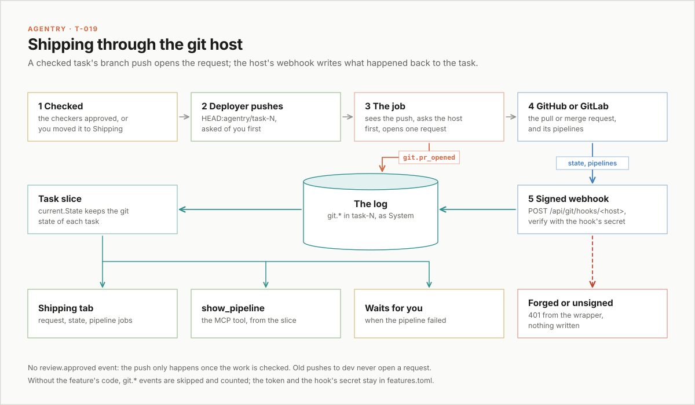

# T-019: shipping through GitHub and GitLab

Status: proposed, for task-121 (story 19 of the extensions epic,
`docs/design/extensions.md` section 11, phase 4).
Design only: nothing in the server or the page changes with this document.
It covers the feature's event types, what starts it, its job, how it fits
with the deployer, its tool, its waiting entry, its tab, its webhooks, its
settings, security, the build stories and the questions that are yours.

## In short

PLAN.md's T-019 is "open the PR after `review.approved`". Today, a task's
work leaves Agentry when the deployer merges the task branch into dev and
pushes (`internal/agents/defaults/deployer.md`). Nothing records the
pipeline that push starts, beyond one line in the deployer's report, and
the Visionaries found three Backlog tasks (41, 44, 45) that all say "Done
isn't shipped".

The recommendation is a feature, `git`, in a package `internal/githost`,
turned on by a token in `features.toml`. When it is on for a task's repo,
the deployer pushes the task branch instead of dev, and the feature's job
opens a pull request (GitHub) or merge request (GitLab) from
`agentry/task-N` into dev. The host's webhook reports the request's state
and its pipelines back, as `git.*` events in the task's stream, written as
System. The task page gets a Merge request tab, Claude Code gets a
`show_pipeline` tool, and a failed pipeline waits for you.

There is no `review.approved` event, and none is needed. A reviewer's
verdict is read from its report when the coordinator decides
(`internal/coordinator/checks.go`), and the deployer only gets the task
once the work is checked or you moved it to Shipping. So the job starts
from what the log already holds: the deployer's approved, finished push of
the task branch (section 2).

One core change is proposed that the extensions note didn't plan: a
task slice. The feature's events sit in task streams, and `current.State`
keeps nothing for types it doesn't know, so every read would rescan
streams. A task slice is the owned-stream mechanism applied to a feature's
types inside task streams, with one applier, and a check that can refuse
(section 1).



## 1. The git.* task types

Each type is one of the feature's `TaskTypes` (`events.Registration`), in
the `git.` namespace, which no core type uses (`NewCatalogue` refuses a
task type in a core namespace). Every one goes in a task's stream. Required
fields are the `Spec.Fields`; the rest are optional from the start, as the
core's comments list them. A field is only ever added as an optional one,
and a type whose shape must change gets a new name (extensions section 8).

| Type | Written by | Required fields | Optional fields |
|---|---|---|---|
| `git.pr_opened` | System, the job (`{System, "git"}`) | `host` (`github` or `gitlab`), `number`, `url`, `branch`, `base`, `sha` | `found`: true when the job found the request already open and recorded it, rather than opening it |
| `git.pr_changed` | System, a webhook (`httpapi.System`) | `number`, `state` (`open`, `closed` or `merged`) | `sha` (a new head), `delivery`, `at` (the host's time) |
| `git.pipeline` | System, a webhook | `id`, `status` (`pending`, `running`, `success`, `failed`, `canceled`, `skipped`), `url`, `sha` | `ref`, `attempt`, `jobs` (each `{name, status, url}`), `delivery`, `at` |
| `git.refused` | System, the job | `action` (`open` or `reopen`), `status` (the host's HTTP status), `reason` | `sha` |
| `git.retry` | Human, the tab's "Try again" | none | none |

What each means:

- `git.pr_opened`: the request for this task's branch is open on the host.
  A task has at most one open at a time (the check below).
- `git.pr_changed`: the host says the request was merged, closed, reopened
  or got a new head.
- `git.pipeline`: one pipeline's status, as of `at`. A later event for the
  same `id` and `attempt` replaces the earlier only if its `at` is later,
  so a delivery that arrives late can't undo a newer one. Jobs merge by
  name.
- `git.refused`: the host refused to open or reopen the request, for a
  reason a retry won't fix by itself (a bad token, no access, no such
  branch). The job tries no more until the next push, or a `git.retry`.
- `git.retry`: you asked the job to try again, after fixing the token.

The webhook stores only these fields, never the payload: payloads carry
names and emails the log has no use for. Strings are cut to a length (a
URL to 2 KB, a job name to 200 characters) and `jobs` to 100.

### The task slice

`current.State` builds a task with `tasks.apply`, which ignores types it
doesn't know (only `LastActiveAt` moves). So a `git.*` event changes no
state the feature can read, and every read of it (the tab, the waiting
list, the job's "is one open already?") would read the task's stream again.
That is the cost `docs/design/read-model.md` removed.

The fix is the owned-stream mechanism, for a feature's types in task
streams:

```go
// TaskSlice is a feature's state inside each task's stream, built from its
// task types alone: as Streams, but keyed by task. Its task types are the
// ones in its namespace: "git." for the feature "git".
type TaskSlice struct {
	FromEvents func(accepted []events.Event) any // the feature's events of one task, in order
	Next       func(prev any, e events.Event) any
	Check      Rule // optional: refuses a proposal of one of its task types
}

// Rule is a feature's order check for one of its task types: the reason to
// refuse p, or "". slice is the task's slice as Next left it, nil when it
// holds nothing yet.
type Rule func(task *tasks.Task, slice any, p events.Proposal) string
```

`Rule` is new: `extensions.md` only sketches it, and `rules.Check` still
names ideas directly. A feature's task types all sit in one namespace,
named after the feature (`git.pr_opened` is the `git` feature's).
`NewCatalogue` already reads a task type's namespace to refuse a core one;
`events.Namespace` exports that, and the state and the rules find a type's
feature by it.

How the parts change:

- **Passing it in.** `Feature` gains `TaskSlice *TaskSlice`.
  `current.New`, `Restore` and `EqualThroughSnapshots` take
  `...features.Feature` instead of `...*features.Streams`, and keep each
  feature's `Streams` and `TaskSlice`. `serve.go` passes its installed list,
  and `storetest.OpenWith` passes `ideas.Feature()`.
- **Load and Apply.** `fold` and `Apply` pass an event of a feature's task
  type to its `Next`, beside `tasks.apply`, which is unchanged. The slices
  sit in `slices map[string]map[string]any` (by task, then feature).
- **A broken slice.** `broken` is keyed by stream, so a slice can't use it
  without breaking the task. A slice's `guard` writes to its own
  `brokenSlices map[string]map[string]error` (by task, then feature)
  instead: the task reads as before, `TaskSlice` returns the error, and the
  slice takes no more events, as a broken stream takes none. A slice that
  breaks in the tail after a snapshot sets `tail.broke`, so Resume falls
  back to a whole replay, as a broken stream does.
- **Archiving.** `archive` drops the task's slices and broken slices with
  the rest of the task. `task.unarchived` refolds the stream (`Refolds`),
  and `fold` builds the slices again from its events. So `TasksWith`, the
  manifest's count and the waiting list never list an archived task, and
  all list it again once it is back.
- **Snapshots.** Owned streams aren't in the snapshot, and Resume rebuilds
  them from the log (`rebuilt`). Slices are the same: `savedState` gains
  `Sliced map[string][]string`, `TasksWith` per feature, broken ones
  included. Resume reads each of those tasks' streams up to the snapshot's
  position and builds just its slices (a `foldSlices`, which leaves the
  task the snapshot holds as it is), before it applies the tail.
  `EqualThroughSnapshots` then compares the slices through every cut, and
  the startup benchmark (`startup_bench_test.go`) gets tasks with slices,
  so the cost of rebuilding them is measured.
- **Reading.** `Reader` gains `TaskSlice(task, feature string) (any, error)`
  and `TasksWith(feature string) []string` (tasks holding a slice, in log
  order, broken ones too, as `OwnedIDs`). `githost.Of(r, task)` wraps
  them, so the `any` stays in the package, as `ideas.Get` does.
- **Equality.** `current.Equal` compares every task's slices with a
  replay, so the equivalence test covers them.
- **The rules.** `rules.Check(p, state, catalogue, installed)` gains the
  installed features; `serve.go` passes them in the check it gives
  `store.Open`, so a feature's `Rule` runs inside `Store.Propose`, under the
  store's write lock, like every other order check. For a proposal of a
  feature's task type, `rules.Check` refuses a foreign or archived task and
  a task that doesn't exist, as now, then runs the feature's `Rule` (none:
  allowed) and returns, before the core's task rules. It lets the type into
  a done task: the coordinator finishes a task once the push shows, so
  `git.pr_opened` and every pipeline and merge after it arrive on a done
  task. The `afterDone` list stays the core's. `taskRules[p.Type]` gains a
  nil check, so a type with no entry is allowed instead of calling a nil
  func. The git `Rule` refuses a `git.pr_opened` while the slice holds an
  open request: never two at once, enforced under the lock rather than
  hoped for in the job.
- **The API.** `GET /api/tasks/{task}` gains `slices`: the names of the
  features holding a slice for the task. The page uses it to show a
  feature's tab (section 7). The core names no feature.

Why not an owned stream per task (`git-121` beside `task-121`): its events
would sit beside the task, not in it, so archiving would leave them
behind, the task's Events tab and `LastActiveAt` wouldn't see them, the
rules couldn't refuse a write into an archived task without reading another
stream, and `Store.Create` names a new stream by a count, not after a task.

### Old logs, and a build without the feature

- A log from before the feature has no `git.*` events: every task's slice
  is empty, and nothing changes.
- A build without the feature (an older binary, or one built without it)
  meets `git.*` events as unknown types in known task streams. Story 7 of
  the extensions plan already handles that: `tasks.apply` ignores them,
  `current` counts them in the unknown tally ("31 events of a type this
  build doesn't know: git.pipeline"), and nothing fails. A new proposal of
  one is refused by `CheckShape` ("unknown event type"). No feature code
  runs, so nothing can crash.
- Re-adding the feature replays every `git.*` event into the slices,
  including those the older build only counted.
- Each `git.*` event wakes the coordinator loop for its task
  (`touchedTasks` takes any event in a task stream). `Loop.act` works from
  state, so it starts nothing, but story 2 tests that: a pipeline event on
  a done task and on a working one starts no turn. The event does move the
  task's `LastActiveAt`, which is right: a pipeline result is news on the
  task.

## 2. What starts it

There is no `review.approved` in the log. A checking agent (a reviewer, a
tester: `Column: agents.Reviews`) ends its report with "Verdict: approved"
or "Verdict: changes needed", and `verdictOf` reads it from the
`turn.ended` report when the coordinator decides. `unchecked` (in
`checks.go`) refuses a done decision until every checker approved since the
last change. Nothing is written when the work becomes checked: it is worked
out from the turns each time.

The job doesn't need that moment. A request can't open until the branch is
on the host, and only the deployer's push puts it there. The deployer
(`Column: agents.Ships`) is handed the task only when the work is checked,
or when you moved the task to Shipping and so took it as it was
(`Turn.Shipped`). So the job reads what is already in the log:

- `task.assigned` to an agent in the Ships column, then its `turn.started`
  and `turn.ended`.
- In that turn, an `action.requested` that pushes to the task's branch,
  with `action.approved` and `action.result`.

`Task.Pushed(turn)` already exists, but it matches any approved, finished
command that starts with `git push`, whatever its target. Only its comment
and `deployer.md` talk about the exact command. So the feature reads the
target with `tasks.plainPush` (`internal/tasks/waiting.go`), the parser the
waiting line already uses, and the push qualifies only when the branch it
returns equals the task's `Worktree.Branch`. Story 7 exports that as
`Task.PushedTo(turn, branch string) bool`; `Pushed` stays as it is for the
coordinator. A push `plainPush` can't read (a quote, an unknown option, a
bare `git push`) doesn't qualify: the deployer's instructions give the
exact command, `git push origin HEAD:agentry/task-N`.

A push to dev, which every task shipped before this feature made, never
qualifies, so turning the feature on opens nothing for old tasks.

No core event is needed. A `task.checked` event, written by System when
`unchecked` turns "", would freeze in the log a rule that lives in code and
has changed before (the ship retry in `recordOf`), and it would still not
put the branch on the host. If a later change needs the moment the work is
checked (say, a draft request opened at review), that event is the minimal
addition: `task.checked {turn}`, System, written by the coordinator, with
no other change.

## 3. The job

`Feature.Jobs`, started by `features.StartJobs` under `recover`. It never
holds the store: it reads through `Core.Read` and `Core.Events`, and writes
through `Core.Log`, which refuses any type the feature didn't register.

`Core.Events` today has only `Stream(name)`. The job needs to follow the
log, as the loop does with `Store.NewReader`, so `features.EventLog` gains
`Follow(position int64) Follower` (`Next(ctx)`, `Close()`) and `Head()`,
and `ReadOnly` wraps them, still with no way to write.

What it does:

1. It reads its settings on each pass (`Settings` gives the version in
   force on every call; nothing tells the job the file changed). With no
   token or no project it does nothing that pass.
2. It looks at every task once (`Read.TaskIDs()`), then follows the log
   from `Head()`, and looks again at each task a batch touched.
3. A task is due when it is in the project (its `Worktree.Repo`'s origin
   names the project; the job reads `git remote get-url origin` there once
   per repo and keeps it), its slice holds no open request, and its latest
   qualifying push (section 2) comes later in the log than the slice's
   last mark. The marks are a `git.pr_opened`, a `git.pr_changed` to
   `closed` or `merged`, and a `git.refused` that no `git.retry` followed;
   a `git.retry` clears a refusal, so the push before it counts again. The
   slice keeps the position of its last mark, and the push's position is
   its `action.result`'s. So a request you close or merge on the host is
   left alone until the deployer pushes again, and a new push onto an open
   request only updates it on the host.
4. For a due task it asks the host for the most recent request from the
   branch, in any state (GitHub
   `GET /repos/{owner}/{repo}/pulls?head={owner}:{branch}&state=all&sort=created&direction=desc`,
   GitLab
   `GET /projects/{id}/merge_requests?source_branch={branch}&state=all&order_by=created_at&sort=desc`).
   If it is open, or was created after the push's `action.result`, it is
   one the job opened and didn't record (a crash between the host's reply
   and the write): it writes `git.pr_opened` with `found: true`, then a
   `git.pr_changed` with its state if it is closed or merged, and opens
   nothing.
5. Otherwise, if the slice's last request is closed and not merged, it
   reopens that one (GitHub `PATCH .../pulls/{n}` with `state: open`,
   GitLab `PUT .../merge_requests/{iid}` with `state_event: reopen`) and
   writes `git.pr_opened` for it.
6. Otherwise it opens one from the branch into `base` (dev by default),
   titled with the task's title, its body the task's link and its summary
   when it has one, and writes `git.pr_opened`.

Never two requests for one task:

- The slice's check refuses a second `git.pr_opened` while one is open.
- The job asks the host first (step 4), in every state, so a crash after
  the host opened the request and before `git.pr_opened` was written finds
  it on restart and records it, even if it was merged or closed meanwhile.
- There is one job, which handles one task at a time.
- A host that says the request exists (GitHub 422 "A pull request already
  exists", GitLab 409) is treated as step 4: look it up and record it.
- A merged request stays merged. If the task is reopened and shipped
  again, the new push opens a new request: one open at a time, never two.

When the host says no:

- No token, or no project: the feature is off (section 9). The job writes
  nothing, and the Settings page says how to turn it on.
- 401, 403, 404, or a 422 that is not "already exists": `git.refused` with
  the status and the host's message, cut to 300 characters. The tab shows
  it with "Try again", and it waits for you (section 6). It isn't retried
  by itself: a bad token stays bad.
- A network error, a timeout, 429 or 5xx: nothing is written. It tries
  again after 1, 2, 4 and up to 30 minutes, or after the host's
  `Retry-After`, and logs one line per task and status, never the token or
  a header.

## 4. How it fits with today's deployer

The deployer merges `origin/dev` into the task branch, runs the tests and
the build, pushes the branch to dev with `git push origin HEAD:dev` (the
push asks you first), and reports the pipeline once with `glab ci list` or
`gh run list`. The coordinator finishes the task once a ship turn pushed
(`recordOf`, `Task.Pushed`).

The options:

| Option | What happens | For | Against |
|---|---|---|---|
| A. The request replaces the push to dev | The deployer merges `origin/dev` in, tests, and pushes the task branch (`git push origin HEAD:agentry/task-N`), still asked first. The job opens the request; the host merges it | Dev only moves through a request and its pipeline; the host's checks and branch protection apply; no agent holds a token | Merging becomes a step on the host (yours, or the host's auto-merge) |
| B. The request beside the push | The deployer pushes the task branch, the job opens the request, then the deployer pushes dev as today, and the host marks the request merged | The request records the work and runs the branch pipeline | Two pushes and two approvals per task; the request is merged before anyone could look at it, so it adds a record but no check |
| C. The deployer merges through the request itself | The deployer runs `gh pr create` and `gh pr merge` (or `glab mr`) in its turn | No job, no webhook | The token sits in the agent's environment; state lives only in its report; nothing comes back after its turn ends |

Recommended: A, for a repo the feature is on for, and today's push to dev
for every other repo. The deployer learns which through its instructions:
the feature's `Coordinator.Brief` adds a section for a coordinator whose
team ships ("This repo ships through merge requests: tell the deployer to
push the task branch, not dev"), and `deployer.md` gains the matching
paragraph. The push is still asked of you, and `Task.Pushed` still counts
it, so the coordinator's "pushed, so it can be done" rule is unchanged.
The task is done when the request is open; whether it should wait for the
merge is question 5.

The deployer's pipeline report stays as it is: it is one line in its
report, and the feature's events replace it as the record.

## 5. The show_pipeline tool

An MCP tool in `agentry mcp`, from the feature's `Tools`, listed while the
feature is enabled or visible, as Ideas' tools are.

- Input: `{ "task": "task-121" }`. Required.
- Output, as text: the request (`!412 open: https://...`, or "no merge
  request yet" with why: off, not shipped, refused), then the latest
  pipeline on its head (`failed 3 minutes ago, 4f2c1a9: https://...`),
  then its jobs, failed first (`test: failed https://...`). When the
  feature is off it says so and how to turn it on.
- Data: `GET /api/git/tasks/{task}` (a UI route), which reads the task's
  slice. It reads the log, not the host: what the webhook last said. It
  makes no call to the host, so the tool is fast and needs no token in
  `agentry mcp`.

## 6. A waiting entry when a pipeline fails

The feature's `Waiting`, read over `GET /api/git/waiting` until the
server lists what waits (extensions story 13), then worked out in the
server from the slices.

- Kind: `git`.
- Line: `task-121's pipeline failed on agentry/task-121: test, lint
  (https://...)`. For a refusal: `task-121: GitLab refused to open the merge
  request (401): <its message>`.
- Key: `git/<task>/pipeline/<id>/<attempt>` for a failure, so a new
  pipeline or a retried one that fails again is news, and the same failure
  delivered twice is not. `git/<task>/refused/<position>` for a refusal.
- It clears when a later pipeline on the request's head is anything but
  failed (a retry that is running counts), when the request is merged or
  closed, or when the task is archived. A refusal clears on the next
  `git.pr_opened` or `git.retry`.

Only the latest pipeline on the request's head counts: a failure on an
older head, since replaced, waits for no one.

## 7. The Merge request tab

The extensions note's `taskTabs` slot, added with this feature:

```ts
// ui/src/features/index.ts
export interface TaskTab {
  id: string; // in the URL's ?tab=; the core's TABS and other features' ids may not repeat it
  label: string;
  element: ComponentType<{ task: TaskDetail }>;
}

export interface FeatureUI {
  // ...as now
  taskTabs?: TaskTab[]; // tabs on the task page, for a task the feature holds a slice for
}
```

`TaskPage.tsx` appends the tabs of each visible feature whose name is in
the task's `slices`, after the core's last tab, Details. `TabId` widens to the core's ids plus
feature tab ids. A test checks that no feature tab id repeats a core one.

`ui/src/features/git/` brings one tab, `merge-request` ("Merge request"),
not "Shipping", which is the name of a board column:

- The request: its number and link, its state (open, merged, closed) and
  base, and `found` as "found open on GitLab" when the job recorded one it
  didn't open.
- The latest pipeline on its head: status, link, short sha, when, and its
  jobs with their status, failed first.
- A refusal, with the host's message and "Try again" (`POST
  /api/git/tasks/{task}/retry`, a UI route that writes `git.retry` as you).

The tab shows when the manifest lists `git` as visible and the task has a
git slice. The manifest's entry:

- `enabled`: a token, a host and a project are in `features.toml`.
- `visible`: enabled, or any task holds a git slice (`TasksWith("git")`),
  so the history stays readable after the token is removed.
- `why`: "opens merge requests on gitlab.com for group/name", or "add a
  token to features.toml to open merge requests", or "kept while 12 tasks
  have merge requests; no token is set".

## 8. The webhooks

Two routes, both `features.Signed(verify)`, so the core's `signed` wrapper
reads the body (up to `httpapi.MaxBody`, 1 MB), runs `verify`, and answers
401 with nothing written when it refuses. No token opens them.

| Route | Host | Events it takes |
|---|---|---|
| `POST /api/git/hooks/github` | GitHub | `pull_request`, `workflow_run`, `workflow_job`, `ping` |
| `POST /api/git/hooks/gitlab` | GitLab | `Merge Request Hook`, `Pipeline Hook` |

Each `verify` reads the secret from the settings file in force, at the
time of the request, so a changed secret applies at once. No secret set
means every request is refused: a missing secret never opens a route.

- GitHub signs the body. `X-Hub-Signature-256` is `sha256=` and the hex
  HMAC-SHA256 of the body with the secret. `verify` decodes the hex,
  computes the HMAC over the bytes it was given, and compares with
  `hmac.Equal`. A missing or malformed header is refused. The older
  `X-Hub-Signature` (SHA-1) is ignored.
- GitLab doesn't sign the body. It sends the secret itself in
  `X-Gitlab-Token`. `verify` compares the header with the secret using
  `subtle.ConstantTimeCompare` and ignores the body. That proves only that
  the sender knows the secret, so it is as safe as the channel: the route
  needs an https public address, and the Settings page says the GitLab hook
  is off without one.

What a verified delivery writes, always as System (`httpapi.System`):

- Its project: GitHub's `repository.full_name` or GitLab's
  `project.path_with_namespace` must equal the configured `project`
  (GitHub's ignoring case, as GitHub treats names). Otherwise nothing is
  written: an organisation's or group's hook, or a second project with the
  same `agentry/task-N` branch names, can't write into a task here.
- Its task: the branch (`pull_request.head.ref`, `workflow_run.head_branch`,
  GitLab's `object_attributes.source_branch` or `ref`, or a merge request
  pipeline's `merge_request.source_branch`) must be `agentry/task-N`, and
  task N's `Worktree.Branch` must equal it. Otherwise nothing is written.
- `pull_request` and `Merge Request Hook`: `git.pr_changed` when the state
  or head changed (closed with `merged: true` is `merged`).
- `workflow_run` and `Pipeline Hook`: `git.pipeline`, with GitLab's
  `builds` as `jobs`. `workflow_job`: a `git.pipeline` for its run with one
  job, merged by name.
- `ping`, and any other event: nothing.

Replay and duplicate deliveries:

- Each event carries `delivery`: GitHub's `X-GitHub-Delivery`, GitLab's
  `X-Gitlab-Event-UUID`. A delivery already in the task's slice is
  answered 200 and not written again. Two copies racing past that check
  write the same state twice, which changes nothing: each event sets
  state, none counts.
- A delivery that arrives late, or an old one sent again, carries its own
  `at`, and the slice keeps the newest per pipeline, so it can't undo a
  later status.
- Replaying the log replays these events like any other: nothing calls the
  host on replay.

What is refused, and the answer:

- A bad or missing signature or token: 401, from the wrapper, nothing
  written.
- A body over 1 MB, or a verified body that isn't JSON: 202 with a
  one-line reason, nothing written. The sender can't fix either, and a 4xx
  counts toward GitLab turning the hook off. The core's `signed` wrapper
  answers 400 for an over-long body today, before `verify` runs, so story
  9 changes it to answer 202 for that on every signed route; the handler
  answers 202 for a body it can't decode. GitHub's deliveries for these
  events are well under 1 MB.
- An event for another project, no task, a branch that isn't a task's, an archived task
  (the rules refuse a write into it), an event the feature doesn't take:
  202 with a one-line reason, nothing written. These are 2xx on purpose:
  GitLab turns a hook off after it fails a few times in a row, and none of
  these is the sender's fault.

## 9. Settings and secrets

In `features.toml`, beside `policy.toml`, read by `internal/settingsfile`.
`cmd/agentry/policy.go` already lists the file as protected, so no agent can read or
change it. Nothing in it reaches the log, a snapshot, the page or the API.

```toml
[git]
host = "gitlab"            # or "github"
project = "group/name"     # GitHub: "owner/repo"
base = "dev"               # the branch requests go into; dev when unset
api = "https://gitlab.example.com/api/v4"  # only for a self-hosted host

[git.secrets]
token = "..."              # sent as PRIVATE-TOKEN (GitLab) or a Bearer token (GitHub)
webhook = "..."            # the hook's secret: GitHub's signing secret, GitLab's secret token
```

- On: `host`, `project` and `token` are set. The webhook is optional to
  open requests; without it the tab shows the request but no pipeline.
- The job, the routes' `verify`, the manifest and the coordinator brief
  read the table in force on every call, so an edit applies without a
  restart.
- Today only jobs get `Core.Settings` (`startJobs`). `Manifest` is
  `func(Reader) Entry` and `Coordinator.Brief(state, task)` has no `Core`,
  so neither can reach them that way. The design: the feature is built
  with its settings, `githost.Feature(settings features.Settings)`, and its
  `Manifest`, `Brief`, routes' `verify` and job read them from the
  closure. Story 3 makes that possible for any feature:
  `installedFeatures(settings func(feature string) features.Settings)`.
  `serve.go` opens `features.toml` once (`settingsfile.Open`, moved out of
  `startJobs`) and passes its `For`; `cmd/agentry/mcp.go` and
  `cmd/agentry/claudecode.go`, which also call `installedFeatures`, pass
  one that gives the zero `Settings`. They need none: they use only
  `Tools`, `Instructions` and `Waiting`, which read the server's API.
- While the feature is off, the Settings page lists it (it is installed
  and not visible) with its `why` and its `turnOn`: the TOML above, with
  the token's scopes (section 10), and the path of the file. The page
  never takes the token: you put it in the file yourself.

## 10. Security

- The token's scope. GitHub: a fine-grained token for the one repository,
  with Pull requests read and write, Contents read and Actions read. GitLab:
  a project access token with the Developer role and the `api` scope
  (`read_api` can't open a merge request; a project token keeps `api` to
  the one project). The token can open and reopen requests and read
  pipelines; merging is left to you or the host.
- Only the server uses the token. It is never in an agent's environment,
  so an agent's `gh` or `glab`, which the deployer still runs for its
  pipeline line, uses the machine's own sign-in, as today.
- A forged webhook writes nothing: `signed` refuses it before the handler
  runs. A genuine delivery can only set the state of a task whose branch
  it names, and only to what the host says.
- No secrets in logs or snapshots: secrets are only in `features.toml`
  and the server's memory. `settingsfile` already never logs the file's
  content. The job's log lines name the host, the task and the status.
  The webhook's lines name the event and the delivery, never a header. The
  slices hold only the event fields above. Story 5 adds a test that writes
  a known token and secret, runs the job and the webhooks against fakes,
  and finds neither in the log, the snapshot or the server's output.
- The `api` address is the file's, which only you can change, so the job
  calls no address an agent or a webhook chose.

## 11. Build stories

In build order. Each is one reviewable change.

1. **Task slices in current and the snapshot.** `features.TaskSlice`,
   `features.Rule` (the type only), `Feature.TaskSlice`,
   `events.Namespace`; `current.New`, `Restore` and
   `EqualThroughSnapshots` take `...features.Feature`; `fold`, `Apply`,
   `archive` and `Equal` keep a slice per task and feature, with
   `brokenSlices`; `savedState.Sliced` and Resume's `foldSlices`;
   `Reader.TaskSlice` and `TasksWith`; `slices` on `GET /api/tasks/{task}`.
   Files: `internal/features/features.go`, `internal/events/catalogue.go`,
   `internal/current` (`current.go`, `equal.go`, `snapshot.go`,
   `resume.go`, `startup_bench_test.go`), `internal/store/storetest`,
   `cmd/agentry/serve.go`, `internal/web/api.go`, `ui/src/api/types.ts`.
   Done: a test feature's task types replay to the same slices as `Apply`
   (the equivalence test, and `EqualThroughSnapshots` through every cut);
   a state resumed from a snapshot holds the same slices as a whole
   replay; without the feature, the task is the same and the tally counts
   them; a panic in its `Next` breaks only that slice, and the task still
   reads; archiving drops the slices from `TasksWith` and unarchiving
   brings them back; the startup benchmark runs with slices. It changes
   replay and apply, so before it lands it runs the real-log replay test
   on a fresh read-only `VACUUM INTO` copy. After: none.
2. **Feature task rules in rules.Check.** `rules.Check` takes the
   installed features, runs a feature's `Rule` for its task types before
   the core's task rules, and lets them into a done task, never an
   archived one; the nil check on `taskRules`. Files:
   `internal/rules/rules.go`, `cmd/agentry/serve.go`,
   `internal/store/storetest`. Done: tests that a test feature's `Rule`
   refuses with its reason, runs under `Store.Propose`'s lock, allows when
   it is nil, lets its type into a done task, and refuses it in an
   archived one and in a task that doesn't exist; a core task type with no
   `taskRules` entry no longer panics; a test event on a done task and on
   a working one starts no turn. It changes which events the log accepts
   and so what replay and apply meet, so before it lands it runs the
   real-log replay test on a fresh read-only `VACUUM INTO` copy. After: 1.
3. **Settings reach the features list.** `installedFeatures(settings)`;
   `serve.go` opens `features.toml` once and passes its `For` to the list
   and to `startJobs`; `agentry mcp` and Claude Code's hooks pass the zero
   `Settings`. Files: `cmd/agentry/serve.go`, `cmd/agentry/mcp.go`,
   `cmd/agentry/claudecode.go`, `internal/features/settings.go`. Done: a
   test feature's manifest and route read a value from the file and see
   an edit without a restart; a secret in the file is not in
   `GET /api/features`; `agentry mcp` starts with no settings file. After:
   none.
4. **Jobs follow the log.** `features.EventLog` gains `Follow` and `Head`;
   `ReadOnly` wraps them. Files: `internal/features`, `cmd/agentry/serve.go`.
   Done: a job sees events written after it started, and a type assertion on
   its `Follower` gets no store. After: none.
5. **The git feature: types, slice, rule and manifest.** `internal/githost`
   with the five types, the slice, its `Rule` (one open request), the
   manifest, and `ui/src/features/git` with `turnOn`; the schemas in
   `internal/events/schemas`; a fixture log under `testdata`. The wiring in
   `cmd/agentry/serve.go`: `githost.Registration()` in `NewCatalogue`,
   `githost.Feature(settings("git"))` in `installedFeatures`, and its
   `features.Checked(feature, githost.Registration(), log)` proposer in the
   `logs` map (without it, the feature gets `features.Unwritable`). Done:
   the catalogue builds with the feature; the rule refuses a second
   `git.pr_opened`; a build without the feature replays the fixture with
   the tally counting it; the Settings page shows Git with its `turnOn`
   while off; the no-secrets test (section 10). It registers new types
   that apply reads, so it runs the real-log replay test on a fresh
   read-only `VACUUM INTO` copy before landing. After: 2, 3.
6. **Host clients.** GitLab and GitHub over `net/http`: find the most
   recent request by branch in any state, open, reopen. Files:
   `internal/githost/gitlab.go`, `github.go`. Done: tests against
   `httptest` fakes for opened, found (open, merged and closed), "already
   exists" (GitHub 422, GitLab 409) as found, 401, 404, 429 with
   `Retry-After`, and 5xx. After: none (host order is question 2).
7. **The job.** `Task.PushedTo` over `plainPush`; `due` by log position,
   look up, record, reopen or open, refusals, backoff. Files:
   `internal/tasks/task.go`, `internal/githost/job.go`. Done: tests with a
   fake host: one request per task across a restart between the host's
   reply and the write, also when the request was merged or closed before
   the restart; a request closed on the host isn't reopened until a new
   push; a push onto an open request opens nothing; a push to dev, and a
   push `plainPush` can't read, open nothing; an old log opens nothing; no
   token writes nothing; a 401 writes one `git.refused` and no more until
   `git.retry`; an edit to the settings file reaches the next pass. After:
   4, 5, 6.
8. **The deployer ships through the request.** The feature's
   `Coordinator.Brief` section and the paragraph in `deployer.md`. Files:
   `internal/githost/coordinator.go`, `internal/agents/defaults/deployer.md`.
   Done: a ship brief for a repo the feature is on for says to push the
   task branch, and one for any other repo doesn't; `Task.Pushed` counts the
   branch push; the prompt test passes. After: 7.
9. **The webhooks.** Both routes, their `verify`, the project and task
   checks, duplicates and refusals; the core's `signed` answers 202 for a
   body over 1 MB. Files: `internal/githost/hooks.go`,
   `internal/web/server.go`. Done: tests for a good GitHub signature, a
   bad one, a missing one, GitLab's token right and wrong, no secret set
   (all refused); another project with the same branch name, a branch that
   is no task's, an archived task, a body that isn't JSON and one over
   1 MB (each 202, nothing written); the same delivery twice (written
   once); an older status after a newer (the newer stays). After: 5.
10. **Read route, show_pipeline and the waiting entry.**
    `GET /api/git/tasks/{task}`, `GET /api/git/waiting`, the retry route,
    the tool and `Waiting`. Files: `internal/githost/routes.go`, `tools.go`.
    Done: tool tests on a fixture (request and failed pipeline, refusal, no
    request, feature off); a failed pipeline makes one entry, a retry that
    fails again makes a new one, and a later success clears it. After: 5.
11. **The taskTabs slot and the Merge request tab.** `TaskTab`,
    `FeatureUI.taskTabs`, `TaskPage.tsx`, the tab component. Done:
    `npm run lint` and `npm run build` clean; render tests for a merged
    request with a passed pipeline, a failed one, a refusal with "Try
    again", and a task with no git slice (no tab); the feature's tab comes
    after Details; a feature tab id equal to a core one fails a test.
    After: 1, 10.

## 12. Open questions for the user

1. **How shipping works with the request (section 4).** Recommended: A, the
   request replaces the push to dev, for the repos the feature is on for.
   B adds a record but no check; C puts the token in the agent's hands.
2. **GitHub and GitLab both, or one first?** Recommended: GitLab first,
   since Agentry's own repo is there and you'd use it at once; GitHub in a
   second story after story 6. The types and the tab are the same for
   both.
3. **Who merges?** Recommended: you, on the host, at first. Auto-merge when
   the pipeline passes (GitLab's merge when pipeline succeeds, GitHub's
   auto-merge) can be a later setting, `merge = "auto"`.
4. **Can GitHub or GitLab reach your Agentry?** Webhooks need an https
   public address (`-public-url`). If yours runs only on your machines,
   the job could instead ask the host for the pipelines of open requests
   every two minutes, and write the same `git.pipeline` events. Recommended:
   build the webhooks as planned, and add polling as a twelfth story only
   if there is no public address.
5. **Is a task done when its request opens, or when it merges?**
   Recommended: when it opens, as today a task is done once pushed; the
   Merge request tab and the waiting entry follow the merge and the pipeline
   after that, and you reopen the task if the pipeline fails.

PLAN.md's T-019 row also names notification and email extensions. They are
out of this note: the waiting entry reaches Claude Code now, and Web Push
(extensions phase 3) once it lands.
